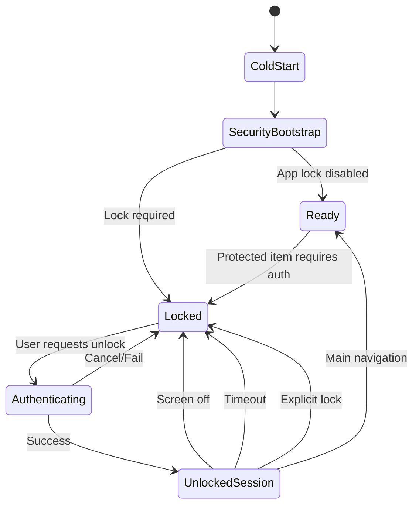
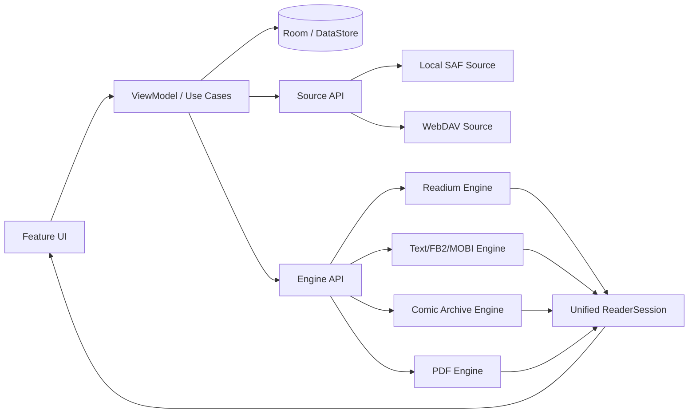
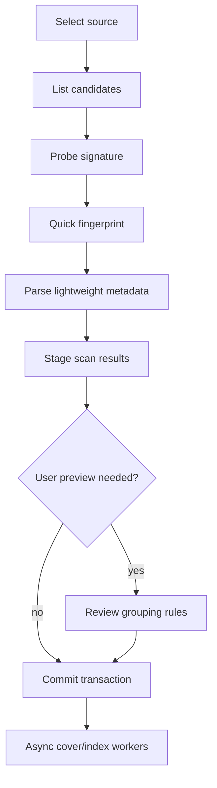
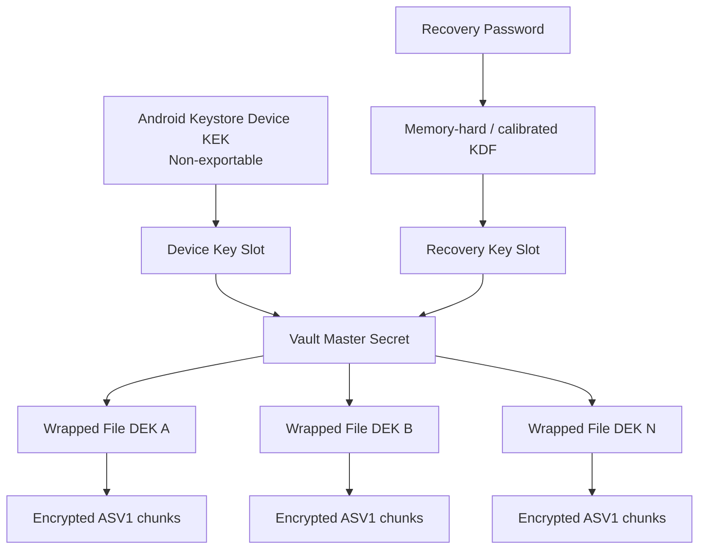
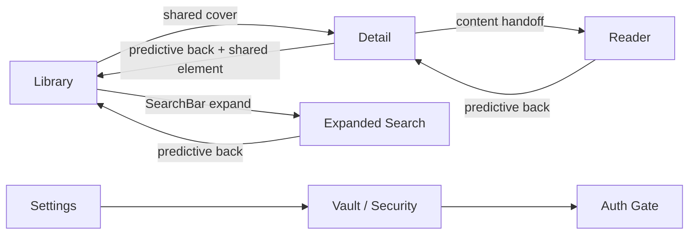
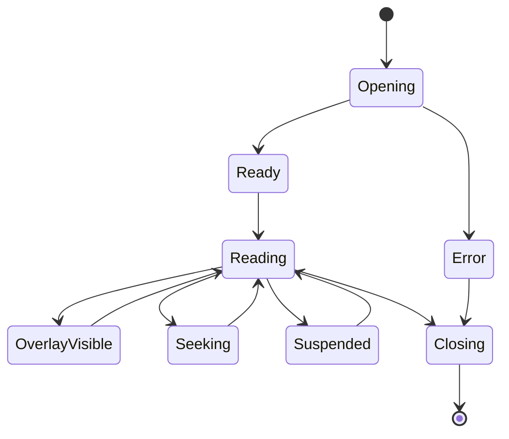
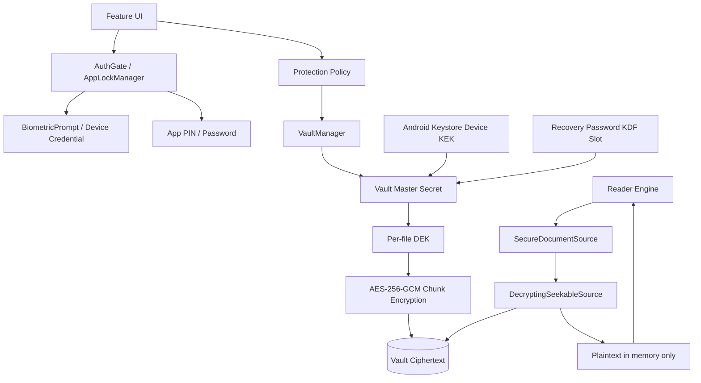

# Aster Reader — MASTER ENGINEERING DOSSIER FINAL v3.0

> 生成日期：2026-09-29。正式开发前冻结版。此文件用于单文件阅读或交给 Coding Agent；**日常维护仍以分文件版本为真源**。

> 平台冻结：`minSdk 31 / Android 12` · `targetSdk 37` · `compileSdk 37`。

---


---

<!-- README.md -->

# Aster Reader Engineering Dossier — FINAL v3.0

> 2026-09-29 · 正式开发前冻结版  
> **Android 原生 · Local-first · Material 3 Expressive · Monet · 统一电子书/漫画 · App Lock · 真加密 Vault · 手机/平板/折叠屏**

这不是一份“概念 PRD”，而是一套直接用于创建 Android Studio 工程、拆 Issue、让人类开发者或 Coding Agent 按阶段实现的工程档案。

## 1. 已冻结的核心决策

- **最低 Android 12 / API 31**；`targetSdk=37`、`compileSdk=37`。
- Kotlin + Jetpack Compose，单 Activity。
- Material 3；全局默认 Monet Dynamic Color。
- Material 3 Expressive 只通过 Design System 单点封装，避免 alpha API 污染业务层。
- Navigation 3 + Material3 Adaptive。
- 本地文件通过 SAF，不依赖真实路径、不把“所有文件访问”当常规前提。
- 统一 `Publication` 模型，漫画/电子书共享 Library、Detail、Progress、Security。
- `ReaderShell` 与实际 Reader Engine 分离。
- App Lock + 单本/文件夹/书架/仓库保护。
- **Access Lock ≠ Encrypt & Lock**：后者必须把持久文件变成 Vault 密文。
- Android Keystore + Vault Master Secret + per-object DEK + AES-256-GCM chunk container。
- 受保护 metadata、cover、FTS、recents、screenshot 均纳入隐私模型。
- Room 数据库不允许正式版 destructive migration。
- Baseline Profile + Macrobenchmark 是发布要求，不是“有时间再做”。

完整冻结清单：`docs/27_FINAL_ARCHITECTURE_DECISIONS.md`。

## 2. 第一次阅读顺序

如果你是 Android 新手，按以下顺序，不要跳：

1. `docs/00_START_HERE.md`
2. `docs/27_FINAL_ARCHITECTURE_DECISIONS.md`
3. `design.md`
4. `docs/01_PRODUCT_PRD.md`
5. `docs/20_ANDROID_ENGINEERING_STANDARD.md`
6. `docs/05_SYSTEM_ARCHITECTURE.md`
7. `docs/19_SECURITY_VAULT_AND_APP_LOCK.md`
8. `docs/06_READER_ENGINE.md`
9. `docs/22_IMPLEMENTATION_COOKBOOK.md`
10. `docs/28_FINAL_DEVELOPMENT_PLAN.md`
11. `docs/29_DEFINITION_OF_DONE_AND_GATES.md`
12. `docs/35_FINAL_PRE_DEVELOPMENT_CHECKLIST.md`

如果准备让 Codex/Claude Code 等开始写代码，还必须给它根目录 `AGENTS.md`。

## 3. 文档地图

### Product / UX
- `docs/01_PRODUCT_PRD.md`
- `docs/02_COMPETITOR_SYNTHESIS.md`
- `docs/03_UX_INFORMATION_ARCHITECTURE.md`
- `docs/18_SCREENSHOT_AUDIT.md`

### Design / Motion
- `design.md` — **唯一视觉/动效/交互真源**
- `docs/04_MD3E_DESIGN_SYSTEM.md`
- `docs/21_MOTION_ANIMATION_SPEC.md`
- `docs/25_PRIVACY_LOCK_UX_SPEC.md`
- `docs/33_ACCESSIBILITY_AND_LOCALIZATION.md`

### Architecture / Data / Reader
- `docs/05_SYSTEM_ARCHITECTURE.md`
- `docs/06_READER_ENGINE.md`
- `docs/07_STORAGE_LIBRARY_SYNC.md`
- `docs/08_DATA_MODEL.md`
- `docs/09_FORMAT_MATRIX.md`
- `docs/10_PERFORMANCE.md`
- `docs/27_FINAL_ARCHITECTURE_DECISIONS.md`
- `docs/34_DIAGNOSTICS_AND_OBSERVABILITY.md`

### Security
- `docs/11_SECURITY_PRIVACY.md`
- `docs/19_SECURITY_VAULT_AND_APP_LOCK.md`
- `docs/23_THREAT_MODEL_AND_RECOVERY.md`
- `docs/32_SECURITY_VERIFICATION_PLAN.md`

### Engineering / Execution
- `docs/12_TESTING_QA.md`
- `docs/13_DEVELOPMENT_PLAN.md` — 快速索引
- `docs/14_LICENSE_AND_RISKS.md`
- `docs/15_PROJECT_STRUCTURE.md`
- `docs/16_ACCEPTANCE_CRITERIA.md`
- `docs/20_ANDROID_ENGINEERING_STANDARD.md`
- `docs/22_IMPLEMENTATION_COOKBOOK.md`
- `docs/24_BUILD_DEPENDENCY_BASELINE.md`
- `docs/26_NEWBIE_BUILD_GUIDE.md`
- `docs/28_FINAL_DEVELOPMENT_PLAN.md` — **正式开发主计划**
- `docs/29_DEFINITION_OF_DONE_AND_GATES.md`
- `docs/30_RELEASE_MIGRATION_MAINTENANCE.md`
- `docs/31_AGENT_IMPLEMENTATION_PLAYBOOK.md`
- `docs/35_FINAL_PRE_DEVELOPMENT_CHECKLIST.md`

### Planning / Agent
- `ROADMAP.md`
- `AGENTS.md`
- `planning/backlog.csv`
- `planning/development_tasks.csv`

### Reusable skeletons
- `starter-contracts/core/`
- `starter-contracts/security/`
- `starter-contracts/design/`
- `diagrams/`
- `references/screenshots/`

## 4. 工程基线

```text
minSdk     31 / Android 12
targetSdk  37 / Android 17
compileSdk 37
Kotlin     2.4.20 baseline
AGP        9.4.x baseline
Gradle     9.6.x baseline
JDK        17
```

Jetpack/Reader 具体锁定版本见 `docs/24_BUILD_DEPENDENCY_BASELINE.md`。

## 5. 正式实施顺序

```text
Foundation
  ↓
Library + SAF + Room
  ↓
App Lock + Keystore + Vault
  ↓
Comic Reader
  ↓
Text / EPUB / FB2 / MOBI
  ↓
PDF
  ↓
Backup + Recovery + Performance + Accessibility
  ↓
WebDAV（可延后）
  ↓
1.0 Hardening / RC
```

不要在 Reader 做完以后再“补安全”；不要在 1.0 RC 期间继续塞大功能。

## 6. 两条最重要的工程纪律

### 安全纪律

“加锁”如果宣称文件已加密，就必须真的把明文迁入 Vault。UI 模糊、隐藏目录、数据库 flag 都不能叫文件加密。

### 设计纪律

任何页面如果需要一个新颜色、新圆角、新 motion duration、新导航模式，先改 `design.md` / Design System，再写 Feature；不允许每个页面长成自己的风格。

## 7. 开始开发

先执行 `docs/35_FINAL_PRE_DEVELOPMENT_CHECKLIST.md` 中的前 10 个 Issue。完成 BOOT/DESIGN/NAV/DATA/FILE 的基础骨架后，再进入 Scanner 与 Vault。


---

<!-- ROADMAP.md -->

# Aster Reader Roadmap — FINAL

| Milestone | Outcome | Main phases |
|---|---|---|
| M0 Skeleton | Android 12+ App 可安装，Monet/Navigation/Adaptive 骨架完成 | Phase 0 |
| M1 Library Alpha | SAF 本地仓库、扫描、资料库/书架可用 | Phase 1 |
| M2 Secure Alpha | App Lock + 单文件 Encrypt & Lock + Vault 随机读取 | Phase 2 |
| M3 Comic Alpha | CBZ/CBR/CB7/CBT/图片目录可高质量阅读 | Phase 3 |
| M4 Ebook Alpha | EPUB/TXT/MD/HTML/FB2/MOBI 主链 | Phase 4 |
| M5 Feature Complete Beta | PDF、备份恢复、性能、无障碍、自适应完整 | Phase 5–6 |
| M6 1.0 RC | Feature Freeze，只修质量 | Phase 8 |
| M7 1.0 | 正式稳定版 | Release Gate |

详细任务与 Exit Gate：`docs/28_FINAL_DEVELOPMENT_PLAN.md`。


---

<!-- AGENTS.md -->

# AGENTS.md — Aster Reader Coding Rules

This file is mandatory context for any coding agent.

## Frozen decisions

- Android native Kotlin + Jetpack Compose.
- `minSdk=31`, `targetSdk=37`, `compileSdk=37`.
- Monet Dynamic Color is the global default.
- `design.md` is the UI/Motion source of truth.
- Navigation 3 + Material3 Adaptive.
- UI → ViewModel → UseCase(optional) → Repository → DataSource.
- Composables NEVER access DAO/ContentResolver/network/archive/crypto directly.
- Reader Shell is separate from Publication Engines.
- SAF is the standard local repository entry.
- “Access Lock” != “Encrypt & Lock”. Encrypt & Lock must store ciphertext in Vault.
- Vault: Android Keystore + master secret + per-object DEK + AES-256-GCM chunks.
- Protected metadata/cover/search must stay hidden while locked.
- No destructive database migration.
- Stable dependencies by default; experimental Material3 APIs are wrapped only in `:core:designsystem`.

## Before coding

Read:
1. `docs/27_FINAL_ARCHITECTURE_DECISIONS.md`
2. relevant feature docs
3. `docs/29_DEFINITION_OF_DONE_AND_GATES.md`
4. `design.md` for any UI task

State the modules/files you plan to touch and the tests you will run.

## Never do

- No giant MainActivity.
- No hardcoded UI colors/radii/motion durations in Feature modules.
- No raw file paths assumption for SAF documents.
- No plaintext protected-content temp files unless explicitly required and securely lifecycle-managed.
- No passwords/keys/decrypted text/protected paths in logs.
- No deleting source files before encrypted output is verified and committed.
- No dependency upgrades inside unrelated feature PRs.
- No disabling tests to make CI green.

## Required finish report

- implemented
- changed modules
- tests run
- API31/API37 manual status
- security/data migration impact
- known limitations


---

<!-- design.md -->

# Aster Reader — Design System / `design.md`

> 版本：Final v3.0 · 2026-09-29  
> 本文件是 **整个应用唯一的视觉、动效、交互设计真源（single source of truth）**。任何新页面、组件、动画、主题、平板适配都先改本文件，再写代码。

## 0. 设计总纲

Aster Reader 的视觉方向不是“做得像某个现有阅读器”，而是把以下优点重新组织成一致的 Android 原生体验：

- MH-ARK 截图中的低噪声、圆润、轻量、留白充分的 Material 风格。
- Book's Story 的 Material You / Compose 原生感。
- FrogReader 的现代 Android 信息结构。
- Material 3 Expressive 的动态形状、MotionScheme、共享元素和响应式组件。

最终设计关键词：**安静、柔和、可预测、现代、原生、可触摸、内容优先。**

### 0.1 绝对规则

1. **Android 12+ 全局默认使用 Monet / Dynamic Color。** 不另外发明一套强品牌主色去覆盖系统壁纸颜色。
2. UI 主题与“书页主题”分离：用户壁纸变色，不应把 EPUB 的纸张色、漫画背景随意改掉。
3. 所有页面默认 edge-to-edge；所有交互必须避让 system bars / display cutout / gesture insets。
4. 所有主要动效统一从 Material Theme 的 motion token 读取，禁止每个页面自己随手写 `tween(300)`。
5. 任何安全锁定内容，在认证前不得先显示真实封面、标题、缩略图，再盖一层模糊。
6. 触控目标不小于 48dp；图标必须有语义；高字体缩放仍可操作。
7. 手机、横屏、平板、折叠屏是同一设计系统，不是四套 UI。

---

## 1. 全局主题：Monet Dynamic Color

### 1.1 Android 12+

使用：

- `dynamicLightColorScheme(context)`
- `dynamicDarkColorScheme(context)`

应用启动时由 `AsterTheme` 在最外层统一决定颜色方案。

默认策略：

```text
系统浅色 -> dynamicLightColorScheme(context)
系统深色 -> dynamicDarkColorScheme(context)
系统不支持动态色/厂商实现异常 -> Aster emergency fallback scheme
```

### 1.2 Emergency fallback（仅异常兜底）

项目最低版本固定为 **Android 12 / API 31**，正常设备均应使用系统 Monet Dynamic Color。仍保留一套 Aster emergency fallback，仅用于自动化测试、OEM 动态色实现异常或 API 返回失败等极端情况；它不是 Android 11 及以下兼容主题，也不得作为默认主题入口。

要求：

- fallback 只能由 Theme 层自动触发，不暴露为“品牌主题”覆盖 Monet。
- 不超过 1 个 seed；Surface 系列优先于高饱和品牌色。
- 深色模式避免纯黑大面积卡片；仅 Reader 的 OLED 黑色阅读主题可以使用纯黑。

### 1.3 颜色角色

不在业务代码写十六进制颜色。业务组件只能读取语义 token：

- `primary / onPrimary`
- `primaryContainer / onPrimaryContainer`
- `secondaryContainer`
- `tertiaryContainer`
- `surface`
- `surfaceContainerLow`
- `surfaceContainer`
- `surfaceContainerHigh`
- `surfaceContainerHighest`
- `outline / outlineVariant`
- `error / errorContainer`

推荐对应：

| 场景 | 颜色角色 |
|---|---|
| 首页背景 | `surface` |
| 大搜索条 | `surfaceContainer` |
| 快速入口卡片 | `secondaryContainer` 或 `surfaceContainerHigh` |
| 当前导航项 | `secondaryContainer` |
| 主 FAB | `primaryContainer` |
| Reader Control Island | `surfaceContainerHigh` / 半透明 tonal |
| 锁定状态徽章 | `tertiaryContainer` |
| 危险删除 | `errorContainer` |

---

## 2. Shape System

全部圆角来自 `AsterShapes`，禁止页面硬编码。

| Token | 建议 | 用途 |
|---|---:|---|
| `shapeXs` | 6dp | 极小标签、封面内状态 |
| `shapeSm` | 10dp | 封面、窄按钮 |
| `shapeMd` | 16dp | 普通卡片 |
| `shapeLg` | 24dp | Settings group、空状态卡 |
| `shapeXl` | 28–32dp | SearchBar、Bottom Sheet 顶部 |
| `shapePill` | 50% | Chips、Reader Control Island、导航选中态 |

M3 Expressive 组件支持动态 shape 时，优先使用组件官方 shape API；自定义 shape morph 必须复用统一 motion token。

---

## 3. Spacing / Layout Grid

使用 4dp 基础网格。

- 4dp：图标内部细间距
- 8dp：同组紧凑元素
- 12dp：chip / metadata
- 16dp：标准页面边距（Compact）
- 20dp：中等窗口页面边距
- 24dp：大卡片内部边距
- 32dp：大区块间距
- 40–48dp：Hero / 空状态呼吸空间

手机首页不允许内容贴边。平板不要简单把 16dp 拉到全宽；用内容最大宽度与 pane scaffold。

---

## 4. Typography

UI 使用系统字体与 Material 3 Typography；阅读正文完全独立。

### 4.1 UI 层级

- App/Screen Title：`headlineSmall` / `titleLarge`
- Section Title：`titleMedium`
- Card Primary：`titleMedium`
- Metadata：`bodyMedium`
- Secondary Metadata：`bodySmall`
- Chips：`labelLarge`

### 4.2 阅读正文

由 Reader Typography Profile 控制：

- 字体族
- 字号
- 行高
- 字间距
- 段距
- 首行缩进
- 页边距
- 对齐
- CJK 标点/断行策略

不复用 UI Typography token。

---

## 5. Motion System

### 5.1 总原则

项目把“动画”作为交互语义，不是装饰。

优先使用 Material 3 的 `MotionScheme`：

```kotlin
MaterialTheme(
    colorScheme = colorScheme,
    typography = typography,
    shapes = shapes,
    motionScheme = MotionScheme.expressive(),
) { content() }
```

截至 2026-09-23，Material3 稳定版为 `1.4.0`，`MotionScheme` / `MotionScheme.expressive()` 位于 `1.5.0-alpha29`。因此项目采用 **稳定核心 + 单点实验封装** 策略：

- 业务 Feature 不直接依赖 alpha API；只通过 `:core:designsystem` 中的 `AsterMotion` / `AsterTheme` 使用。
- 开发通道可锁定 `1.5.0-alpha29` 以获得 Expressive Motion；升级必须单独 PR。
- 若 alpha 出现阻塞回归，Design System 可切回 Material3 `1.4.0`，Feature 无需改动。

### 5.2 动画分类

#### Effects Motion
不改变布局空间：颜色、alpha、阴影、icon 状态。

使用 `fastEffectsSpec / defaultEffectsSpec / slowEffectsSpec`。

#### Spatial Motion
改变位置、尺寸、容器边界、共享元素。

使用 `fastSpatialSpec / defaultSpatialSpec / slowSpatialSpec`。

### 5.3 统一动画语言

| 交互 | 设计 |
|---|---|
| 按压 | tonal/ripple + 轻微 shape/scale 响应，绝不整卡夸张弹跳 |
| 搜索展开 | 使用 M3 SearchBar 原生展开与 predictive back |
| 书封面 -> 详情 | `sharedElement/sharedBounds`，封面为主要共享元素 |
| FAB -> 添加来源 | FAB 与 BottomSheet/页面保持空间连续感 |
| 列表/网格重排 | animate item placement；不要逐项延迟造成“瀑布慢动作” |
| 详情 -> 阅读 | 内容淡出 + Reader surface 接管，不强行做复杂 3D 翻转 |
| Reader Controls | 下方 Control Island 轻微位移 + fade；顶部栏同步出现 |
| 设置开关 | 使用官方 M3 Switch 动画，不自定义轨道 |
| 解锁成功 | 锁屏轻微缩小/淡出，主界面淡入；认证前不参与 shared element |
| 加密迁移 | 进度卡片展开、成功后锁图标 shape/颜色状态变化 |

### 5.4 Predictive Back

必须完整支持 Android 预测性返回：

- 不在根 Activity 粗暴拦截 Back。
- Navigation 3 负责导航回退。
- SearchBar、ModalBottomSheet 等使用 Material3 自带 predictive back 支持。
- Detail -> Library 的共享元素应与 back gesture 进度保持一致。

### 5.5 Reduced Motion

提供：

```text
动效强度：跟随系统 / 减少动效 / 完整动效
```

`减少动效` 下：

- 禁止长距离 spring overshoot。
- shared element 可退化为短 fade/size。
- 无限动画全部停用。
- Reader 翻页允许设置为“无动画”。

测试必须覆盖 motion duration scale = 0。

---

## 6. Haptics

触觉反馈只用于“状态确认”，不是每点一下都震。

允许：

- 长按进入多选。
- 书签成功。
- 拖动进度条跨章节边界。
- 加密/解锁成功或失败。
- Reader 锁定/解锁。

禁止：

- 普通列表滚动。
- 每次翻页。
- 每次 chip 点击都强震。

设置里允许总开关。

---

## 7. 导航设计

### Compact phone

顶级目的地：

1. 首页 / Library
2. 书架 / Shelves

设置从 Overflow / Navigation Drawer / profile-less app menu 进入。

### Medium / Expanded

使用 `NavigationSuiteScaffold` / Material3 Adaptive：

- 手机：Bottom Navigation
- 平板/横屏：Navigation Rail
- 大屏：可扩展 Wide Rail / supporting pane

详情页优先 List-Detail 双栏：左侧书库，右侧详情；阅读器始终独占主要阅读区域。

---

## 8. 页面视觉规范

### 8.1 首页

沿用截图优点：

```text
System Bars
Large Search Capsule + filter badge
Scope title + overflow
Library grid/list
FAB
Bottom navigation
```

空状态允许插画，但最多 1 个主标题 + 1 个辅助说明 + 1 个主动作。

### 8.2 书架

顶部标题“书架”，右上 `+`。

固定 2×2 Quick Shelf：

- 全部
- 收藏
- 历史
- 书签

下方再显示用户书架。平板变为更宽的卡片网格，不无限拉伸。

### 8.3 搜索

搜索栏进入 expanded search state；筛选 chips 横向可滚动：

- 随机推荐
- 排序
- 阅读状态
- 来源/仓库
- 格式
- 标签

受保护内容未解锁时不得出现在搜索建议、最近搜索结果封面中。

### 8.4 详情

封面、标题、作者/系列、收藏、阅读状态、来源、目录、继续阅读。

长文件名永远不作为主标题；原始文件名放“文件信息”。

底部动作使用 Floating Toolbar / Control Island 思路，最多 5 个一级动作。

### 8.5 Reader

Reader 是一个“内容画布 + transient chrome”。

- 顶栏：返回 + 章节/标题。
- 中间：纯内容。
- 底部：进度 + Control Island。
- 漫画与文字书共享 Shell，但功能按钮随 capabilities 改变。

漫画常用：显示模式 / 目录 / 书签 / 设置 / 跳页。  
文本常用：排版 / 目录 / 书签 / 搜索 / TTS。

### 8.6 Vault / 受保护内容

锁定卡片不显示真实缩略图。显示统一安全占位：

- 锁图标
- “受保护内容”
- 可选数量

解锁后再加载封面和元数据。

---

## 9. 安全相关 UI 设计

三个概念必须使用不同文案：

1. **应用锁**：进入 App 前认证。
2. **访问锁**：只在 App 内隐藏/要求认证，不改变原文件。
3. **加密并上锁**：文件迁移至 Vault，磁盘上保存为密文。

默认给用户的主动作应是 **“加密并上锁”**，因为它才满足“锁定后文件也加密”的语义。

不得把“仅 UI 隐藏”伪装成“加密”。

---

## 10. 可访问性

- 触控目标 >= 48dp。
- 支持 TalkBack 顺序与自定义动作。
- 不依赖颜色单独表达锁定/阅读状态。
- 200% 字体至少保持核心操作可达；推荐测试更高字号。
- 进度 Slider 有语义值。
- 漫画缩放与文本字号均提供显式按钮，不能只靠手势。
- 动画关闭后状态转换仍清晰。

---

## 11. 设计代码边界

唯一入口：

```text
:core:designsystem
  ├─ AsterTheme.kt
  ├─ Color.kt
  ├─ Typography.kt
  ├─ Shapes.kt
  ├─ Motion.kt
  ├─ Dimens.kt
  ├─ Haptics.kt
  ├─ Icons.kt
  └─ components/
```

Feature 模块禁止自己定义“另一套主题”。Reader 允许覆盖“内容主题”，但 Reader chrome 仍来自 AsterTheme。

---

## 12. 官方依据

- Material 3 in Compose: https://developer.android.com/develop/ui/compose/designsystems/material3
- Dynamic Color: https://developer.android.com/develop/ui/compose/designsystems/material3
- Material3 releases: https://developer.android.com/jetpack/androidx/releases/compose-material3
- MotionScheme API: https://developer.android.com/reference/kotlin/androidx/compose/material3/MotionScheme
- Shared elements: https://developer.android.com/develop/ui/compose/animation/shared-elements
- Predictive back: https://developer.android.com/develop/ui/compose/system/predictive-back-setup
- Adaptive navigation: https://developer.android.com/develop/adaptive-apps/guides/build-adaptive-navigation
- Edge-to-edge: https://developer.android.com/develop/ui/compose/system/setup-e2e


---

<!-- docs/00_START_HERE.md -->

# 00 START HERE — Aster Reader FINAL v3.0

> 这是正式开发前的入口文档。你不需要先懂 Android 的所有知识；按文档规定的顺序做，每一阶段都先建立边界、再实现功能、最后过 Gate。

## 一句话目标

做一个 **Android 原生、Local-first、以本地资料库为核心的强大阅读器**：

- 漫画：图片目录、CBZ/ZIP、CBR/RAR、CB7/7Z、CBT/TAR、PDF Comic。
- 电子书：EPUB、TXT、Markdown、HTML、FB2、MOBI/KF8、PDF Document。
- Library：仓库、书架、标签、收藏、历史、搜索、筛选、元数据。
- Reader：统一 Shell + 不同 Engine。
- Privacy：App Lock、局部保护、真加密 Vault、受保护 metadata 隐藏。
- UI：Material 3 / M3 Expressive / Monet / Predictive Back / Shared Element。
- Adaptive：手机、横屏、平板、折叠屏、分屏。

## 平台边界已经定死

```text
Minimum Android = Android 12 / API 31
Target Android  = Android 17 / API 37
Compile SDK     = API 37
```

Android 12 是完整支持版本，不是阉割版；Android 13–17 只提供渐进增强。

## 最重要的四条原则

### 1. 不把所有东西塞进 Activity / Composable

```text
UI
→ ViewModel / StateHolder
→ UseCase（需要时）
→ Repository
→ DataSource / Source / Engine / Security
```

### 2. 不把“隐藏”叫“加密”

- Access Lock：App 内门禁，原文件仍是明文。
- Encrypt & Lock：迁移到 Vault，持久文件是密文。

### 3. 不让每个页面自己设计

根目录 `design.md` 是唯一视觉、交互、动画真源。

### 4. 不在 Reader 完成后才补安全

Security/Vault 在 Comic/Text Reader 之前进入架构，以 `SecureDocumentSource` 方式成为普通 IO 路径的一部分。

---

# 新手阅读顺序

## 第一轮：先弄懂“我们到底要做什么”

1. `01_PRODUCT_PRD.md`
2. `02_COMPETITOR_SYNTHESIS.md`
3. `03_UX_INFORMATION_ARCHITECTURE.md`
4. `../design.md`
5. `27_FINAL_ARCHITECTURE_DECISIONS.md`

## 第二轮：弄懂 Android 工程边界

6. `20_ANDROID_ENGINEERING_STANDARD.md`
7. `05_SYSTEM_ARCHITECTURE.md`
8. `15_PROJECT_STRUCTURE.md`
9. `24_BUILD_DEPENDENCY_BASELINE.md`
10. `26_NEWBIE_BUILD_GUIDE.md`

## 第三轮：数据与 Reader

11. `07_STORAGE_LIBRARY_SYNC.md`
12. `08_DATA_MODEL.md`
13. `06_READER_ENGINE.md`
14. `09_FORMAT_MATRIX.md`
15. `10_PERFORMANCE.md`

## 第四轮：安全

16. `11_SECURITY_PRIVACY.md`
17. `19_SECURITY_VAULT_AND_APP_LOCK.md`
18. `23_THREAT_MODEL_AND_RECOVERY.md`
19. `25_PRIVACY_LOCK_UX_SPEC.md`
20. `32_SECURITY_VERIFICATION_PLAN.md`

## 第五轮：正式开工

21. `22_IMPLEMENTATION_COOKBOOK.md`
22. `28_FINAL_DEVELOPMENT_PLAN.md`
23. `29_DEFINITION_OF_DONE_AND_GATES.md`
24. `30_RELEASE_MIGRATION_MAINTENANCE.md`
25. `35_FINAL_PRE_DEVELOPMENT_CHECKLIST.md`

使用 Coding Agent 时再读：`../AGENTS.md` + `31_AGENT_IMPLEMENTATION_PLAYBOOK.md`。

---

# 开发顺序

```text
Phase 0  工程 / Design System / Monet / Navigation / Adaptive
Phase 1  Room / SAF / Scanner / Library
Phase 2  App Lock / Keystore / Vault
Phase 3  Comic Reader
Phase 4  Text / EPUB / FB2 / MOBI
Phase 5  PDF
Phase 6  Backup / Recovery / Performance / Accessibility
Phase 7  WebDAV（若 1.0 本地质量不足则延期）
Phase 8  1.0 Hardening / Release Candidate
```

正式的每周任务、依赖和 Exit Gate：`28_FINAL_DEVELOPMENT_PLAN.md`。

# 开发第一天不要做什么

- 不要先写 EPUB parser。
- 不要先接 WebDAV。
- 不要一次创建 40 个空模块。
- 不要先做“全功能设置页”。
- 不要把第三方截图逐像素照搬。
- 不要先写密码学实现再补测试。

第一天做：Project → Version Catalog → CI → Theme → Navigation → 三个空顶级页面 → API31/API37 启动测试。

# 你可以直接复用

- `starter-contracts/`：核心接口草案。
- `diagrams/`：架构/Reader/Vault 状态图。
- `planning/`：Backlog 与正式开发任务表。
- `AGENTS.md`：直接交给 Coding Agent。

# 版本策略

稳定依赖优先。Material3 的最新 Expressive API 如果处于 alpha，只允许被 `:core:designsystem` 封装，业务 Feature 不直接 import experimental API。这样未来切回 stable 或升级时不会全项目爆炸。


---

<!-- docs/01_PRODUCT_PRD.md -->

# 01 产品需求文档 PRD

## 产品定位

Aster Reader 面向“本地收藏很多、格式杂、既看小说又看漫画”的 Android 用户。它不以内容商店为中心，而以用户自己的文件库为中心。

### 用户价值

- 一个 App 处理文字书与漫画，不再为 EPUB、MOBI、PDF、CBZ 分多个阅读器。
- 书籍、漫画、画集都可以进入同一套书架、标签、历史、收藏和搜索体系。
- 无账号也能完整使用；数据可导出、可恢复、可迁移。
- 阅读体验根据内容类型自动切换，但交互逻辑保持一致。

## 主要用户场景

### 场景 A：本地大书库

用户已有 `/Books`、`/Manga`、SD 卡、NAS 同步目录等大量文件，希望授权文件夹后自动扫描、增量刷新、识别封面与章节，而不是一本一本导入。

### 场景 B：漫画/画集

用户的内容可能是图片目录、CBZ、CBR、CB7、PDF；希望横向翻页、竖向连续、条漫、右到左、双页、裁边、缩放，并快速回到上次位置。

### 场景 C：文字电子书

用户需要 EPUB/FB2/MOBI/TXT/Markdown，重视字体、字号、行距、段距、页边距、两端对齐、主题、夜间模式、章节目录、全文搜索、笔记与高亮。

### 场景 D：跨设备/远程但不依赖平台账号

用户希望通过 WebDAV 或手工备份在设备间迁移进度和书库元数据。远程库不是“云账号”，而是用户自选存储端。

## P0 功能（首发必须）

### 资料库

- 多本地仓库（目录授权）
- 单文件导入
- 增量扫描与手动全量扫描
- 自动封面、标题、作者、系列、章节识别
- 网格/列表显示
- 书架、标签、收藏、历史、未读/在读/读完状态
- 搜索：标题/作者/系列/标签；文本书全文搜索
- 重复项提示与重命名后匹配
- 元数据手工编辑和自定义封面

### 阅读

- 自动选择阅读引擎
- 自动保存位置
- 目录/章节导航
- 书签
- 文本：高亮、笔记、复制、翻译 Intent、TTS
- 漫画：横翻、竖滚、Webtoon、RTL、双页
- PDF：分页与连续滚动
- 锁定操作、保持屏幕唤醒、亮度/方向设置
- 硬件音量键翻页（可关闭）
- 阅读进度拖动与快速返回

### 配置

- Material You 动态色
- 预设主题色
- 浅色/深色/跟随系统/OLED 黑
- 每本书覆盖全局阅读配置
- 横屏独立配置
- 缓存管理
- 备份/恢复

## P1 功能

- WebDAV 远程仓库
- WebDAV ZIP/PDF 范围读取（服务端支持 Range 时）
- 自动备份与保留最近 N 份快照
- 书库统计与阅读时长
- OPDS 导入（只作为目录，不做内容源生态）
- 平板三栏布局
- 快捷小组件

## P2 功能

- SMB/SFTP SourceProvider
- 可选 OCR 索引扫描版 PDF/漫画
- 阅读目标/统计
- 物理书跟踪
- 插件 SDK（第三方格式/来源）

## 非目标（至少首发不做）

- 不做爬虫书源、聚合在线漫画站。
- 不做社区、评论、推荐算法。
- 不要求登录。
- 不把 AI 作为核心依赖。
- 不承诺破解 DRM。

## 产品成功指标

比 DAU 更重要的是可靠性和留存：

- 1,000 本规模库扫描后 UI 仍可稳定 60/120Hz 滚动。
- 10,000 项库首次索引可中断恢复，二次增量扫描显著更快。
- 阅读位置丢失率接近 0；强杀进程后仍恢复到最近可靠位置。
- 2GB 以上 PDF/漫画不因“一次性读入内存”崩溃。
- 本地无网情况下除远程 Source 外所有核心功能可用。
- 备份恢复后书架、标签、书签、笔记、进度一致。

## v2.0 安全与隐私 P0

首发安全能力升级为 P0：

- 整个 App 可启用应用锁。
- 系统屏锁/强生物识别解锁。
- 可选独立 App PIN/密码。
- 单本书、文件、文件夹、书架、仓库可保护。
- 默认主动作“加密并上锁”：内容进入 Vault 后原文件才可在用户确认后删除。
- 受保护文件只在 Reader 按需解密，不生成持久明文临时副本。
- 受保护封面/标题/全文索引在锁定状态不可泄露。
- Recents / screenshot privacy。
- Recovery Password / encrypted backup 路径。

安全语义详见 `19_SECURITY_VAULT_AND_APP_LOCK.md`。

## v2.0 设计与动效 P0

- Android 12+ 全局默认 Monet Dynamic Color。
- Material 3 Expressive 作为视觉基线。
- 全局统一 MotionScheme；禁止页面级随意 animation spec。
- Shared Element：Library -> Detail 封面过渡。
- Predictive Back 全面支持。
- Reader transient controls 统一动效。
- 提供 Reduced Motion。
- 所有规范以根目录 `design.md` 为真源。


---

<!-- docs/02_COMPETITOR_SYNTHESIS.md -->

# 02 竞品融合与取舍

## 结论先行

三者不是简单取并集，而应形成以下分工：

| 来源 | 最值得吸收 | 不建议照搬 |
|---|---|---|
| Book's Story | Compose/Material You、简洁本地书库、多文本格式、阅读自定义 | GPL 源码直接复用；单体项目结构直接照搬 |
| FrogReader | 自定义解析思路、全文搜索、元数据编辑、分页缓存、备份、数据安全 | Alpha 阶段尚未稳定的 UI/内部 API 直接依赖 |
| MH-ARK | 仓库模型、压缩包/图片/PDF 漫画管理、WebDAV 流式、本地优先、详情页与阅读控制岛、MD3E 风格 | 不确认开源许可的代码；把漫画目录规则写死 |

## Book's Story 给我们的启发

公开信息显示它是 Kotlin + Jetpack Compose 的 Material You 本地电子书阅读器，支持 PDF/TXT/EPUB/FB2/HTML/MD，并使用 Storage Access Framework。它最大的价值不是某个独家功能，而是证明了“原生 Compose + 本地文件 + 干净 UI”在阅读器上是成立的。

我们的使用方式：

- 借鉴产品行为和信息结构。
- 视觉上保留 Material You 的轻量感，但升级为更统一的 M3 Expressive 组件体系。
- **不把其 GPL-3.0 源码作为默认代码基础**，否则整个派生项目的许可证策略会被锁定。

## FrogReader 给我们的启发

FrogReader 的价值更偏“工程内核”：

- 自定义 EPUB/FB2/MOBI/TXT/Markdown 解析管线。
- 分页/连续模式。
- 全文搜索、目录、选择、引用、笔记。
- 元数据编辑采用安全的 copy-on-write。
- 数据与原文件分离，支持 data-only/full backup。
- WorkManager 定期备份与快照轮转。

我们的使用方式：

- 其 MIT 许可更适合按模块审查后复用思路或代码。
- 重点参考它对“用户数据”和“原书文件”的分离方式。
- 将解析层放到 `engine-*`，不要与 UI 绑定。

## MH-ARK 截图给我们的启发

### 仓库而不是“导入文件夹”

截图里的“本地仓库管理 / 远程仓库管理”非常适合大规模本地收藏。仓库是长期存在的 Source，有名字、有扫描策略、有缓存状态、有独立刷新，而不是一次性导入。

### 主页信息密度控制

截图主页：顶部搜索胶囊 + 筛选按钮 + 当前范围标题 + 内容区 + 右下 FAB + 底部导航。空库时用插画而不是堆说明文字。这个信息密度很舒服，值得保留。

### 书架页的“快速入口卡片”

全部 / 收藏 / 历史 / 书签做成 2×2 大卡片，比藏在筛选器里直观。下面再放用户自定义书架。

### 设置页分组卡片

仓库管理、漫画管理、其他，用圆角 Surface 分组而不是传统 Preference 列表，适合 MD3E，也非常适合平板双栏。

### 详情页底部控制岛

封面 + 标题 + 更新时间/状态 + 目录卡片 + 底部浮动工具岛。操作层级清楚。我们的改进：工具岛根据内容类型自适应，不固定 5 个图标。

### 阅读器 Overlay

顶部标题栏、侧面锁定按钮、底部进度条+控制岛的方式非常适合漫画。文字书也可复用壳层，但工具项换成排版/TTS/目录/书签。

## 最终融合后的产品结构

```
统一资料库
├─ 本地仓库 LocalSource
├─ WebDAV 仓库 WebDavSource
├─ 书架 / 标签 / 收藏 / 历史
└─ Publication
   ├─ Text/Reflow Engine
   │  ├─ EPUB
   │  ├─ FB2
   │  ├─ MOBI/KF8
   │  ├─ TXT/MD/HTML
   │  └─ PDF(Text mode, optional)
   └─ Fixed/Image Engine
      ├─ Image Folder
      ├─ CBZ/ZIP
      ├─ CBR/RAR
      ├─ CB7/7Z
      ├─ CBT/TAR
      └─ PDF(Comic mode)
```

## 我们要比三者再多做的一层

真正拉开差距的是“**统一 Locator 和 Source/Engine 接口**”：无论内容来自本地文件夹还是 WebDAV，无论用文字引擎还是漫画引擎，书签、进度、详情页、历史记录都只认统一的 `PublicationId + Locator`，这样以后新增格式不会重写整个 App。


---

<!-- docs/03_UX_INFORMATION_ARCHITECTURE.md -->

# 03 信息架构与 UX

## 顶层导航

### 手机竖屏

只保留两个一级入口：

1. **资料库**
2. **书架**

搜索属于资料库的全局能力，不独立占底部 Tab；设置从资料库右上角更多菜单进入。这样延续截图的轻量感。

### 平板/折叠屏

使用 NavigationSuite：底部导航自动切换为 Navigation Rail。横屏时优先使用 list-detail：左侧列表/书架，右侧详情或预览。

## 页面清单

### 1. 资料库 Home

结构：

- Large Search Bar（默认折叠）
- Filter 按钮，存在非默认筛选时显示计数 Badge
- 当前范围标题（全部/某仓库/某书架）
- 右上 overflow：扫描、排序、布局、设置
- Book Grid / Compact List
- FAB：添加
  - 添加文件
  - 添加本地仓库
  - 添加远程仓库（1.x）
- Empty State 插画

卡片信息：封面、标题、作者/系列、进度条、状态角标。长按进入多选。

### 2. 书架 Shelves

顶部：标题 + `+`

快速卡片：

- 全部
- 收藏
- 历史
- 书签

其下为自定义书架：封面拼贴 + 名称 + 数量。允许拖拽排序。

### 3. 搜索 Search

延续截图：搜索框下方一排 Filter Chips：

- 随机推荐
- 排序
- 阅读状态
- 仓库
- 格式
- 标签
- 更多

结果实时更新，但 150ms debounce；全文结果与元数据结果分组。

### 4. 详情 Detail

手机：

- 左上返回
- 右上收藏
- Hero：封面 + 标题 + 作者/系列
- 状态：最近更新 / 阅读状态 / 总进度
- 可折叠元数据
- 目录/卷/章节卡片
- 底部浮动操作岛

操作岛默认：

- 阅读设置
- 目录
- 主阅读按钮
- 编辑元数据/笔记
- 删除/移出库

漫画可加“章节”；文字书可加“TTS”。

平板：左侧封面与元数据固定，右侧目录列表，操作岛变为底部工具栏。

### 5. 阅读器 Reader Shell

所有引擎共享：

- 沉浸式内容层
- 顶部 transient app bar
- 边缘锁定按钮
- 底部 Reader Control Island
- 全局 progress/locator
- 手势区域统一配置

#### 漫画模式

- 横向分页
- 竖向分页
- 连续条漫
- RTL
- 双页
- Fit Width / Height / Smart
- 预读 N 页
- 自动裁边（P1）
- 跳过空白页

#### 文字模式

- 分页 / 连续滚动
- 字体 / 字号 / 行距 / 段距 / 页边距
- 两端对齐 / 连字符
- 主题：白、纸张、深色、OLED
- 目录、搜索、书签、笔记、高亮、TTS

### 6. 设置 Settings

沿用截图的分组 Surface：

**仓库管理**
- 本地仓库
- 远程仓库

**阅读与资料库**
- 书架管理
- 标签管理
- 阅读配置管理
- 元数据与扫描规则

**应用**
- 主题
- 缓存
- 备份/恢复
- 隐私与安全
- 关于/开源许可

## 交互规则

- 任何危险操作（删除原文件、覆盖元数据）都要明确区分“从资料库移除”和“删除文件”。
- 单击卡片进入详情；可在设置中启用“跳过详情直接阅读”。
- 返回键优先关闭 Reader Overlay，其次退出阅读。
- 进度写入做 debounce + lifecycle 关键节点强制 flush。
- 列表快速滚动时暂停昂贵封面解码，只保留缓存命中。

## 手机/平板自适应断点

不要手工按设备型号判断。以 Window Size Class 为准：

- Compact：底部导航、单栏。
- Medium：2~4 列网格，详情页可增加横向信息布局。
- Expanded：Rail + list-detail，设置双栏，资料库 5~8 列。

阅读器在 Expanded 下不强制全屏：漫画可居中有限宽度，文字书限制最大行宽以避免超长行。

## 7. 安全与保险库页面

### Auth Gate

位于主导航之前。认证未通过时不初始化敏感 Library UI。

### Vault

入口位于“设置 -> 隐私与安全 -> 保险库”，并可从受保护项目菜单直接进入。

页面包括：

- 保险库容量
- 受保护项目数
- 批量迁移任务
- 验证保险库
- 恢复密码状态
- 导出加密备份

### Protected Placeholder

未解锁时：不显示真实封面/标题，只显示锁占位和“受保护内容”。

### Item menu

明确区分：

- 加密并上锁
- 仅添加访问锁
- 移出保险库

详见 `25_PRIVACY_LOCK_UX_SPEC.md`。


---

<!-- docs/04_MD3E_DESIGN_SYSTEM.md -->

# 04 Material 3 Expressive 设计系统

> **规范真源已迁移至根目录 `design.md`。** 任何 UI、颜色、形状、动效、Reader chrome、平板适配都以 `design.md` 为准；本文件保留为工程索引与实现约束。

## 核心结论

- Android 12+：全局默认 Monet / Dynamic Color。
- 项目最低版本即 Android 12；Aster fallback scheme 仅作异常兜底和测试，不用于旧系统兼容。
- UI Theme 与 Reader content theme 分离。
- 优先 Material 3 Expressive。
- 最新 Motion 使用 `MaterialTheme.motionScheme` + `MotionScheme.expressive()`；如 alpha API 不稳定，设计系统层统一提供 fallback，业务页面不得直接感知。
- 页面默认 edge-to-edge。
- 手机/平板/折叠屏统一走 Material3 Adaptive。
- Shared Element、Predictive Back、SearchBar、BottomSheet 动效遵循 `21_MOTION_ANIMATION_SPEC.md`。

## 代码位置

```text
:core:designsystem
  AsterTheme.kt
  Color.kt
  Typography.kt
  Shapes.kt
  Dimens.kt
  Motion.kt
  Haptics.kt
  Icons.kt
  components/
```

## 强制规则

1. feature 模块禁止直接硬编码品牌主色。
2. feature 模块禁止散落自定义动画 duration/easing。
3. 受保护内容认证前禁止绘制真实封面/标题。
4. 所有触控目标 >= 48dp。
5. Reader 可以覆盖书页颜色，但工具栏/控制岛仍使用 Aster Theme。
6. 任何新组件先确认 M3/M3E 是否已有官方实现。

## 必读

- `../design.md`
- `21_MOTION_ANIMATION_SPEC.md`
- `20_ANDROID_ENGINEERING_STANDARD.md`

## 官方参考

- https://developer.android.com/develop/ui/compose/designsystems/material3
- https://developer.android.com/jetpack/androidx/releases/compose-material3
- https://developer.android.com/reference/kotlin/androidx/compose/material3/MotionScheme


---

<!-- docs/05_SYSTEM_ARCHITECTURE.md -->

# 05 系统架构

## 架构目标

- UI 不知道具体文件格式。
- 阅读器不直接操作 Room。
- Source 不知道 Book Card 如何展示。
- 新增格式只需实现 Engine；新增远程位置只需实现 SourceProvider。

## 推荐模块

```text
:app
:core:common
:core:model
:core:database
:core:datastore
:core:designsystem
:core:ui
:core:engine-api
:core:source-api
:core:reader-session

:engine:readium
:engine:text
:engine:fb2
:engine:mobi
:engine:comic
:engine:pdf

:source:local
:source:webdav

:feature:library
:feature:shelves
:feature:search
:feature:detail
:feature:reader
:feature:metadata
:feature:settings
:feature:backup

:benchmark
```

初期如果团队只有 1–2 人，可合并 engine 小模块，但接口边界不要省。

## 依赖方向

```text
feature:* ───> core:model / core:*-api / core:ui
engine:*  ───> core:engine-api / core:model
source:*  ───> core:source-api / core:model
core:database ─> core:model
app ───────> feature:* + DI wiring
```

`engine:*` 不依赖 `feature:*`。这条是硬规则。

## 核心接口

### SourceProvider

职责：列目录、打开随机/顺序读取流、查询元数据、检测能力。

能力位：

- LIST
- READ
- RANDOM_ACCESS
- RANGE_READ
- WRITE
- DELETE
- WATCH

本地 SAF Source 通常有 READ/WRITE；WebDAV 是否支持 RANGE_READ 需要探测。

### PublicationEngine

职责：判断格式、解析 metadata/TOC、创建 ReaderSession。

```kotlin
interface PublicationEngine {
    val id: String
    suspend fun probe(input: PublicationInput): ProbeResult
    suspend fun parse(input: PublicationInput): ParsedPublication
    suspend fun open(input: PublicationInput, locator: Locator?): ReaderSession
}
```

### ReaderSession

统一暴露：

- 当前 Locator
- 目录
- 进度
- next/previous
- seek(locator)
- search(query)（能力可选）
- bookmark target
- lifecycle close/flush

UI 根据 `capabilities` 决定显示哪些按钮。

## 状态管理

Feature 使用 `ViewModel + StateFlow`；复杂 Reader 状态建议 Reducer/MVI 风格，但不引入重型框架。

`ReaderUiState` 分为：

- session state（位置、章节、页数）
- transient UI（overlay visible、bottom sheet）
- settings snapshot
- engine capabilities

避免把 Bitmap、PdfDocument 等大对象塞进 Compose State。

## 数据持久化

- Room：Publication、Source、Shelf、Tag、Bookmark、Annotation、Progress、ScanRecord。
- Room FTS：标题/作者/描述/章节文本索引。
- DataStore：主题、全局阅读设置、手势、缓存上限。
- 文件缓存：app cache + 可选用户指定目录。
- KeyStore：远程仓库凭据加密。

## 后台任务

WorkManager：

- RepositoryScanWorker
- MetadataIndexWorker
- FullTextIndexWorker
- ThumbnailWorker
- BackupWorker
- RemoteRefreshWorker

任务均可重入、可取消、可恢复。

## 架构决策：为什么不是“一个超大 ReaderActivity”

阅读器的复杂度最终来自格式和来源组合。若 EPUB、PDF、CBZ、WebDAV 的逻辑都写进 Activity/ViewModel，后期任何修复都会触碰所有格式。使用 Source/Engine 双抽象后，组合是 `Source × Engine`，但代码仍是线性扩展。

## v2.0 Security / Vault 模块

新增：

```text
:core:security-api
:core:security-keystore
:core:crypto
:core:vault
:feature:auth
:feature:vault
```

依赖：

```text
feature:auth   -> core:security-api
feature:vault  -> core:security-api + core:vault + core:model
core:vault     -> core:crypto + core:security-api + core:source-api
core:security-keystore -> core:security-api
engine:*       -> 只能看到 SecureDocumentSource 抽象，不直接碰 Keystore
```

根启动结构：

```text
MainActivity
  -> AsterTheme
    -> BootstrapCoordinator
      -> SecurityBootstrap
        -> AuthGate
        -> Navigation3
```

### SecureDocumentSource

对于受保护文件，Reader Engine 仍然只处理统一的可读接口；差别由 Source 层完成：

```text
Plain Local -> SafDocumentSource
Vault       -> SecureDocumentSource -> DecryptingSeekableSource
Remote      -> RemoteDocumentSource
```

因此 EPUB/PDF/Comic engine 不需要知道密钥来自 Keystore 还是恢复密码。


---

<!-- docs/06_READER_ENGINE.md -->

# 06 阅读引擎设计

## 总体策略：两类渲染内核，一个统一 Session

### A. Reflow/Text Engine

适合 EPUB、FB2、MOBI/KF8、TXT、MD、HTML。

能力：

- 章节/目录
- 分页与连续滚动
- CSS/字体/段落排版
- 文本选择
- 全文搜索
- 高亮/笔记
- TTS

### B. Fixed/Image Engine

适合图片目录、CBZ/CBR/CB7/CBT、扫描 PDF、固定版式 EPUB。

能力：

- 逐页图像
- 横翻/竖翻/条漫
- RTL
- 双页
- Zoom/Pan
- 裁边与 fit policy
- 预取

## EPUB

建议使用 Readium Kotlin Toolkit 作为兼容性底座。原因：EPUB 2/3、固定版式、RTL、搜索、TTS、偏好等已有成熟实现，且许可证宽松。

注意：Readium 的 Compose-based web navigator 仍可能处于演进状态，因此业务层必须通过 `engine:readium` 适配，不让 feature 依赖其具体 Navigator 类型。

## FB2 / MOBI / TXT / Markdown

可走自有文本 pipeline，参考 FrogReader 的能力边界：

`bytes -> encoding -> parser -> semantic blocks -> style tree -> layout -> page cache`

MOBI/KF8 推荐两条路线：

1. 审查并复用 MIT 许可实现思路/代码，保留 NOTICE；
2. 独立实现 PalmDoc/PDB/MOBI/KF8 解析。

不建议把一个 LGPL native 库直接定为首发硬依赖，除非团队明确接受对应合规成本。

## PDF

PDF 必须区分两种 UX：

- **Document mode**：保留 PDF 页，支持目录、文本选择能力（视引擎能力）。
- **Comic mode**：按图像页优化，强调预读、双页、RTL、裁边。

底层尽量共用 PDFium/Readium adapter，避免打包两个完整 PDF engine。

## 漫画压缩包

### ZIP / CBZ

- 首选随机访问 ZipFile。
- 读取中央目录并自然排序 entry。
- 不全量解压。

### RAR / CBR、7Z / CB7、TAR / CBT

- 通过 libarchive adapter。
- 建立 entry index。
- 对不适合随机访问的格式采用“窗口缓存”：当前位置前 2 页、后 6–12 页。
- 对 solid archive 明确提示首次跳页可能较慢。

## 图片目录

支持 JPG/JPEG/PNG/WEBP/BMP/HEIC/GIF。动画 GIF 首发按静态首帧显示；后续可选原动图。

排序规则默认 natural sort：`1, 2, 10` 而不是 `1, 10, 2`；支持用户覆盖。

## Locator 设计

统一 Locator 不能只存“页码”。建议：

```text
Locator
- publicationId
- resourceId/chapterId
- progression: 0..1
- position: optional integer
- textAnchor: optional (cfi/css selector/text quote)
- imagePageId: optional stable entry id
- timestamp
```

这样 EPUB 重排后仍可尽量恢复，漫画重命名后也能通过 stable entry id 匹配。

## 分页缓存

文字分页缓存 key 至少包含：

`publication hash + chapter + viewport + font + size + line height + margins + theme-affecting-layout flags`

主题颜色变化不应让分页缓存失效；字号变化必须失效。

## Reader 预取

漫画：

- 当前页高优先级。
- 后 2 页立即预解码缩略/适配尺寸。
- 后 6–12 页做 I/O 预取。
- 反向 2 页保留。
- 内存压力时先丢全分辨率 bitmap，再丢缩略。

文字：预解析下一章，分页只对邻近页做 warmup。

## 大图策略

禁止默认按原始分辨率整图解码。根据 viewport 计算目标采样尺寸；放大时再触发 tile/region decode。PDF 采用 page tile/cache，而不是一次 render 超大 bitmap。

## 阅读进度可靠性

写入时机：

- 翻页/滚动 debounce 1–2 秒
- Activity `onStop`
- Session close
- 切换章节
- 进入后台

数据库写入使用单独 coroutine dispatcher；UI 不等待落盘。

## v2.0 SecureDocumentSource

Reader Engine 不知道“这是明文文件还是 Vault 文件”。统一接收 `PublicationInput/DocumentSource` 抽象。

受保护内容链路：

```text
ReaderSession
 -> Engine
 -> SecureDocumentSource
 -> DecryptingSeekableSource
 -> encrypted ASV1 chunks
```

硬规则：

- Engine 不拿 raw key。
- Engine 不要求永久明文 path。
- PDF/Archive adapter 优先支持 seekable/random read。
- 若第三方 engine 强制 real plaintext file，必须先做 security architecture review；默认不允许用于 Vault 内容。
- Reader close 时关闭 SecureDocumentSource，并释放明文 page/text caches。


---

<!-- docs/07_STORAGE_LIBRARY_SYNC.md -->

# 07 仓库、扫描、缓存与同步

## 仓库模型

每个仓库 `Source` 是长期配置：

- `id`
- `type`：LOCAL_TREE / WEBDAV / future SMB/SFTP
- displayName
- rootUri
- capabilities
- scanPolicy
- credentialRef（仅远程）
- lastScanAt
- health/status

## 本地仓库

使用 Storage Access Framework `ACTION_OPEN_DOCUMENT_TREE` 获取 persistable URI permission。不要依赖真实 `/storage/emulated/0/...` 路径。

优势：

- Android 官方支持方式。
- 不需要泛化存储权限。
- 可访问 SD 卡、系统 DocumentsProvider 和部分云盘 Provider。

## 扫描流程

```text
选择目录
  ↓
建立 Source
  ↓
快速目录枚举
  ↓
候选文件 Probe（扩展名 + magic bytes）
  ↓
轻量 metadata/cover
  ↓
写入 staging tables
  ↓
事务 commit
  ↓
后台生成全文索引/缩略图
```

### 增量扫描

对每个资源保存：relative path、size、mtime、quick fingerprint。

快速指纹建议：

`hash(size + first64KiB + last64KiB)`

用于识别重命名/移动，避免重复创建 Publication。

## 目录规则

不要像某些漫画工具那样假设“一个父目录下所有压缩包一定是同一作品”。提供可配置 Profile：

- 每文件即作品
- 每目录即作品、子文件为章节
- 根目录单行本
- 自动推断（默认）

扫描预览必须告诉用户“将识别出 X 本 / Y 章节”，可在提交前修改规则。

## WebDAV

WebDAV 是 SourceProvider，不是特殊业务分支。

- PROPFIND 列表
- ETag/Last-Modified 做增量刷新
- HTTPS 优先
- 凭据存在 Keystore 加密后的本地数据库/Preferences 中
- ZIP/PDF 若服务器支持 HTTP Range，可尝试范围读取
- RAR/7Z 等随机访问差的格式允许转入下载缓存

每个远程文件应显示缓存状态：未缓存 / 部分 / 完整。

## 缓存层级

1. Memory decoded cache：小，跟随内存压力。
2. Disk render cache：页面缩略/文本分页。
3. Remote file cache：可配置上限。
4. Original files：永不由“清缓存”删除。

设置页必须显示每类缓存占用，清理时分项选择。

## 备份

两种模式：

### Data-only

包含：数据库、设置、书架、标签、进度、书签、笔记、自定义封面引用，不含原书。

### Full

Data-only + 用户选择的原文件。需要估算大小并提示。

备份使用 manifest 带 schemaVersion；恢复前先验证 hash，再在事务里导入。自动备份保留最近 5 份，可配置。

## 同步

首发不做复杂双向实时同步。1.x 可做“备份文件同步”：将 data-only backup 推送 WebDAV，再在另一设备恢复/合并。

若后续做真正进度同步，要为每条可变记录引入 `updatedAt + deviceId + logicalVersion`，否则冲突难以解决。

## v2.0 Vault Storage

Vault 是独立于普通 Repository 的安全存储层。

### 默认位置

建议默认 app-private storage；高级用户未来可选择 SAF Vault directory。

### 迁移语义

“加密并上锁”是 copy-encrypt-verify-commit，再根据用户选择删除原文件。绝不原地先覆盖原文件。

### 批量加密

目录/书架/仓库批量迁移由 WorkManager 执行，每文件独立事务，可取消、可恢复。

### 扫描

普通 Scanner 不直接把 `.asv` 密文当未知书籍解析；Vault 有自己的 manifest/index，并映射回 Publication。


---

<!-- docs/08_DATA_MODEL.md -->

# 08 数据模型

## 核心实体

### SourceEntity

- id
- type
- name
- rootUri
- capabilitiesJson
- credentialAlias
- scanProfileId
- lastScanAt
- status

### PublicationEntity

- id (UUID)
- sourceId
- relativePath
- mediaType
- format
- title
- sortTitle
- authorText
- seriesName
- seriesIndex
- description
- language
- publisher
- publishedYear
- isbn
- coverRef
- contentFingerprint
- fileSize
- modifiedAt
- addedAt
- lastOpenedAt
- readingState

### ResourceEntity

代表章节/内部文件/页组：

- id
- publicationId
- href/path
- title
- orderIndex
- mediaType
- duration/pageCount optional

### ReadingProgressEntity

- publicationId PK
- locatorJson
- progression
- chapterProgression
- updatedAt
- readingSeconds

### BookmarkEntity

- id
- publicationId
- locatorJson
- label
- createdAt

### AnnotationEntity

- id
- publicationId
- locatorJson
- selectedText
- note
- colorRole
- createdAt/updatedAt

### ShelfEntity / ShelfPublicationCrossRef

多对多，另有 sortIndex。

### TagEntity / PublicationTagCrossRef

支持自定义颜色/图标但不强制。

### ScanEntryEntity

记录上次扫描 fingerprint、mtime、size、status，帮助增量扫描。

## FTS

两个索引：

1. `PublicationFts`：title, authors, series, description, tags。
2. `ContentFts`：publicationId, resourceId, normalizedText, anchorMap。

全文索引是可重建派生数据，不进入关键备份也可以；备份时只保留用户数据。

## 删除语义

必须区分：

- `RemoveFromLibrary`：保留原文件。
- `DeleteOriginal`：需要 Source WRITE/DELETE 能力 + 二次确认。
- `Missing`：扫描发现文件消失，但先保留用户进度一段时间，允许重新关联。

## 数据迁移

每个 schema migration 都需要：

- instrumentation migration test
- 从至少前 2 个稳定版本升级
- 不允许 destructive fallback 进入 release

## v2.0 保护与保险库实体

### ProtectionEntity

- targetType: PUBLICATION / SHELF / SOURCE / PATH
- targetId
- mode: ACCESS_LOCK / VAULT_ENCRYPTED
- authPolicyId
- hideMetadata
- screenshotPolicy
- createdAt

### VaultItemEntity

- id
- publicationId nullable
- vaultRelativePath
- containerVersion
- encryptedSize
- plaintextLogicalSize
- wrappedDekRef
- state: STAGING / READY / CORRUPT / MIGRATING_OUT
- createdAt / verifiedAt

### KeySlotEntity

只保存 **包装后的** secret / metadata，不保存明文 key：

- slotId
- type: DEVICE_KEYSTORE / RECOVERY_PASSWORD
- wrappedMasterSecret
- kdfParamsRef（recovery slot only）
- createdAt

### AppLockPolicy

放 DataStore（不含 secret）：

- enabled
- unlockMode
- timeout
- lockOnScreenOff
- secureRecents
- secureProtectedScreens

### Protected metadata

对 `isProtected=true` 的 publication，普通 `PublicationEntity` 只保留非敏感 shell；真实 title/author/cover/private notes 使用 encrypted payload。保护内容不得进入普通 `PublicationFts` / `ContentFts`。


---

<!-- docs/09_FORMAT_MATRIX.md -->

# 09 格式支持矩阵

| 格式 | MVP | 解析/渲染 | 目录 | 全文搜索 | 元数据编辑 | 远程流式策略 |
|---|---:|---|---:|---:|---:|---|
| EPUB 2/3 | ✓ | Readium | ✓ | ✓ | P1 | Range/缓存 |
| EPUB FXL | ✓ | Readium/Fixed | ✓ | 部分 | P1 | Range/缓存 |
| FB2 | ✓ | 自有/可参考 MIT | ✓ | ✓ | ✓ | 下载/缓存 |
| MOBI/KF8 | ✓ | 自有/可参考 MIT | ✓ | ✓ | ✓ | 下载/缓存 |
| AZW3 | P1 | KF8 路线 | ✓ | ✓ | P1 | 下载/缓存 |
| TXT | ✓ | Text Engine | 自动章节 | ✓ | n/a | 流/缓存 |
| Markdown | ✓ | CommonMark | H1-H6 | ✓ | n/a | 流/缓存 |
| HTML/HTM | ✓ | sanitized HTML | 视文档 | ✓ | n/a | 流/缓存 |
| PDF | ✓ | PDFium/Readium | ✓ | 引擎允许时 | 否 | Range 优先 |
| Image Folder | ✓ | Comic Engine | 文件/目录 | 否 | n/a | provider dependent |
| ZIP/CBZ | ✓ | ZipFile | ✓ | 否 | n/a | 可做 Range |
| RAR/CBR | ✓ | libarchive | ✓ | 否 | n/a | 通常缓存 |
| 7Z/CB7 | ✓ | libarchive | ✓ | 否 | n/a | 通常完整缓存 |
| TAR/CBT | ✓ | libarchive | ✓ | 否 | n/a | 顺序缓存 |

## 图片编码

首发：JPEG/JPG、PNG、WEBP、BMP、HEIC（系统支持时）、GIF 静态首帧。

P1：AVIF；动图逐帧播放仅作为可选能力。

## MIME/扩展名策略

扩展名只能做快速筛选，最终 `probe()` 必须验证 magic bytes / container signature，避免用户把错误文件改后缀导致崩溃。

## 失败降级

- 不规范 EPUB：先正常解析，失败后启用兼容模式。
- PDF 某页解码失败：显示单页错误占位，不让整本退出。
- 压缩包某 entry 损坏：跳过并记录问题列表。
- 编码不明 TXT：BOM -> UTF-8 -> UTF-16 -> 用户选择编码；不要静默乱码。


---

<!-- docs/10_PERFORMANCE.md -->

# 10 性能、内存与缓存

## 性能目标

### 启动

- Warm start：目标 < 500ms（中高端设备）
- Cold TTFD：目标 < 1.5s；大库不阻塞首屏
- 所有扫描/索引延后到可交互后

### 列表

- 1,000 项滚动无明显 jank
- 10,000 项数据库查询分页/懒加载
- 封面只解码到显示尺寸，不使用原图 bitmap

### 阅读

- 普通翻页 P95 < 100ms 进入下一页占位/可视状态
- 缓存命中 P95 < 50ms
- 连续漫画滚动不累计保留离屏大图

## Compose 规则

- LazyGrid/LazyList 所有 item 使用稳定 key。
- `Immutable`/stable model；数据库 entity 不直接暴露给 UI。
- 高频滚动状态使用 `derivedStateOf`。
- 不在 composition 做文件 I/O、图片尺寸探测、hash。
- Debug 版卡顿不作为最终性能结论，Release + R8 才做基准。

## Baseline Profile

建立 `:benchmark` 模块，覆盖：

1. 冷启动到资料库显示。
2. 打开 1,000 本书的书库并滚动。
3. 打开 EPUB 到首个可读页。
4. 打开 CBZ 到首张图。
5. 打开大 PDF 到指定页。

每个 release 自动生成/验证 Baseline Profile。

## 内存预算

以 256–384MB 可用应用内存的中低端设备为保守目标：

- decoded bitmap memory cache：动态按 maxMemory 的 10–15%。
- 单张大图超过阈值使用采样/tile。
- PDF page render 只保留当前±N 页。
- 压缩包 entry 不一次性读进 ByteArray。

## I/O

- Scanner 使用 bounded concurrency（例如 2–4），避免同时打开几十个 archive。
- 小文件 metadata 可并行；大 PDF/7z 限流。
- 所有 hash 都分层：quick fingerprint -> 必要时 full hash。

## 缓存失效

CacheKey 必须包含内容 fingerprint，不仅是 path；否则文件原地替换后会显示旧封面/旧页。

## 观测

Release 中仅记录匿名本地性能日志（默认不上传）：

- scan duration
- parse duration
- first-page latency
- render error code
- OOM/low-memory events

用户可在“诊断”导出日志主动分享。

## v2.0 加密阅读性能

Vault 加密不能把 Reader 性能拖垮，因此单独 benchmark：

- sequential throughput
- random 4KiB / 64KiB / 1MiB reads
- CBZ page seek latency
- PDF random page latency
- encrypted vs plaintext overhead
- low-memory behavior

建议 1MiB chunk 起步，通过真实设备 benchmark 调整。DecryptingSeekableSource 只缓存当前/相邻 chunk，避免把整个文件解密进内存。

Performance trace 不得把 key/plaintext 写入 trace args。


---

<!-- docs/11_SECURITY_PRIVACY.md -->

# 11 安全与隐私总规范

> v2.0 起，本项目把安全从“凭据不明文”升级为完整的 **应用锁 + 局部访问锁 + 文件保险库加密 + 解密阅读 + 恢复模型**。

## 1. 安全原则

- 最小权限。
- 本地优先、无强制账号。
- 安全语义不欺骗：UI 锁 != 文件加密。
- “加密并上锁”必须真的把文件变为密文。
- 密钥不进入应用数据库、日志、备份。
- 解密内容优先只存在内存，不生成明文临时文件。
- 安全失败必须 fail closed：认证/完整性失败时不输出部分明文。

## 2. 应用锁

支持：

- Android 系统屏锁 / 强生物识别：`BiometricPrompt`
- 应用 PIN/密码
- 任一解锁 / 双重认证
- 自动锁定 timeout
- 屏幕关闭立即锁

Root UI 必须先做 `SecurityBootstrap -> AuthGate`，不能先绘制书库再盖锁屏。

## 3. 局部保护

保护粒度：

- 单本书
- 文件
- 文件夹
- 书架
- Repository

主安全动作叫 **“加密并上锁”**：迁移至 Vault，磁盘保存密文。  
另有高级 **“访问锁”**：只在 App 内要求认证，不宣称文件加密。

## 4. 文件加密

- Android Keystore 保护 device KEK。
- Vault Master Secret 包装每文件 DEK。
- Per-file AES-256-GCM。
- 大文件分块认证加密。
- 每 chunk 唯一 nonce + AAD。
- 文件读取使用 `SecureDocumentSource / DecryptingSeekableSource` 按需解密。

详细：`19_SECURITY_VAULT_AND_APP_LOCK.md`。

## 5. 受保护元数据

保护内容不得把真实标题、封面、全文索引直接暴露在普通 Room/FTS 查询链中。

锁定时 UI 只拿 `ProtectedPlaceholder`。

## 6. 屏幕隐私

- AuthGate：隐藏 Recents snapshot。
- Protected Reader / Detail：默认 `FLAG_SECURE`。
- Android 13+ 可用 `setRecentsScreenshotEnabled(false)`。

## 7. 权限

- 文件访问优先 SAF。
- 不默认请求 all-files access。
- 只 persist 用户明确授权的 URI。
- 删除原文件必须 source 具有 DELETE 能力 + 用户明确确认。

## 8. Web/EPUB 安全

- 默认禁止任意 JS。
- 默认禁止 publication 内资源自动访问互联网。
- URL scheme 白名单。
- 外链交给系统浏览器/明确用户动作。

## 9. 压缩包安全

- Zip Slip path normalization。
- entry count 上限。
- uncompressed size / compression ratio 检测。
- image pixel bomb 检测。
- 异常 archive 不后台无限展开。

## 10. Backup

- Vault files 默认不进系统 Auto Backup。
- Keystore key 不备份。
- 提供 Aster encrypted backup + optional recovery password。
- 没有 recovery slot 时必须警告：卸载/清数据后 Vault 可能永久不可恢复。

## 11. 隐私默认

- 无广告 SDK。
- 无行为追踪 SDK。
- 无默认云同步。
- 崩溃数据默认本地或明确 opt-in。
- 诊断导出主动触发，受保护标题/路径需脱敏。

## 12. 必读

- `19_SECURITY_VAULT_AND_APP_LOCK.md`
- `23_THREAT_MODEL_AND_RECOVERY.md`
- `25_PRIVACY_LOCK_UX_SPEC.md`


---

<!-- docs/12_TESTING_QA.md -->

# 12 测试与 QA

## 测试金字塔

### Unit

- natural sort
- fingerprint
- TXT encoding
- EPUB/FB2/MOBI parser fixtures
- archive entry sanitizer
- locator serialization
- progress merge
- scan diff algorithm

### Integration

- Room migration
- SAF fake provider
- SourceProvider contract tests
- Engine contract tests
- backup -> restore roundtrip
- metadata copy-on-write

### UI / Screenshot

关键页面做 Compose screenshot tests：

- Phone / Foldable / Tablet / Desktop-size preview
- Light / Dark / Dynamic color off
- fontScale 1.0 / 1.5 / 2.0
- Chinese / English / long German text

### E2E

- 添加仓库 -> 扫描 -> 打开 -> 翻页 -> 强杀 -> 恢复位置
- 重命名文件 -> 刷新 -> 不丢进度
- 删除文件 -> Missing -> 重新关联
- WebDAV 断网/重连
- 备份 -> 清数据 -> 恢复

## 格式测试语料

建立合法可分发 fixture corpus：

- EPUB2/3 正常与不规范样本
- RTL EPUB
- 大字体/复杂 CSS
- FB2 含诗歌/图片
- MOBI PalmDoc/KF8
- UTF-8/UTF-16/GBK 测试 TXT（若支持 GBK 需专门声明）
- CBZ 多层目录
- RAR/7z 大包
- PDF 不同页尺寸、超长页、损坏页
- 50MP 超大图片

## 设备矩阵

最低：

- Android 12 / API 31 基线机：4GB RAM（最低支持边界）
- Android 12 动态色
- Android 16/17 旗舰机
- 8–11 英寸平板
- 折叠屏
- 120Hz 屏幕

## 性能 CI

Macrobenchmark 不要求每个 PR 都跑全套，但每个 release candidate 必跑。任何关键路径 P95 回退 > 15% 需要说明。

## Bug 分级

P0：数据丢失、删除错文件、无法恢复、严重安全问题。

P1：常用格式无法打开、频繁崩溃、进度丢失、OOM。

P2：布局错位、少数文件兼容问题、功能异常有绕路。

P3：文案/动画/非阻塞视觉问题。

## v2.0 Security / Motion 测试矩阵

### Security

- Biometric success/fail/cancel
- Device credential fallback
- background timeout
- screen off relock
- cold start no sensitive flash
- encrypt/migrate crash at every phase
- ciphertext tamper/truncate/chunk swap
- source delete only after verified commit
- recovery password restore
- no-recovery uninstall warning
- protected metadata absent from FTS
- screenshot/recents policy

### Motion

- predictive back complete/cancel
- shared element with portrait/landscape change
- animation duration scale 0
- reduced motion
- 60/90/120Hz reader transition traces
- font scale + animation
- tablet pane transitions


---

<!-- docs/13_DEVELOPMENT_PLAN.md -->

# 13 开发计划（索引版）

> Final v3.0 起，正式执行计划已经升级为 `28_FINAL_DEVELOPMENT_PLAN.md`。本文件保留为快速索引，避免旧链接失效；**阶段顺序、Sprint、Exit Gate 与发布门槛均以 28 号文档为准。**

## 冻结后的阶段顺序

```text
Phase 0  Project Foundation
Phase 1  Library / SAF / Data
Phase 2  Security Foundation / Vault
Phase 3  Comic Reader
Phase 4  Text / EPUB / FB2 / MOBI
Phase 5  PDF
Phase 6  Backup / Recovery / Performance / Accessibility
Phase 7  WebDAV（允许延后到 1.1）
Phase 8  1.0 Hardening / RC
```

为什么 Security 在 Reader 前：Vault 必须通过 `DocumentSource` / `ReaderSession` 进入 IO 层。若先把 Reader 完成后再补真加密，会导致 Source、缓存、临时文件、进度恢复和错误模型大规模返工。

## 正式开发必读

- `27_FINAL_ARCHITECTURE_DECISIONS.md` — 不得随便改变的架构决定。
- `28_FINAL_DEVELOPMENT_PLAN.md` — 每个 Sprint 的任务、依赖和退出条件。
- `29_DEFINITION_OF_DONE_AND_GATES.md` — 什么才叫完成。
- `35_FINAL_PRE_DEVELOPMENT_CHECKLIST.md` — 开工前检查和第一批 Issue。
- 根目录 `AGENTS.md` — 给 Coding Agent 的强制规则。

## 里程碑

- M0 Skeleton
- M1 Library Alpha
- M2 Secure Alpha
- M3 Comic Alpha
- M4 Ebook Alpha
- M5 Feature Complete Beta
- M6 1.0 RC
- M7 1.0

详见根目录 `ROADMAP.md`。


---

<!-- docs/14_LICENSE_AND_RISKS.md -->

# 14 许可证、合规与风险

## 推荐许可证策略

默认建议 **Apache-2.0**（或 MIT）发布本项目自有代码，前提是采用 clean-room 架构，不直接复制 GPL-3.0 项目源码。

### Book's Story

仓库公开为 GPL-3.0。若直接复制/修改其源码形成派生作品，需要遵守 GPL-3.0 的传播条件。因此本档案默认只参考它的公开行为、功能和设计，不以其源码为基础。

### FrogReader

公开为 MIT。若复用具体代码，保留原版权与 MIT 许可声明，并在 THIRD_PARTY_NOTICES 记录来源与 commit。

### MH-ARK

从公开商店/官网信息与截图可观察其产品行为，但不能假定其应用代码开源。仅参考通用交互与公开功能，禁止反编译复制实现。

## 第三方库候选

- Readium Kotlin Toolkit：BSD-3-Clause
- Coil：Apache-2.0
- libarchive-android：Apache-2.0
- AndroidX / Compose：Apache-2.0 体系
- dav4jvm：MPL-2.0，若采用需保留对应文件级许可义务

每次引入 native library 必须额外检查：ABI、16KB page size、维护状态、CVE、许可证。

## 主要工程风险

### 1. 格式长尾

电子书“能打开”很容易，“各种野生文件都不炸”最难。解决：fixture corpus + Engine 隔离 + 失败降级。

### 2. 超大漫画/PDF 内存

解决：采样、tile、窗口缓存、bitmap budget、低内存回调。

### 3. SAF 性能与 Provider 差异

不同 DocumentsProvider 的 list/open 性能差异很大。解决：扫描限流、缓存 metadata、避免频繁 `DocumentFile` 层层遍历，必要时封装更底层 DocumentsContract 查询。

### 4. WebDAV 随机访问假设错误

并非所有服务器支持 Range，且压缩格式本身可能不适合随机读。解决：运行时能力探测 + fallback 完整缓存。

### 5. 过度模块化

早期拆 30 个模块会拖慢构建和开发。建议核心边界先定，feature 逐步拆。

### 6. UI 追求“精美”导致功能层混乱

M3E 是组件和 motion 语言，不等于每个元素都加大圆角和动画。阅读器本身必须让内容优先。


---

<!-- docs/15_PROJECT_STRUCTURE.md -->

# 15 工程目录与编码规范

## 推荐目录

```text
aster-reader/
├─ app/
├─ core/
│  ├─ common/
│  ├─ model/
│  ├─ database/
│  ├─ datastore/
│  ├─ designsystem/
│  ├─ engine-api/
│  ├─ source-api/
│  └─ reader-session/
├─ engine/
│  ├─ readium/
│  ├─ text/
│  ├─ fb2/
│  ├─ mobi/
│  ├─ comic/
│  └─ pdf/
├─ source/
│  ├─ local/
│  └─ webdav/
├─ feature/
│  ├─ library/
│  ├─ shelves/
│  ├─ search/
│  ├─ detail/
│  ├─ reader/
│  ├─ metadata/
│  ├─ settings/
│  └─ backup/
├─ benchmark/
└─ build-logic/
```

## Kotlin 规则

- UI model 与 DB entity 分离。
- `Result`/sealed error 明确错误类型，不用 `Exception.message` 当业务状态。
- I/O API 全部 suspend。
- Engine 生命周期必须 Closeable/AutoCloseable 语义。
- 禁止 GlobalScope。
- Bitmap/ParcelFileDescriptor/native handle 必须有明确 owner。

## Compose 规则

- Screen composable 无业务 I/O。
- ViewModel 只暴露不可变 UiState + event function。
- 每个 feature 提供 Preview fixtures。
- 组件优先 stateless；state hoisting。
- Reader canvas/gesture 高频部分可单独使用低层 pointer input，不要让整个 screen 重组。

## Git/PR

分支：`feat/`, `fix/`, `perf/`, `refactor/`, `docs/`。

PR 必须包含：

- 变更原因
- 测试
- UI 变更截图（如有）
- 性能影响（Reader/Scanner 相关必须说明）
- 许可证新增依赖（如有）

## CI

每个 PR：

- ktlint/detekt
- unit tests
- assembleDebug
- license check

主分支/RC：

- instrumentation tests
- screenshot tests
- migration tests
- benchmark subset
- dependency vulnerability scan

## v2.0 新增目录

```text
core/
  security-api/
  security-keystore/
  crypto/
  vault/
feature/
  auth/
  vault/
```

设计系统唯一规范根文件：`design.md`。

### 安全编码额外规则

- `Cipher` 只允许出现在 `core:crypto` / `core:security-keystore`。
- feature 层不得接触 raw SecretKey。
- 日志禁止 protected title/path。
- 任何“解密到 temp file”的代码必须 security review，默认不允许。
- 任何删除原文件操作必须在“加密副本校验成功”之后。


---

<!-- docs/16_ACCEPTANCE_CRITERIA.md -->

# 16 验收标准

## 资料库

- [ ] 用户可添加多个本地仓库。
- [ ] 重新启动后 URI 权限仍有效；失效时能引导重新授权。
- [ ] 增量扫描不会重复创建未变化书籍。
- [ ] 文件重命名后尽可能保留阅读进度。
- [ ] 10,000 项列表可搜索/筛选，不一次性加载全部实体到内存。
- [ ] “从库移除”和“删除原文件”文案完全不同。

## 漫画

- [ ] 图片目录/CBZ/CBR/CB7/CBT 可打开。
- [ ] 横翻、竖滚、RTL、Webtoon、双页可独立配置。
- [ ] 50MP 图片不会默认整图 OOM。
- [ ] 快速跳页时旧解码任务被取消。
- [ ] 强杀 App 后恢复到最近可靠页。

## 文字书

- [ ] EPUB/FB2/MOBI/TXT/MD 基本样本可打开。
- [ ] 字号/行距/边距变化实时生效且不会错页。
- [ ] 目录跳转准确。
- [ ] 全文搜索结果能跳回目标位置。
- [ ] 高亮/笔记重启后保持。
- [ ] 主题切换不错误改变分页缓存。

## PDF

- [ ] 超大 PDF 不整本载入内存。
- [ ] 不同页尺寸正确适配。
- [ ] 单页损坏不导致整本崩溃。
- [ ] 支持分页/连续两种阅读模式。

## UI

- [ ] Android 12+ 动态色正常。
- [ ] Android 12 / API 31 为最低支持边界；无 Android 11 及以下兼容分支。
- [ ] Dynamic Color 异常时 emergency fallback 可用，但不会覆盖正常 Monet。
- [ ] Phone/Tablet/Foldable 布局无明显拉伸。
- [ ] 200% 字体缩放可操作。
- [ ] Reader overlay 不遮住系统手势区域。

## 数据安全

- [ ] 备份/恢复 roundtrip 完整。
- [ ] 数据库升级不 destructive migrate。
- [ ] 清缓存不删除原文件。
- [ ] WebDAV 密码不进入明文备份。

## v2.0 应用锁与加密

- [ ] App Lock 开启后冷启动必须先认证，首页敏感数据不闪现。
- [ ] 支持 `BIOMETRIC_STRONG | DEVICE_CREDENTIAL`。
- [ ] 屏幕关闭后按策略重新锁定。
- [ ] 单本书“加密并上锁”后，Vault 文件不是可直接打开的原格式。
- [ ] 加密失败时绝不删除原文件。
- [ ] 阅读受保护内容不生成持久明文 temp file。
- [ ] 修改任意 ciphertext chunk 会触发完整性错误。
- [ ] 未解锁时真实标题/封面不进入 UI state。
- [ ] protected publication 不进入普通 FTS。
- [ ] Protected Reader 默认可阻止 screenshot / recents preview。
- [ ] 忘记 PIN / recovery password / device-key invalidation 流程符合策略。
- [ ] 未设置 recovery password 时明确提示卸载/清数据风险。

## v2.0 Design / Motion

- [ ] Android 12+ 默认 Dynamic Color。
- [ ] Material3 MotionScheme 或统一 fallback token 覆盖主要组件。
- [ ] Library -> Detail 封面共享元素正常。
- [ ] Predictive Back 可取消/恢复状态。
- [ ] animation scale 0 时无逻辑卡死。
- [ ] Reduced Motion 可用。
- [ ] edge-to-edge/insets 在手势和三键导航均正确。


---

<!-- docs/17_REFERENCE_LEDGER.md -->

# 17 调研来源（2026-09-29）

以下链接用于架构与竞品调研。版本号可能继续变化，因此真正开工时应再锁定依赖版本。

## Book's Story

- GitHub: https://github.com/Acclorite/book-story
- 公开说明：Material You、Jetpack Compose、SAF、PDF/TXT/EPUB/FB2/HTML/MD；GPL-3.0。

## FrogReader

- GitHub: https://github.com/KNITIPKA/frog-reader
- 公开说明：Kotlin + Compose + Material 3；EPUB/FB2/MOBI/TXT/MD；分页/连续、全文搜索、元数据编辑、备份、DataStore/WorkManager；MIT。

## MH-ARK

- 官网：https://www.dlmenghu.cn/
- Google Play: https://play.google.com/store/apps/details?id=com.mhdh.mh_ark
- 公开说明：本地仓库、ZIP/CBZ/7Z/CB7/RAR/CBR/TAR/CBT、EPUB/MOBI/AZW3/PDF、WebDAV 流式、自定义书架、MD3E 适配。

## Android / Material

- Material 3 in Compose: https://developer.android.com/develop/ui/compose/designsystems/material3
- Compose Material3 releases: https://developer.android.com/jetpack/androidx/releases/compose-material3
- Adaptive apps: https://developer.android.com/develop/ui/compose/build-adaptive-apps
- Adaptive navigation: https://developer.android.com/develop/adaptive-apps/guides/build-adaptive-navigation
- Storage Access Framework: https://developer.android.com/training/data-storage/shared/documents-files
- Baseline Profiles: https://developer.android.com/develop/ui/compose/performance/baseline-profiles
- Android 17 SDK: https://developer.android.com/about/versions/17/setup-sdk

## 阅读与底层库

- Readium Kotlin Toolkit: https://github.com/readium/kotlin-toolkit
- Readium docs: https://readium.org/kotlin-toolkit/latest/
- libarchive-android: https://github.com/zhanghai/libarchive-android
- Coil: https://github.com/coil-kt/coil
- dav4jvm: https://github.com/bitfireAT/dav4jvm

## 许可证提醒

任何真实代码复用都应固定到具体 commit/tag，并在 `THIRD_PARTY_NOTICES` 记录，而不是只记项目首页。

## v2.0 Android 安全 / 动效 / 架构官方资料

- App architecture: https://developer.android.com/topic/architecture
- BiometricPrompt: https://developer.android.com/identity/sign-in/biometric-auth
- Android Keystore: https://developer.android.com/privacy-and-security/keystore
- Cryptography: https://developer.android.com/privacy-and-security/cryptography
- KeyGenParameterSpec: https://developer.android.com/reference/android/security/keystore/KeyGenParameterSpec.Builder
- Secure sensitive activities / FLAG_SECURE: https://developer.android.com/security/fraud-prevention/activities
- Activity recents screenshots: https://developer.android.com/reference/android/app/Activity#setRecentsScreenshotEnabled(boolean)
- Auto Backup: https://developer.android.com/identity/data/autobackup
- MotionScheme: https://developer.android.com/reference/kotlin/androidx/compose/material3/MotionScheme
- Shared elements: https://developer.android.com/develop/ui/compose/animation/shared-elements
- Predictive Back: https://developer.android.com/develop/ui/compose/system/predictive-back-setup
- Edge-to-edge: https://developer.android.com/develop/ui/compose/system/setup-e2e
- Material3 releases: https://developer.android.com/jetpack/androidx/releases/compose-material3
- Navigation3 releases: https://developer.android.com/jetpack/androidx/releases/navigation3
- Material3 Adaptive releases: https://developer.android.com/jetpack/androidx/releases/compose-material3-adaptive
- Room releases: https://developer.android.com/jetpack/androidx/releases/room
- DataStore releases: https://developer.android.com/jetpack/androidx/releases/datastore

## Final v3.0 工具链 / 质量资料

- Android architecture recommendations: https://developer.android.com/topic/architecture/recommendations
- Canonical adaptive layouts: https://developer.android.com/develop/adaptive-apps/guides/canonical-layouts
- Support different display sizes: https://developer.android.com/develop/adaptive-apps/guides/support-different-display-sizes
- Compose performance: https://developer.android.com/develop/ui/compose/performance
- Baseline Profile creation: https://developer.android.com/topic/performance/baselineprofiles/create-baselineprofile
- WorkManager releases: https://developer.android.com/jetpack/androidx/releases/work
- Benchmark releases: https://developer.android.com/jetpack/androidx/releases/benchmark
- Biometric releases: https://developer.android.com/jetpack/androidx/releases/biometric
- Activity releases: https://developer.android.com/jetpack/androidx/releases/activity
- Lifecycle releases: https://developer.android.com/jetpack/androidx/releases/lifecycle
- AGP 9.4 release notes: https://developer.android.com/build/releases/agp-9-4-0-release-notes
- AGP compatibility table: https://developer.android.com/build/releases/about-agp
- Kotlin 2.4.20: https://kotlinlang.org/docs/whatsnew2420.html
- Dagger/Hilt: https://dagger.dev/
- Coil changelog: https://coil-kt.github.io/coil/changelog/
- Backup security best practices: https://developer.android.com/privacy-and-security/risks/backup-best-practices


---

<!-- docs/18_SCREENSHOT_AUDIT.md -->

# 18 用户提供的 MH-ARK 截图审计

本节只分析你提供的界面行为和视觉，不推断其内部实现。

## 01 首页

观察：

- 顶部大 Search Bar 占据视觉主导，右侧筛选带 Badge。
- “全部”作为当前范围标题。
- Empty State 插画位置居中偏上，底部留白充分。
- 右下 `+` 作为导入主动作。
- 底部只保留“首页 / 书架”两个一级入口。

我们保留：大搜索、两 Tab、右下 Add FAB、低噪声空状态。

我们调整：底部不额外塞高权重深色圆形按钮；快速阅读/随机阅读改为 FAB speed dial 或 overflow。

## 02 书架

观察：全部/收藏/历史/书签 2×2 大块卡片，认知成本非常低。

我们保留并扩展：下方增加用户自定义书架；平板改为 3–4 列。

## 03 设置

观察：分组标题使用绿色 tone；同组内大圆角容器；左侧统一线性图标。

我们保留：这种 grouped settings 比 Android 传统 Preference 更现代。

我们调整：同组内部减少每行独立圆角，改为共享 Surface + divider，让层级更整洁。

## 04 软件设置

观察：开关尺寸与 M3 视觉一致；“同步时间线路”有二级文本。

我们保留：一级项 + supporting text。

我们增加：每项可展示当前值，而不是必须点进去才能知道。

## 05 开源许可列表

截图中能看到 AndroidX、Coil、Moshi、tabler-icons、lottie、libarchive-android、Libmobi、pdfium、dav4jvm、libzip、OpenCC、MMKV 等依赖。它说明 MH-ARK 对漫画格式/网络/图片/本地存储用了成熟库组合。

我们的策略不是逐个照抄依赖，而是：

- Coil 保留候选。
- libarchive-android 保留候选。
- pdfium/Readium 统一评估，避免重复 PDF 引擎。
- dav4jvm 可作为 WebDAV 实现候选。
- MMKV 不必引入，DataStore + Room 已能覆盖需求。
- Moshi 可避免，若全项目以 kotlinx.serialization 统一更一致。

## 06 搜索

观察：搜索框顶部固定；下面是水平 filter chips；“排序/阅读状态/仓库”直接暴露。

我们保留此模式，并增加格式/标签 chip；筛选状态支持保存为 Smart Shelf（P1）。

## 07 本地仓库文档

截图显示支持：图片目录、ZIP/CBZ、7Z/CB7、RAR/CBR、TAR/CBT、EPUB、MOBI、AZW3、PDF。这正是统一漫画引擎应覆盖的格式边界。

我们的改进：不要依赖固定文件夹命名规则，扫描前提供 Profile 和预览。

## 08 详情页

观察：封面+大标题、收藏按钮、更新时间/阅读状态、目录大卡片、底部 action island。

问题：原始文件名/哈希直接作为标题时过长。

我们的改进：导入阶段做 title sanitizer；详情页标题优先元数据，原文件名下沉到“文件信息”。

## 09 阅读器

观察：内容全屏、顶部标题、侧面锁、底部进度与工具岛，符合漫画阅读场景。

我们保留壳层，并让 tool island 根据 engine capabilities 动态变化：

- 漫画：页面模式 / 目录 / 书签 / 显示设置。
- 文字：排版 / 目录 / 书签 / 搜索 / TTS。

Reader Shell 应统一，避免每个格式各写一套手势和 overlay。


---

<!-- docs/19_SECURITY_VAULT_AND_APP_LOCK.md -->

# 19 安全保险库、应用锁与局部加密架构

> 这是 v2.0 新增的核心文档。目标不是“加一个密码页面”，而是让 **应用锁、单本书锁、文件夹锁、书架锁、仓库锁与真正的磁盘加密** 在同一套安全模型中工作。

## 1. 必须先明确的语义

用户说“上锁以后，文件就加密了，只有阅读时才解密”，工程上必须区分：

### A. Access Lock（访问锁）

只是 App 内要求认证，外部原文件仍是明文。

它适合：

- 用户不想改变原目录。
- 原文件还要给其他 App 使用。

**它不能宣传为“文件已加密”。**

### B. Encrypt & Lock（加密并上锁）

把内容迁移到 Aster Vault，源文件在迁移成功后可由用户选择删除。Vault 中只存密文；阅读时按需解密。

这是本项目默认推荐的“锁定”行为。

---

## 2. 保护粒度

支持以下范围：

- 整个 App
- 单个 Publication（一本漫画/电子书/PDF）
- 单个文件
- 文件夹 / Repository path
- Shelf（书架）
- Source / Repository（整个本地仓库或远程仓库的访问）

### 2.1 Shelf 的特殊语义

书架本身是“虚拟集合”。若用户选择“加密书架”：

- 实际加密对象是该书架中的 Publications。
- 同一本书即使同时存在于普通书架，也仍然是加密文件。
- 书架只是触发批量策略，不创建第二份明文副本。

若用户只选择“锁定书架入口”：这是 Access Lock，不自动加密文件，UI 必须明确写明。

---

## 3. 认证方式

### 3.1 系统认证（推荐默认）

使用 AndroidX `BiometricPrompt`：

```text
BIOMETRIC_STRONG | DEVICE_CREDENTIAL
```

用户可以用：

- 指纹/面容等强生物识别（设备支持时）
- 系统屏幕锁 PIN / 密码 / 图案

不要自己模拟系统 PIN UI。

### 3.2 应用密码 / PIN

提供两类：

1. **快捷 PIN**：4–8 位，主要用于 App 内访问门禁。
2. **保险库恢复密码**：建议 8+ 字符，用于真正的可恢复密钥包装。

短 PIN 熵太低，不应单独承担“离线文件被拷走后仍抗暴力破解”的全部责任。

### 3.3 解锁策略

用户可选择：

- 系统认证
- 应用密码
- 任一即可
- 双重认证（高级）

建议默认：**系统认证即可**。

---

## 4. App Lock 状态机

```text
COLD_START
   |
   v
LOCK_REQUIRED? ----no----> APP_READY
   |
  yes
   v
AUTH_GATE
   | success
   v
UNLOCKED_SESSION
   |
   +-- screen off ----------> LOCKED
   +-- timeout -------------> LOCKED
   +-- explicit lock -------> LOCKED
   +-- process death -------> COLD_START
```

### 4.1 自动锁定

设置项：

- 立即
- 15 秒
- 30 秒
- 1 分钟
- 5 分钟
- 仅屏幕关闭时

安全默认建议：**30 秒 + 屏幕关闭立即锁定**。

### 4.2 进入后台

不能只依赖某个 Activity 的 `onPause()`。使用进程级前后台观察（如 `ProcessLifecycleOwner`）维护 session lock deadline。

---

## 5. 启动顺序：防止“先闪出书库再锁屏”

根 UI 必须是：

```text
System Splash
   -> AppBootstrap
      -> SecurityBootstrap
         -> AuthGate OR MainNavigation
```

在 `AuthGate` 通过之前：

- 不查询受保护书籍的真实 metadata。
- 不请求 Coil 加载保护封面。
- 不恢复 Reader 的真实页面。
- 不在 Recents 生成真实内容预览。

---

## 6. 密钥层级：Envelope Encryption

推荐密钥层级：

```text
Android Keystore
  └─ Device KEK (non-exportable; optional user-auth bound)
        └─ wraps Vault Master Secret

Recovery Password (optional)
  └─ KDF -> Recovery KEK
        └─ wraps the SAME Vault Master Secret

Vault Master Secret
  └─ wraps per-file DEK
        └─ AES-256-GCM encrypt file chunks
```

解释：

- **Device KEK**：Android Keystore 生成，尽量硬件支持，不导出。
- **Vault Master Secret**：随机 256-bit；不直接长期明文落盘。
- **Per-file DEK**：每个加密文件独立随机 256-bit，文件替换时重新生成。
- **Recovery Slot**：用户自愿设置恢复密码后，额外包装同一个 Vault Master Secret，便于卸载/换机后的可恢复导入。

### 6.1 为什么不直接用一个 Keystore AES Key 加密所有大文件

因为：

- 大文件需要随机访问与分块。
- 每文件独立 DEK 更容易重加密、迁移、撤销和并发读取。
- Master Secret 只负责包装 DEK，减少核心密钥直接处理大数据。

---

## 7. Android Keystore 规则

Device KEK 使用 Android Keystore：

- AES-256
- `AES/GCM/NoPadding`
- `PURPOSE_ENCRYPT | PURPOSE_DECRYPT`
- `setUserAuthenticationRequired(true)`（当采用系统认证绑定时）
- 允许 `BIOMETRIC_STRONG | DEVICE_CREDENTIAL`

若 StrongBox 可用可优先尝试，但 **StrongBox 不应成为硬依赖**，失败时回退到普通 hardware-backed / TEE Keystore。

密钥永不写入：

- Room
- DataStore
- logcat
- crash report
- backup
- git

---

## 8. Vault 文件格式

建议自定义简单、可版本化的容器：`ASV1`。

### 8.1 Header（示意）

```text
magic: "ASTERVLT"
version: 1
fileId: UUID
chunkSize: 1048576
originalLength: UInt64
mimeType: encrypted metadata ref
wrappedDekLength
wrappedDek
noncePrefix
headerTag / authenticated metadata
```

### 8.2 数据分块

建议 chunk size：**1 MiB** 起步，后续按 benchmark 调整。

每个 chunk：

```text
plaintext chunk
  -> AES-256-GCM
  -> ciphertext + 128-bit tag
```

Nonce 必须唯一。可用：

```text
nonce = random 64-bit file prefix + UInt32 chunkIndex
```

前提：每个文件拥有全新的 DEK；文件重写时生成新 DEK。

AAD：

```text
fileId + containerVersion + chunkIndex + plaintextLength
```

这样可以防止 chunk 被调换或拼接。

---

## 9. “只有阅读时才解密”的实现

### 9.1 禁止方案

严禁：

```text
打开受保护 PDF
-> 解密为 /cache/book.pdf
-> 阅读器打开明文临时文件
```

原因：闪存上可能留下可恢复明文，而且异常退出可能来不及删除。

### 9.2 正确方案

创建 `DecryptingSeekableSource`：

```text
Reader Engine
    |
    v
SecureDocumentSource
    |
    v
DecryptingSeekableSource
    |
    +-> read(offset, length)
          -> 算出 chunk 范围
          -> 读取密文
          -> 内存解密
          -> 只返回请求的数据
```

明文生命周期只存在：

- 当前方法内存 buffer
- Reader 当前页的 bitmap/text layout
- 必需的短期内存缓存

Session 关闭后主动清除可控 byte arrays；Bitmap/系统图形内存交由生命周期及时释放。

### 9.3 PDF / ZIP 随机访问

选择底层引擎时必须优先选择可接受：

- Seekable byte source
- FileDescriptor proxy
- random read callback

的库。

若某个第三方库强制要求真实明文 path，默认判定为“不适合作为受保护文件引擎”；除非后续能通过 `ProxyFileDescriptorCallback` / 受控 seekable FD 适配。

---

## 10. 加密迁移流程

用户点击“加密并上锁”：

```text
1. Validate source readable
2. Create staging encrypted file
3. Generate per-file DEK
4. Stream plaintext -> encrypted chunks
5. fsync/close
6. Verify:
   - header
   - all chunk tags
   - plaintext logical length
   - optional content digest
7. Atomically commit vault record
8. Update Publication protection state
9. Ask/execute delete original (only if explicitly requested)
10. Rescan source
```

**任何一步失败都不得先删除原文件。**

### 10.1 删除原文件

只有：

- Source provider 确认具有 DELETE 能力
- 加密副本完整校验通过
- 用户明确选择“迁移后删除原文件”

才允许删除。

---

## 11. 文件夹 / 仓库批量加密

对大量文件必须使用 WorkManager：

- 可暂停/取消
- 每本独立事务
- 显示成功/失败数量
- 断电后可恢复
- 不因一个损坏文件回滚 1000 本已经成功的书

任务状态：

```text
QUEUED -> COPYING -> VERIFYING -> COMMITTED -> SOURCE_DELETE(optional)
```

---

## 12. 元数据也可能泄露隐私

如果文件加密了，但 Room 仍明文保存：

- 标题
- 作者
- 封面路径
- 阅读历史
- 搜索全文

那么隐私仍可能泄漏。

因此保护 Publication 使用两层数据：

### Public shell
Room 可保留：

- publication UUID
- `isProtected=true`
- generic display label
- encrypted payload ref
- minimal state

### Encrypted private metadata
加密保存：

- title/author/series/description
- original path/name（可配置）
- cover thumbnail
- annotations
- sensitive progress labels

保护内容 **不得进入普通 FTS**。解锁后可在内存中临时搜索，或单独维护加密索引。

---

## 13. 截图、最近任务与投屏

提供安全策略：

### 默认

- 锁屏页：禁止 Recents screenshot。
- 受保护内容详情/Reader：默认开启 `FLAG_SECURE`。
- 可选“所有阅读页面禁止截图”。

Android 13+ 可额外：

- `Activity.setRecentsScreenshotEnabled(false)` 防止最近任务缩略图。

注意：这与 `FLAG_SECURE` 作用范围不同，两者可组合。

---

## 14. 备份与恢复

### 14.1 自动系统备份

Vault 密文和 Device KEK 绑定关系不应依赖 Android Auto Backup。

默认：

- Vault 大文件排除 Auto Backup。
- Keystore secret 不备份。
- 敏感配置放 `noBackupFilesDir` 或 backup rules 排除。

### 14.2 Aster Encrypted Backup

提供用户主动导出：

```text
.asterbackup
  manifest
  database user-data snapshot
  encrypted metadata
  encrypted vault files(optional)
  wrapped Vault Master Secret via recovery password
```

没有 Recovery Password 的 device-bound vault，卸载应用/清除数据后应明确提示 **无法恢复**。

---

## 15. 忘记密码 / 生物识别变化 / 锁屏变化

必须设计恢复流程：

- 系统认证可用 + 忘记 App PIN -> 允许重置 PIN（若策略为 OR）。
- `Both required` -> 缺一不可。
- Recovery Password 存在 -> 可在新设备恢复 Vault Master Secret。
- 没有 Recovery Slot -> 卸载/清数据后不可恢复。

任何设置“关闭锁”都需要先成功认证。

---

## 16. 安全模块划分

```text
:core:security-api
:core:security-keystore
:core:crypto
:core:vault
:feature:auth
:feature:vault
```

核心接口：

```kotlin
interface AppLockManager
interface VaultManager
interface VaultKeyRepository
interface SecureDocumentSource
interface ProtectionPolicyRepository
```

UI 不直接调用 Cipher；Reader 不直接操作 Keystore。

---

## 17. 安全日志规则

允许记录：

- vault operation id
- duration
- error enum
- encrypted file byte count

禁止记录：

- password/PIN
- raw key / wrapped key blob
- 原文件完整私密路径（release）
- 标题（受保护内容）
- 明文 chunk

---

## 18. 关键安全测试

必须有：

- 加密 -> 解密 roundtrip fixture。
- 任意修改一个 ciphertext byte -> GCM 验证失败。
- 交换两个 chunk -> 验证失败。
- 截断文件 -> 明确 corruption error。
- 错误密钥 -> 无明文输出。
- app background -> timeout 后重新认证。
- screen off -> 立即锁定。
- protected book 不进入 FTS。
- crash during encryption -> 原文件仍存在，staging 可清理。
- crash after commit before source delete -> 两份文件都安全，后续提示处理。
- app process killed while reading -> 不产生明文 temp 文件。
- forgotten PIN / recovery paths 测试。

---

## 19. 官方依据

- BiometricPrompt: https://developer.android.com/identity/sign-in/biometric-auth
- Android Keystore: https://developer.android.com/privacy-and-security/keystore
- Cryptography: https://developer.android.com/privacy-and-security/cryptography
- KeyGenParameterSpec: https://developer.android.com/reference/android/security/keystore/KeyGenParameterSpec.Builder
- FLAG_SECURE guidance: https://developer.android.com/security/fraud-prevention/activities
- Activity recents screenshot: https://developer.android.com/reference/android/app/Activity#setRecentsScreenshotEnabled(boolean)
- Auto Backup rules: https://developer.android.com/identity/data/autobackup


---

<!-- docs/20_ANDROID_ENGINEERING_STANDARD.md -->

# 20 Android 工程规范（新手可直接照此执行）

> 目标：把 Android 官方推荐实践固化成项目规则，避免“功能能跑，但架构、生命周期、存储、安全、平板、返回手势全部返工”。

## 1. 平台基线

- `compileSdk = 37`
- `targetSdk = 37`
- `minSdk = 31`
- Kotlin 2.x
- Jetpack Compose
- 单 Activity
- Navigation 3
- Material 3 / Material 3 Expressive
- Material3 Adaptive

Android 17 对应 API 37。升级 targetSdk 时必须运行 Android SDK Upgrade Assistant，并做行为变更测试。

---

## 2. 架构原则

遵循 Android 官方 app architecture：

```text
UI Layer
  -> Domain Layer (only where useful)
    -> Data Layer
```

### 2.1 UI Layer

- Composable 只渲染 state、发 event。
- ViewModel 负责 screen state 与调用 use case/repository。
- UI 不能直接访问 Room DAO、File、Cipher、WebDAV client。

### 2.2 Data Layer

Repository 是业务数据访问唯一入口。

例如：

```text
LibraryRepository
PublicationRepository
ProgressRepository
VaultRepository
SourceRepository
```

### 2.3 UDF

单向数据流：

```text
State -> UI -> Event -> ViewModel -> Repository -> New State
```

避免 Composable 内维护业务真相。

---

## 3. 模块依赖规则

```text
feature:* -> core APIs + domain/data interfaces
engine:*  -> engine-api + model
source:*  -> source-api + model
security implementation -> security-api
app -> wiring only
```

硬规则：

- `feature:*` 不互相直接依赖实现。
- `engine:*` 不依赖 UI。
- `core:model` 不依赖 Android UI。
- `:core:crypto` 不依赖 feature。

---

## 4. Compose 编码规范

### Screen 分层

```kotlin
@Composable
fun LibraryRoute(viewModel: LibraryViewModel = hiltViewModel()) { ... }

@Composable
fun LibraryScreen(
    state: LibraryUiState,
    onAction: (LibraryAction) -> Unit,
) { ... }
```

`Route` 负责 ViewModel / navigation glue；`Screen` 可 Preview、可截图测试。

### State

- 业务 state 使用 immutable data class / sealed interface。
- 不把 Bitmap、FileDescriptor、Reader native handle 放进 `UiState`。
- 大列表用 Paging 或数据库 Flow，不一次性加载 10,000 个完整对象。

### Side effects

只在合适 API 使用：

- `LaunchedEffect`
- `DisposableEffect`
- `rememberUpdatedState`

禁止把网络/磁盘 I/O 直接写进 Composable body。

---

## 5. 生命周期与进程死亡

Android 可以随时杀掉后台进程。

因此：

- 阅读进度要周期性可靠落库，不只 `onDestroy` 保存。
- 扫描任务用 WorkManager，可恢复。
- ReaderSession 可以重建：数据库保存 Locator，不保存 engine object。
- `SavedStateHandle` 只保存轻量导航/表单状态。
- 安全 unlock session 不跨进程持久化为“已解锁”。

---

## 6. Storage 规范

### 用户文档

优先 SAF：

- `ACTION_OPEN_DOCUMENT`
- `ACTION_OPEN_DOCUMENT_TREE`
- 持久化 URI permission

不要假设真实 path 可用。

### 不申请

首发不申请 `MANAGE_EXTERNAL_STORAGE`，除非未来有无法由 SAF 满足且政策允许的明确场景。

### App private

- `filesDir`：长期 app 私有数据
- `cacheDir`：可随时删除
- `noBackupFilesDir`：不进入系统 Auto Backup 的设备相关 secret/状态

Vault 是否在 `filesDir` 或用户指定 SAF vault 由存储策略决定，但 backup 规则必须明确。

---

## 7. 后台任务

长任务统一 WorkManager：

- 扫描
- 元数据索引
- 全文索引
- 生成缩略图
- Vault 批量加密
- Backup
- Remote refresh

Worker 必须：

- idempotent
- 可取消
- 可重试
- 有进度
- 能识别 app/schema 版本

---

## 8. Edge-to-edge

Android 15+ target 35+ 强制 edge-to-edge，因此从第一天就正确做：

```kotlin
onCreate() {
    enableEdgeToEdge()
    setContent { ... }
}
```

Compose 使用 WindowInsets / Material3 Scaffold 正确处理：

- status bars
- navigation bars
- display cutout
- IME
- gesture region

不要靠固定 `padding(top = 24.dp)` 假装状态栏高度。

---

## 9. Predictive Back

- 使用 Navigation 3 / 官方 Back API。
- 不在 Activity 根部吞掉 back。
- ModalBottomSheet/SearchBar 使用兼容 predictive back 的 M3 组件。
- Reader 内自定义手势必须避免和系统边缘返回冲突。

---

## 10. Adaptive UI

布局依据 **当前 window size**，不是“手机型号”。

建议：

- Compact：单 pane + bottom nav
- Medium：单/双 pane + rail
- Expanded：list-detail/supporting pane
- Foldable：考虑 hinge/posture

使用 Material3 Adaptive：

- `NavigationSuiteScaffold`
- `ListDetailPaneScaffold`
- `SupportingPaneScaffold`
- adaptive-navigation3

---

## 11. 权限规范

权限请求原则：

1. 尽可能不用 runtime permission。
2. 只在用户触发功能时请求。
3. 先解释“为什么”。
4. 拒绝后核心本地功能仍能用。

文件通过 SAF 不需要传统广泛存储权限。

---

## 12. 安全规范

- 密钥 -> Android Keystore。
- AES -> GCM。
- 密码/PIN -> 永不明文保存。
- Remote credentials -> Keystore 包装。
- Protected content -> 不进入普通 FTS。
- release 日志不得含私密路径/书名。
- 备份必须有明确 include/exclude rules。
- WebView/HTML publication 默认禁止任意 JS 与外网资源。

详细见 `19_SECURITY_VAULT_AND_APP_LOCK.md`。

---

## 13. 网络规范

即使 WebDAV 后做，也先定规则：

- HTTPS 默认。
- 超时分层。
- 不在 UI thread 做请求。
- 远程 Range 能力先 probe。
- 证书错误默认失败，不提供“忽略所有 TLS 错误”按钮。
- 可配置 debug network logging，但 release 移除敏感 header。

---

## 14. 数据库规范

Room：

- migration 必须写测试。
- release 不使用 destructive migration。
- Entity 与 domain model 分离。
- 大文本索引与核心用户数据分离。
- FTS 是可重建缓存，不是唯一数据源。
- 每个写操作考虑事务边界。

---

## 15. DataStore 规范

DataStore 用于：

- theme prefs
- reader defaults
- motion/haptics preference
- app lock timeout preference
- scan/cache preferences

不要把大型结构、书库、密钥放 DataStore。

---

## 16. 错误模型

禁止把 `Throwable.message` 直接显示给用户。

统一：

```kotlin
sealed interface AsterError {
    data object PermissionLost : AsterError
    data object VaultLocked : AsterError
    data class CorruptPublication(val reason: CorruptionReason) : AsterError
    ...
}
```

日志保留技术原因，UI 映射成人能读懂的文案。

---

## 17. Accessibility

必须测试：

- TalkBack
- 200%+ 字体
- 横屏
- Switch Access/键盘基本可达
- 动画 scale 0
- 高对比下状态可分辨

阅读器必须提供显式缩放/字号入口，不能只有 pinch gesture。

---

## 18. 性能规则

- 不在 main thread 解压/解码/解析大文件。
- 不整本加载 PDF/漫画。
- 图片按屏幕尺寸 sample。
- 列表稳定 key。
- 避免 Reader 高频帧驱动整个 screen recomposition。
- 使用 Baseline Profile + Macrobenchmark。

关键 CUJ：

1. 冷启动 -> 首页
2. 首页滚动
3. 搜索
4. 详情打开
5. 详情 -> Reader
6. 漫画快速翻页
7. Protected book 解锁 -> Reader

---

## 19. 测试金字塔

### Unit

parser、locator、scanner、crypto、repository。

### Integration

Room migration、SAF fake/provider、vault roundtrip。

### UI

Compose test + screenshot/golden。

### Instrumentation

Biometric flow（可测试抽象）、system insets、large screen。

### Benchmark

Macrobenchmark + baseline profile。

---

## 20. CI 必须做

每 PR：

```text
format/lint
unit test
assembleDebug
license check
static analysis
```

主分支/RC：

```text
instrumentation
Room migration tests
crypto fixtures
screenshot tests
benchmark subset
R8 release assemble
```

---

## 21. Release 构建

- R8/资源压缩开启。
- signing key 不进仓库。
- `debuggable=false`。
- 禁止 release 网络明文调试器。
- 检查 backup rules。
- 检查 exported components。
- 检查所有 ContentProvider/Intent 输入。

---

## 22. 新手最重要的 12 条

1. 不要在 Composable 里直接读文件。
2. 不要把 Android `Context` 到处传。
3. 不要假设 URI 就有真实文件 path。
4. 不要用 `GlobalScope`。
5. 不要把 Reader 大对象塞 `UiState`。
6. 不要只在 `onDestroy()` 保存进度。
7. 不要自己发明密码学算法。
8. 不要把密码放 SharedPreferences。
9. 不要把所有代码写在 `MainActivity.kt`。
10. 不要为平板复制一套页面；做 adaptive layout。
11. 不要跳过 migration test。
12. 不要“先做完再优化性能”；Reader 性能必须从架构开始。

---

## 23. 官方依据

- App architecture: https://developer.android.com/topic/architecture
- Android 17 SDK: https://developer.android.com/about/versions/17/setup-sdk
- Edge-to-edge: https://developer.android.com/develop/ui/compose/system/setup-e2e
- Adaptive apps: https://developer.android.com/develop/adaptive-apps/guides/get-started-with-adaptive-apps
- Adaptive navigation: https://developer.android.com/develop/adaptive-apps/guides/build-adaptive-navigation
- Predictive back: https://developer.android.com/develop/ui/compose/system/predictive-back-setup
- SAF: https://developer.android.com/training/data-storage/shared/documents-files
- Baseline Profiles: https://developer.android.com/develop/ui/compose/performance/baseline-profiles


---

<!-- docs/21_MOTION_ANIMATION_SPEC.md -->

# 21 Motion & Animation 统一规范

## 1. 目标

Aster Reader 的动效要做到：

- 看起来是 Android 2026 年的原生 App，而不是静态卡片堆叠。
- 有空间连续性，但不喧宾夺主。
- Reader 操作快速，不因动画拖慢翻页。
- 所有动画可中断、可预测、可降级。
- 跟随 Material 3 Expressive，而不是每个功能自行设计时长/曲线。

---

## 2. 技术基线

优先：

- Material3 `MotionScheme.expressive()`
- Compose Animation
- `SharedTransitionLayout`
- `sharedElement()` / `sharedBounds()`
- Navigation 3 transitions
- Predictive Back
- Material3 SearchBar / ModalBottomSheet predictive animations
- Material3 Adaptive AnimatedPane / pane navigation

截至 2026-09-23，MotionScheme 在 Material3 1.5.0-alpha29 中提供。使用前必须固定版本，并把 API 升级作为独立 PR。

---

## 3. Motion Token

业务层不直接拿 duration。

```text
AsterMotion.effectsFast
AsterMotion.effectsDefault
AsterMotion.effectsSlow
AsterMotion.spatialFast
AsterMotion.spatialDefault
AsterMotion.spatialSlow
```

在 M3 1.5+ 时直接映射 `MaterialTheme.motionScheme`。

---

## 4. 页面级动效

### 启动

System Splash -> AuthGate/Main：

- 只做短 fade / content reveal。
- 不做 logo 长动画。
- 若需要应用锁，主界面数据绝不在锁页下方预绘制。

### Library -> Detail

共享：

- 封面 `sharedElement`
- 封面容器 `sharedBounds`

可选：标题轻微淡入，不推荐同时把所有 metadata 做共享元素。

### Detail -> Reader

Reader 是沉浸模式，因此不强制封面飞入正文。

推荐：

- Detail chrome fade/scale out。
- Reader content 在目标 background 上快速出现。
- Bottom control island 之后进入。

### Search

使用官方 expanded SearchBar；返回手势可跟随 predictive back 收拢。

### Settings

列表导航采用标准 spatial transition；Switch 使用组件内建 motion。

### Vault

加密进度：

- 行项目 height 变化 `animateContentSize`
- progress 变化平滑
- 完成态 icon/tonal color 变化
- 失败态不 shake 整屏，可使用局部 haptic + error container

---

## 5. Reader Motion

### UI overlay

单击中央显示/隐藏：

- Top bar fade + small slide
- Bottom island fade + small slide
- scrim 非必要，漫画模式可轻 tonal scrim

### 漫画翻页

提供：

- Instant
- Slide
- Page-like（后期）

默认 Slide 追求响应，手指 drag 与页面 position 1:1 跟随，松手使用 spring settle。

### Webtoon/Continuous

滚动本身就是 motion，不额外加 item enter animation。

### EPUB

分页切换默认轻 slide/fade；用户可关闭。

---

## 6. Predictive Back 规则

- 所有能返回上一级的页面都要允许系统 back gesture 驱动动画。
- 不要用全屏水平拖动手势抢占最左/最右系统边缘。
- 漫画 RTL/LTR 手势区要预留系统返回 edge slop。
- Drawer/Sheet 使用官方 predictive back 支持。

---

## 7. Shared Element 限制

Compose shared element 不是万能：

- ContentScale 变化不会自动平滑处理所有情况。
- shape clipping 需要 `sharedBounds` + 自定义 enter/exit。
- Compose 与 `AndroidView` 混合有互操作限制。

因此 Reader 如果底层引擎包含 AndroidView，不强求共享元素穿透 Reader。

---

## 8. 性能规范

- 动画尽量改变 `graphicsLayer` 属性而非触发重测量。
- 大图片共享元素使用已经缓存的 thumbnail，不在过渡时解码原图。
- Lazy grid 重排不做每项长延迟。
- Reader 翻页不得因 toolbar 动画丢帧。
- 120Hz 设备 benchmark。

---

## 9. Reduced Motion

设置：跟随系统 / 减少 / 完整。

减少模式：

- shared transitions -> fade/short spatial
- spring overshoot -> critically damped / snap-like
- indefinite shimmer -> 禁用
- decorative parallax -> 禁用

测试 motion duration scale = 0，确保 UI 最终状态正确。

---

## 10. 动效验收

- [ ] 所有页面过渡可中断。
- [ ] back gesture 取消时能回到原状态。
- [ ] 120Hz 快速滚动无显著卡顿。
- [ ] animation scale 0 不造成逻辑死锁。
- [ ] 认证前无敏感 shared content。
- [ ] 大字号/屏幕旋转时动画状态不崩。

---

## 官方参考

- MotionScheme: https://developer.android.com/reference/kotlin/androidx/compose/material3/MotionScheme
- Compose animation: https://developer.android.com/develop/ui/compose/animation/quick-guide
- Shared elements: https://developer.android.com/develop/ui/compose/animation/shared-elements
- Predictive Back: https://developer.android.com/develop/ui/compose/system/predictive-back-setup


---

<!-- docs/22_IMPLEMENTATION_COOKBOOK.md -->

# 22 Implementation Cookbook：从空工程直接开做

> 本文件按“新手真的要动手”组织。先照顺序建立骨架，再逐块填实现。

## 1. 建项目

Android Studio：Empty Activity（Compose）。

建议：

```text
name: AsterReader
package: com.example.asterreader   # 正式开发前改成自己的永久包名
minSdk: 31
compileSdk: 37
targetSdk: 37
```

项目一开始就 Git init，不要等代码写多再版本控制。

---

## 2. 创建模块

第一批：

```text
:app
:core:model
:core:common
:core:designsystem
:core:database
:core:datastore
:core:source-api
:core:engine-api
:core:reader-session
:core:security-api
:core:security-keystore
:core:crypto
:core:vault
:feature:auth
:feature:library
:feature:shelves
:feature:detail
:feature:reader
:feature:settings
:feature:vault
:source:local
:engine:comic
:benchmark
```

其他格式后加，别第一天创建 30 个空模块。

---

## 3. Version Catalog

所有依赖集中 `gradle/libs.versions.toml`。

禁止 feature 模块写不同版本号。

推荐基线详见 `24_BUILD_DEPENDENCY_BASELINE.md`。

---

## 4. App 根结构

```kotlin
@Composable
fun AsterApp() {
    AsterTheme {
        val bootstrapState = ...
        when (bootstrapState) {
            Loading -> BootstrapScreen()
            Locked -> AuthGate()
            Ready -> AsterNavigation()
        }
    }
}
```

**不要**：

```kotlin
AsterNavigation()
LockOverlayIfNeeded()
```

因为后者可能先绘制敏感书库。

---

## 5. Dynamic Color + Expressive Motion

示意：

```kotlin
@OptIn(ExperimentalMaterial3ExpressiveApi::class)
@Composable
fun AsterTheme(
    darkTheme: Boolean = isSystemInDarkTheme(),
    content: @Composable () -> Unit,
) {
    val context = LocalContext.current
    val colors = when {
        Build.VERSION.SDK_INT >= Build.VERSION_CODES.S && darkTheme ->
            dynamicDarkColorScheme(context)
        Build.VERSION.SDK_INT >= Build.VERSION_CODES.S ->
            dynamicLightColorScheme(context)
        darkTheme -> AsterDarkFallback
        else -> AsterLightFallback
    }

    MaterialTheme(
        colorScheme = colors,
        typography = AsterTypography,
        shapes = AsterShapes,
        motionScheme = MotionScheme.expressive(),
        content = content,
    )
}
```

若 API 名随 alpha 变化，只允许在 `:core:designsystem` 一处修。

---

## 6. Edge-to-edge

`MainActivity`：

```kotlin
override fun onCreate(savedInstanceState: Bundle?) {
    enableEdgeToEdge()
    super.onCreate(savedInstanceState)
    setContent { AsterApp() }
}
```

页面使用 `Scaffold` / Insets，不手写状态栏高度。

---

## 7. App Lock API

先定义接口再实现：

```kotlin
interface AppLockManager {
    val state: StateFlow<AppLockState>
    suspend fun requireUnlock(reason: UnlockReason): UnlockResult
    fun onAppBackgrounded()
    fun onAppForegrounded()
    fun lockNow()
}
```

认证 UI 在 `feature:auth`，BiometricPrompt 适配在 platform 实现层。

---

## 8. BiometricPrompt

允许系统屏锁回退：

```kotlin
val authenticators =
    BIOMETRIC_STRONG or DEVICE_CREDENTIAL

val promptInfo = BiometricPrompt.PromptInfo.Builder()
    .setTitle("解锁 Aster Reader")
    .setAllowedAuthenticators(authenticators)
    .build()
```

注意：设置 `DEVICE_CREDENTIAL` 时不要同时设置 negative button text。

---

## 9. Vault API

```kotlin
interface VaultManager {
    suspend fun encryptAndImport(
        source: DocumentSource,
        request: VaultImportRequest,
    ): VaultItem

    suspend fun open(itemId: VaultItemId): SecureDocumentSource

    suspend fun removeProtection(itemId: VaultItemId, exportTarget: Uri?): Result<Unit>
}
```

`open()` 返回可随机读取的 secure source，不返回临时明文 path。

---

## 10. 加密伪代码

```kotlin
suspend fun encryptStream(
    input: Source,
    output: Sink,
    fileKey: SecretKeyMaterial,
) {
    var index = 0L
    while (true) {
        val plain = input.readChunk(CHUNK_SIZE) ?: break
        val nonce = nonceFor(index)
        val aad = aadFor(index, plain.size)
        val encrypted = aesGcmEncrypt(fileKey, nonce, aad, plain)
        output.writeChunk(encrypted)
        plain.zeroIfPossible()
        index++
    }
}
```

真实实现必须使用标准 JCA/Keystore Cipher，不自己实现 AES。

---

## 11. Protected Publication 数据读取

```text
Library DB query
  -> sees isProtected
  -> locked?
       yes: return ProtectedPlaceholder model
       no : decrypt metadata -> normal UI model
```

不要查询后再把 title 替换成“***”；那时真实 title 已经进入内存/日志/Compose state。

---

## 12. 本地 Source

SAF 流程：

```text
Add repository
-> ACTION_OPEN_DOCUMENT_TREE
-> takePersistableUriPermission
-> save SourceEntity(rootUri)
-> enqueue scan
```

永远围绕 `Uri` / `DocumentFile` / provider API 工作，不依赖 `/storage/emulated/0/...`。

---

## 13. Scanner

两阶段：

```text
SCAN/STAGE
  -> discover files
  -> fingerprints
  -> proposed publications

COMMIT
  -> Room transaction
  -> enqueue covers/index
```

这样中途失败不会把书库写成半成品。

---

## 14. Reader Session

```kotlin
interface ReaderSession : AutoCloseable {
    val state: StateFlow<ReaderSessionState>
    val capabilities: ReaderCapabilities
    suspend fun seek(locator: Locator)
    suspend fun next()
    suspend fun previous()
}
```

Reader ViewModel 保存 locator，不保存“session 可永久复活”的假设。

---

## 15. Room 数据库第一版

先做：

```text
SourceEntity
PublicationEntity
ReadingProgressEntity
ShelfEntity
ShelfPublicationCrossRef
BookmarkEntity
ProtectionEntity
VaultItemEntity
```

FTS 等核心 CRUD 稳定后再加。

---

## 16. Backup Rules

必须显式定义：

- vault files 默认排除系统云备份
- device-bound wrapped keys 排除
- cache 排除
- 用户普通 settings 可备份

项目 `minSdk = 31`，统一使用 Android 12+ 的 `android:dataExtractionRules`。无需为 Android 11 及以下维护运行时兼容逻辑；如构建工具或第三方测试需要保留 `fullBackupContent`，仅作为显式空/排除规则，不承诺旧系统支持。

---

## 17. Recents / Screenshot

受保护页面：

```kotlin
window.addFlags(WindowManager.LayoutParams.FLAG_SECURE)
```

Android 13+：

```kotlin
setRecentsScreenshotEnabled(false)
```

离开受保护页面后按策略恢复截图能力。

---

## 18. Navigation 3

顶级：Library / Shelves。  
详情、Settings、Vault 为二级 destination。  
Reader 可作为全屏 destination，但保持单 Activity。

不要第一版用多个 Activity 分功能，否则 predictive back、共享元素、状态管理都更复杂。

---

## 19. 第一个可交付里程碑

只做下面这些就提交一个可运行 build：

- Dynamic Color
- Expressive/统一 Motion
- Library 空状态
- Shelves 空页面
- Settings
- App Lock 设置与 AuthGate
- Add local repository SAF
- Room 写入 Source

此时还不需要 EPUB。

---

## 20. 第二个里程碑

- 扫描图片目录/CBZ
- 首页出现书籍
- 详情页
- Comic Reader
- Progress
- Encrypt & Lock 单本漫画

做到这里，App 已经是真正可用的本地漫画阅读器。

---

## 21. 常见错误排查顺序

构建错误：

1. 看第一条 `Caused by`，不是最后 100 行。
2. 检查 Gradle/AGP/JDK 兼容。
3. 检查 alpha Material API 是否改名。
4. `./gradlew :app:assembleDebug --stacktrace`

运行崩溃：

1. Logcat 找当前 package。
2. 先看 exception type + first app-owned stack frame。
3. 不要“清缓存重装”掩盖 migration bug。

SAF 问题：

1. URI permission 是否 persisted。
2. provider 是否支持 seek/write/delete。
3. 不要转换 real path。

Vault 问题：

1. 先验证 ciphertext 完整性。
2. 不要在失败时输出 key/plaintext 到日志。
3. 不要自动删除源文件。


---

<!-- docs/23_THREAT_MODEL_AND_RECOVERY.md -->

# 23 威胁模型与恢复设计

## 1. 我们要防什么

### 主要威胁

- 手机借给他人时被直接打开 App。
- 最近任务缩略图泄露封面/标题。
- 受保护文件从存储中被复制后直接查看。
- App backup 泄露敏感元数据/密钥。
- WebDAV 凭据明文泄露。
- App 崩溃留下明文临时文件。

### 能降低但不能承诺完全防御

- Root 后的恶意系统级攻击。
- 已解锁设备上拥有高权限的恶意软件。
- 用户在允许截图模式下主动截屏。
- 屏幕被摄像头拍摄。
- 运行时内存取证。

文案不能宣称“绝对安全”。

---

## 2. 风险矩阵

| 场景 | 防护 | 剩余风险 |
|---|---|---|
| 他人拿到已锁屏手机 | AppLock + system credential | 系统锁本身强度 |
| 他人拿到已解锁手机 | AppLock timeout | timeout 窗口 |
| 文件被拷走 | Vault AES-GCM | 弱恢复密码可被猜测 |
| App 数据目录被备份 | backup exclusions | root/forensic |
| 最近任务 | no recents screenshot | OEM 特殊行为需测试 |
| 截图/投屏 | FLAG_SECURE | OEM/系统边界 |
| 短 PIN | UI gate + Keystore | 不等价高熵密码 |
| 卸载 App | recovery password slot | 没恢复槽则不可恢复 |

---

## 3. 密钥丢失场景

### App 被卸载

Android Keystore key 通常随 app data 消失。若 vault 只有 Device Slot：**数据永久不可解密**。

因此首次启用 Vault 时明确给两种选择：

1. 设备绑定（最简单；卸载即失去访问）
2. 设置恢复密码（推荐；可导入新设备）

### 用户改变锁屏/生物识别

部分认证绑定 key 可能失效。实现必须捕获 key invalidation，并尝试 recovery slot。

### 忘记 App PIN

如果系统认证仍允许：可认证后重置 PIN。  
如果策略是 PIN-only 且没有 recovery：无法绕过。

---

## 4. 数据损坏恢复

Vault 每文件独立，因此一文件损坏不影响整个 Vault。

提供：

- 验证 Vault
- 重新扫描 vault manifest
- 标记损坏 chunk
- 导出诊断（不含明文/key）
- 从 backup 恢复单文件/metadata

---

## 5. 加密迁移中断

`.staging` 文件必须与 committed 文件区分。

启动清理：

```text
find stale staging
-> if DB transaction committed? reconcile
-> else delete ciphertext staging only
```

绝不因发现 staging 自动删除用户原文件。

---

## 6. 安全 UX

高风险操作必须显示后果：

- “删除原文件后，其他阅读器将无法打开它。”
- “如果不设置恢复密码，卸载应用后保险库无法恢复。”
- “4 位 PIN 仅用于本机快捷访问，不是强恢复密码。”

不使用吓人的文案，但后果必须准确。


---

<!-- docs/24_BUILD_DEPENDENCY_BASELINE.md -->

# 24 构建与依赖基线（2026-09-29）

> 依赖必须统一放 Version Catalog。这里记录“已调研的工程基线”，真正升级时单独 PR，不在功能 PR 顺手升级一堆库。

## 平台

- Android 17 SDK / API 37
- `compileSdk = 37`
- `targetSdk = 37`
- `minSdk = 31`

官方： https://developer.android.com/about/versions/17/setup-sdk

## 平台冻结决策 ADR-001

**最低支持版本固定为 Android 12 / API 31。** 这是 Final v3.0 的架构冻结项，不在普通功能 PR 中修改。理由：

- Android 12 是系统 Monet / Dynamic Color 的原生起点。
- 项目从第一天就以 Material 3 / Material You 为统一视觉基线，不维护 Android 11 及以下的第二套主题与系统行为分支。
- App Lock、Android Keystore、SAF、Room、WorkManager、Compose 等核心能力在 API 31 上均可完整实现。
- 高版本功能使用渐进增强；Android 12 用户必须拥有完整核心功能，不是阉割版。

平台矩阵：

```text
minSdk     = 31  (Android 12)
targetSdk  = 37  (Android 17)
compileSdk = 37
```

任何依赖升级都必须先验证 `minSdk <= 31`、API 31 instrumentation smoke test、API 37 行为测试。

## Toolchain

建议首个正式工程锁定以下 2026-09-29 基线：

- Android Gradle Plugin：`9.4.x`（官方 9.4 支持最高 API 37；初始工程优先使用当前稳定 patch）。
- Gradle：`9.6.x`（AGP 9.4 官方默认/最低基线）。
- JDK：`17`。
- Kotlin：`2.4.20`。

官方：

- https://developer.android.com/build/releases/agp-9-4-0-release-notes
- https://developer.android.com/build/releases/about-agp
- https://kotlinlang.org/docs/whatsnew2420.html

注意：真正创建工程当天，若 Android Studio Stable 已带更高的 **patch** 版本（例如 AGP 9.4.x），可用最新 patch；不得未经验证跨 minor/major。

## Compose

截至 2026-09-23：

- Compose UI/Foundation/Animation stable：`1.12.1`
- Material3 stable：`1.4.0`
- Material3 alpha：`1.5.0-alpha29`

`MotionScheme.expressive()` 在 `1.5.0-alpha29` 提供，因此项目如要使用最新 Expressive Motion，需要接受 alpha 风险。

官方：

- https://developer.android.com/jetpack/androidx/releases/compose
- https://developer.android.com/jetpack/androidx/releases/compose-material3

## Navigation 3

截至 2026-09-23 stable：`1.2.0`。

https://developer.android.com/jetpack/androidx/releases/navigation3

## Material3 Adaptive

截至 2026-08-12 stable：`1.3.0`。  
1.4 系列仍为 alpha。

https://developer.android.com/jetpack/androidx/releases/compose-material3-adaptive

## Room

截至 2026-09-09 stable：`2.8.5`。

https://developer.android.com/jetpack/androidx/releases/room

## DataStore

截至 2026-09-09 stable：`1.2.1`。

https://developer.android.com/jetpack/androidx/releases/datastore

## WorkManager

2026-09 稳定通道：`2.12.0`。

https://developer.android.com/jetpack/androidx/versions/stable-channel

## Biometric

稳定版仍为 `1.1.0`；存在更新 alpha。若仅使用成熟 `BiometricPrompt` + DEVICE_CREDENTIAL 能力，可优先 stable；需要新版 API 再评估 alpha。

https://developer.android.com/jetpack/androidx/releases/biometric

## Benchmark

稳定通道 2026-09：Benchmark `1.5.0`。

用于 Macrobenchmark / Baseline Profile。

## 已确认的核心第三方基线

- Readium Kotlin Toolkit：`3.4.0`（2026-09-11；官方表中 compileSdk 37，最低 SDK 24，因此兼容本项目 minSdk 31）。
- Dagger/Hilt：Dagger `2.60.1` 为当前最新 release；工程初始化时锁定对应 Hilt 依赖并跑 KSP/AGP 兼容构建。
- Coil：`3.6.3`（2026-09-18，包含针对 AGP 9.4/R8 的构建修复）。

来源：

- https://github.com/readium/kotlin-toolkit
- https://dagger.dev/
- https://coil-kt.github.io/coil/changelog/

仍建议在第一次 `./gradlew build` 成功后，把最终解析版本写入 Version Catalog 和 dependency lockfile；文档中的版本是“初始化候选”，不是无条件永久冻结。

## 版本策略

### 稳定优先

Room / DataStore / WorkManager / Navigation 3 / Adaptive 默认用 stable。

### 唯一允许主动使用 alpha 的核心候选

Material3 `1.5.0-alpha29`：因为项目明确追求最新 M3 Expressive `MotionScheme`。

条件：

- 版本锁死。
- 设计系统把 experimental API 包装起来。
- 每次升级单独 PR。
- UI screenshot test + predictive back + bottom sheet + search 回归。

### 不写死的库

Hilt、Coil、Readium、dav4jvm、libarchive 等在真正初始化工程时根据各自官方 release 再锁版本，并记录 commit/tag/license。


---

<!-- docs/25_PRIVACY_LOCK_UX_SPEC.md -->

# 25 应用锁 / 局部锁 / 加密 UI 规范

## 1. 设置页

新增“隐私与安全”分组：

```text
隐私与安全
  应用锁                     [开关]
  解锁方式                   系统屏锁 / 应用密码 / 任一 / 双重
  自动锁定                   30 秒
  屏幕关闭时立即锁定         [开]
  最近任务隐藏内容           [开]
  受保护内容禁止截图         [开]
  保险库
  恢复密码                   已设置 / 未设置
  验证保险库
```

## 2. 单本书菜单

```text
继续阅读
加入书架
编辑信息
加密并上锁     ← 主安全动作
仅添加访问锁   ← 高级选项，明确“不加密原文件”
导出/移出保险库
删除
```

## 3. 批量

多选后：

- 加密并上锁
- 添加访问锁
- 加入书架
- 标签

加密为后台任务，有总进度 + 每本状态。

## 4. 文件夹/仓库

仓库设置：

```text
保护策略
  不保护
  新增内容自动加密到保险库
  仅进入仓库时认证
```

“新增内容自动加密”要提示：原目录中的新文件会被复制到 Vault；是否删除源文件由策略单独设置。

## 5. 书架

书架设置：

```text
书架访问锁
批量加密该书架中的内容
```

两者分开，防止用户误以为锁书架=文件加密。

## 6. Locked Card

认证前：

- 不显示真实封面
- 不显示书名
- 不显示作者
- 显示统一锁图标、数量或“受保护内容”

## 7. 解锁

优先调用系统 BiometricPrompt。  
应用密码作为用户选择的替代或第二因素。

失败：

- 不清空页面重载造成闪烁。
- 不显示“密码错误次数”之外的敏感信息。

## 8. Reader 中重新锁定

若 App 在 Reader 中被锁：

```text
Reader -> immediately cover content -> AuthGate
```

不要先做退出 Reader 动画再遮盖内容。

解锁成功后可回到原 Locator。

## 9. 文案词汇表

统一：

- App Lock：应用锁
- Vault：保险库
- Encrypt & Lock：加密并上锁
- Access Lock：访问锁
- Device Credential：系统屏锁
- Recovery Password：恢复密码

禁止同一功能在不同页叫“私密模式 / 隐藏模式 / 安全锁 / 加密锁”等多个名字。


---

<!-- docs/26_NEWBIE_BUILD_GUIDE.md -->

# 26 新手开发路线：从 0 到可用 APK

## 第 0 天：只准备环境

安装：

- Android Studio
- Android 17 SDK / Build Tools 37
- Git
- JDK 使用 Android Studio 推荐版本

创建 Pixel Emulator + 至少一台真实 Android 12+ 手机测试 Dynamic Color。

不要先下载十几个第三方库。

---

## 第 1 阶段：只做 UI 骨架

目标：App 能开、能导航、能看到截图风格。

完成：

- `AsterTheme`
- Monet Dynamic Color
- `design.md` tokens
- 首页
- 书架
- 设置
- 搜索
- 详情 mock
- Reader mock
- Adaptive navigation
- Predictive back

所有页面先用假数据。

---

## 第 2 阶段：数据层

完成：

- Room
- DataStore
- Source/Publication model
- local SAF repository
- scanner

不要同时做 EPUB parser。

---

## 第 3 阶段：安全层

完成：

- App Lock
- BiometricPrompt
- SecurityBootstrap
- Keystore
- Vault single-file encryption
- Protected metadata placeholder
- Recents/screenshot protection

用测试文件验证“磁盘上看不到明文”。

---

## 第 4 阶段：先把漫画做完整

原因：图片目录 + CBZ 比 EPUB 分页/排版简单，可最快得到真正可用 App。

完成：

- Image directory
- CBZ
- Page index
- Comic Reader
- Zoom
- Horizontal/vertical
- Progress/bookmark
- encrypted comic read path

---

## 第 5 阶段：电子书

顺序：

1. TXT/MD
2. EPUB
3. FB2
4. MOBI/KF8
5. PDF

每加格式只实现 `PublicationEngine`，不要修改 Library UI 业务逻辑。

---

## 第 6 阶段：性能

不要等“全部功能做完”才测试。

准备 fixture：

- 1000 books
- 10000 metadata records
- 50MP image
- 2GB comic archive
- long EPUB
- large PDF

跑 Macrobenchmark。

---

## 第 7 阶段：发布前

- Room migration
- backup/restore
- vault recovery
- forgotten password paths
- TalkBack
- font scaling
- tablet/foldable
- animation scale 0
- airplane mode
- permission revoked
- app killed during scan/encrypt

---

## 每天的开发节奏

建议每个任务按：

```text
需求 -> interface -> unit test -> implementation -> UI -> instrumentation -> docs
```

而不是：

```text
先堆 UI -> 到处直接调用文件/数据库 -> 后面再重构
```

---

## 遇到不会的 API

优先级：

1. Android Developers 官方文档
2. AndroidX release notes / API reference
3. 官方 sample
4. 库的 GitHub README / examples
5. 社区文章

不要用 5 年前的博客指导 Android 17 项目。


---

<!-- docs/27_FINAL_ARCHITECTURE_DECISIONS.md -->

# 27 Final Architecture Decisions — 架构冻结清单

> 状态：**FINAL / 开发前冻结** · 2026-09-29  
> 目的：把后续最容易反复争论、最容易造成返工的决策提前固定。普通 Feature PR 不得修改这些决策；确需修改时必须新建 ADR、写迁移影响和回滚方案。

## ADR-001 平台基线

- `minSdk = 31` — Android 12。
- `targetSdk = 37` — Android 17。
- `compileSdk = 37`。
- Android 12 必须具备完整核心体验；Android 13–17 只做渐进增强。
- 不为 Android 11 及以下维护主题、权限、存储、返回手势或备份兼容分支。

原因：Android 12 是 Monet/Dynamic Color 的原生起点，正好与本项目的 Material You 设计目标重合；减少旧系统兼容分支能显著降低首个大型 Android 项目的复杂度。

## ADR-002 Android 原生技术栈

- Kotlin。
- 单 Activity + Jetpack Compose。
- Material 3；Material 3 Expressive API 只能通过 `:core:designsystem` 封装。
- Navigation 3。
- Material3 Adaptive / adaptive-navigation3。
- Coroutines + Flow。
- Hilt 作为 DI。
- KSP 用于 Room/Hilt 等代码生成。

禁止：主业务 WebView 化、Flutter/React Native 混入、Feature 自建 Service Locator。

## ADR-003 官方推荐分层 + 强边界

遵循 Android 官方推荐的分层架构：

```text
Compose UI
  ↓ events / ↑ UiState
ViewModel / StateHolder
  ↓
UseCase（只在复杂或复用业务存在时）
  ↓
Repository
  ↓
DataSource / SourceProvider / PublicationEngine / Vault
```

规则：

- UI 不直接访问 Room、ContentResolver、WebDAV、libarchive 或 Readium。
- Feature 不直接引用具体 Reader engine 实现。
- Repository 是数据层公开入口。
- State 使用 UDF；持久状态必须有 Single Source of Truth。
- Activity 只承载窗口、系统集成和根 Compose，不保存业务状态。

官方参考：
- https://developer.android.com/topic/architecture
- https://developer.android.com/topic/architecture/recommendations

## ADR-004 Local-first

- 本地数据是默认真源。
- 网络来源（WebDAV/未来 OPDS 等）是 SourceProvider，不改变业务模型。
- 核心阅读功能离线完整可用。
- 不把云账户作为启动前置条件。

## ADR-005 统一 Publication 模型

“漫画”和“电子书”不是两个互相隔离的产品子系统，统一抽象为 `Publication`：

```text
Publication
 ├─ metadata
 ├─ source
 ├─ protectionPolicy
 ├─ readingProgress
 ├─ locators
 └─ engineDescriptor
```

实际打开时由 `PublicationEngineRegistry` 选择：

- Reflow/Text：EPUB/TXT/MD/HTML/FB2/MOBI。
- Fixed/Image：image folder/CBZ/CBR/CB7/CBT/PDF comic。
- Document：PDF document。

## ADR-006 Reader Shell 与 Reader Engine 分离

`ReaderShell` 负责：

- system bars
- top chrome
- bottom control island
- reader settings sheet
- accessibility
- secure-window policy
- progress/navigation UI

Engine 负责：

- 内容解析
- 页面/资源读取
- locator
- search
- decorations/highlights
- 渲染 surface

这样新增格式不会复制整套 UI。

## ADR-007 Storage Access Framework 为本地仓库标准入口

- 文件/目录授权走 `ACTION_OPEN_DOCUMENT` / `ACTION_OPEN_DOCUMENT_TREE`。
- 保存 persistable URI permission。
- 不依赖 `/storage/emulated/0/...` 真实路径。
- 不以 `MANAGE_EXTERNAL_STORAGE` 作为正常工作前提。
- 所有 DocumentProvider 都按“可能很慢、可能远程、可能不支持随机访问”处理。

官方参考：
- https://developer.android.com/training/data-storage/shared/documents-files

## ADR-008 真加密 Vault，不做“假隐私”

访问锁和加密锁是两个概念：

- Access Lock：只做应用内门禁。
- Encrypt & Lock：明文迁入 Vault，持久介质保存密文。

Vault V1：

- AES-256-GCM。
- 每个对象独立随机 DEK。
- Vault Master Secret 包装 DEK。
- Keystore Device KEK 保护 Master Secret 的设备槽。
- 可选恢复密码槽用于迁移/恢复。
- chunked authenticated encryption，支持按块随机读取。
- 解密内容默认只存在于短生命周期内存 buffer，不生成长期明文临时文件。

官方参考：
- https://developer.android.com/privacy-and-security/keystore
- https://developer.android.com/privacy-and-security/cryptography

## ADR-009 App Lock 认证

- 首选 `BiometricPrompt`。
- 支持强生物识别 + DEVICE_CREDENTIAL。
- App PIN/密码为应用层独立策略，不冒充系统凭据。
- `AppLockManager` 维护 `Locked / Authenticating / UnlockedUntil / PermanentlyUnavailable` 状态。
- 后台超时、进程重启、设备锁定等场景必须重新评估认证状态。

## ADR-010 受保护内容不泄露元数据

锁定状态：

- 不加载真实封面。
- 不在普通 FTS 返回标题/作者/文件名。
- 最近阅读卡片显示统一占位。
- App switcher / screenshot 根据策略启用 `FLAG_SECURE` / Recents 保护。
- 通知不得暴露受保护标题。

## ADR-011 Monet 是默认全局主题

- Android 12+ 正常路径始终 `dynamicLightColorScheme()` / `dynamicDarkColorScheme()`。
- 不提供强品牌 seed 默认覆盖壁纸色。
- fallback palette 只用于异常兜底和测试。
- Reader 内容主题独立，不把 Monet 强行灌进纸张色/漫画背景。

官方参考：
- https://developer.android.com/develop/ui/compose/designsystems/material3

## ADR-012 Motion 统一入口

- 所有 Feature 使用 `AsterMotion` semantic token。
- Feature 禁止自行散落 `tween(300)` / `spring(...)`。
- M3 Expressive alpha API 只能留在 Design System。
- Predictive back、shared element、pane transition 都必须能被 Reduced Motion 降级。

## ADR-013 Adaptive 按“窗口”而不是“设备类型”

- 不写 `isTablet`。
- 使用实际 window size class / adaptive info。
- Library/Detail 使用 List-Detail canonical layout。
- Reader settings / metadata 使用 Supporting Pane 或 Sheet。
- 分屏、自由窗口、折叠态都必须动态响应。

官方参考：
- https://developer.android.com/develop/adaptive-apps/guides/canonical-layouts
- https://developer.android.com/develop/adaptive-apps/guides/support-different-display-sizes

## ADR-014 稳定依赖优先，实验能力单点封装

稳定依赖默认使用 stable。唯一允许主动采用 alpha 的核心场景是明确需要 M3 Expressive 新能力，且必须：

1. 锁版本。
2. 封装在 design system。
3. 有稳定回退。
4. 独立升级 PR。
5. 跑 screenshot/motion/predictive-back 回归。

## ADR-015 数据库可迁移，不允许 destructive migration 进入正式版

- Room schema 每次发布写 migration test。
- 正式版禁止 `fallbackToDestructiveMigration()`。
- Reader locator、Vault metadata、书架关系属于用户数据，升级必须保留。

## ADR-016 性能是 Feature Definition of Done 的一部分

- Release + R8 才能做性能结论。
- Baseline Profile 覆盖启动、Library、Detail、Reader。
- Macrobenchmark 使用真实设备。
- 解析/解码/扫描禁止在 Main dispatcher 做阻塞 IO。

官方参考：
- https://developer.android.com/develop/ui/compose/performance
- https://developer.android.com/develop/ui/compose/performance/baseline-profiles

## ADR-017 隐私数据默认不进入系统 Auto Backup

Vault 密钥、密文内部索引、App PIN 派生材料等必须显式排除系统云备份。应用自己的“加密备份”是一条独立功能链路。

因为项目 minSdk 31，统一使用 `android:dataExtractionRules`。

官方参考：
- https://developer.android.com/identity/data/autobackup
- https://developer.android.com/privacy-and-security/risks/backup-best-practices

## ADR-018 不自创密码学

可以设计自己的**容器格式**，但不得发明密码算法、MAC、KDF 或随机数方案。所有密码学使用平台/JCA/经审计实现；格式必须有版本号和测试向量。

## ADR-019 开发顺序安全前置

正式顺序冻结为：

```text
Foundation
→ Library/SAF/Data
→ Security/Vault
→ Comic Reader
→ Text/EPUB
→ PDF
→ Backup/Recovery/Performance
→ Remote/WebDAV
→ 1.0 hardening
```

原因：Vault 必须进入 DocumentSource/ReaderSession 的 IO 抽象，不能在 Reader 完成后再补。

## ADR-020 v1.0 Scope Freeze

v1.0 必须做到“本地强大且可靠”，不追求无限功能：

P0：
- 本地 Library/Repository
- 漫画主流压缩格式
- EPUB/TXT/MD/HTML/FB2/MOBI
- PDF
- 阅读进度/书签/高亮/笔记（格式支持时）
- App Lock + Encrypt & Lock
- 备份/恢复
- 手机/平板/折叠屏
- Monet/M3E/Motion

P1（可以 1.0 后）：
- WebDAV 深度流式读取优化
- OPDS/Komga/Calibre 等连接器
- 跨设备同步
- 插件系统


---

<!-- docs/28_FINAL_DEVELOPMENT_PLAN.md -->

# 28 Final Development Plan — 正式开发执行计划

> 本文件是正式开工后的主计划。`13_DEVELOPMENT_PLAN.md` 保留为早期摘要；**实际执行以本文件为准**。

## 0. 开发方式

项目按“可运行纵切（vertical slice）”推进，而不是先把所有底层写完再做 UI。每个阶段都必须产生一个可以安装、可以演示、可以测试的 App。

推荐节奏：

- 每个 Sprint：1 周。
- 每周最多 1 个“大风险核心目标” + 若干小任务。
- 每个 Sprint 结束必须打 internal build。
- 不以“代码写完”作为完成，以对应验收测试通过作为完成。

单人第一次做大型 Android 项目，不要求机械追日期。下面周数是**推荐顺序和体量**，真正进度由 Exit Gate 决定。

---

## Phase 0 — Project Foundation（S0–S2）

### 目标

建立一个以后不需要推倒重来的工程骨架。

### Sprint 0：工具链与仓库

任务：

- 创建 Git 仓库，默认分支 `main`。
- Android Studio 当前稳定版。
- JDK/Gradle/AGP/Kotlin 版本锁定。
- `compileSdk 37 / targetSdk 37 / minSdk 31`。
- Gradle Version Catalog。
- CI：assemble + unit test + lint。
- Dependabot/Renovate 二选一，只提升级 PR，不自动合并。
- 建立 `AGENTS.md`、PR 模板、Issue 模板。

Exit Gate：

- clean clone 后一条命令可构建。
- API 31 emulator 和 API 37 emulator 均能启动空 App。
- CI 绿。

### Sprint 1：模块、Theme、Navigation

落地最小模块：

```text
:app
:core:model
:core:common
:core:designsystem
:core:database
:core:datastore
:core:files
:core:reader-api
:core:security-api
:feature:library
:feature:shelves
:feature:settings
:benchmark
```

实现：

- AsterTheme。
- Monet light/dark。
- emergency fallback。
- edge-to-edge。
- Navigation 3 根导航。
- adaptive navigation bar/rail。
- Library/Shelves/Settings 空页面。

Exit Gate：

- 与 `design.md` token 对齐。
- 旋转/分屏不丢导航状态。
- Android 12 真机能看到 Monet。

### Sprint 2：UI 基础组件与质量底座

实现：

- Search surface。
- Publication card。
- Empty state。
- Settings group。
- Reader control island prototype。
- AsterMotion semantic wrapper。
- Reduced Motion。
- screenshot tests / Preview catalog。
- detekt/ktlint 或等价静态检查。

Exit Gate：Design System 可以支撑后续页面，不需要 Feature 自己发明颜色/圆角/动画。

---

## Phase 1 — Library / SAF / Data（S3–S6）

### Sprint 3：Room 数据模型

- Publication / Source / Repository / Shelf / Tag / ReadingProgress / Bookmark。
- FTS 普通索引。
- migration test 框架。
- fake repository + test fixtures。

### Sprint 4：SAF Repository

- `ACTION_OPEN_DOCUMENT_TREE`。
- persistable URI permission。
- capability probe。
- DocumentSource 抽象。
- 目录授权移除/失效处理。

### Sprint 5：Scanner

Scanner 流程：

```text
Enumerate
→ Classify
→ Fingerprint
→ Parse light metadata
→ Stage
→ Diff
→ Commit transaction
→ Cover job
```

必须支持：

- 取消。
- 崩溃后重扫。
- 文件移动/删除/修改。
- 大目录分批处理。

### Sprint 6：Library 真页面

- grid/list。
- search/filter/sort。
- shelves/tags/favorites/history。
- 详情页第一版。
- 1,000 publication fixture。

Exit Gate：不要求全格式都能读，但 Library 已经是一个真正可用的本地资料管理器。

---

## Phase 2 — Security Foundation / Vault（S7–S10）

> 这是 v1.0 最重要的技术风险阶段之一。不要为了赶 UI 跳过测试。

### Sprint 7：App Lock

- SecurityBootstrap。
- BiometricPrompt。
- BIOMETRIC_STRONG / DEVICE_CREDENTIAL capability matrix。
- App PIN/Password。
- lock timeout。
- background/foreground state machine。
- lock screen UI。

### Sprint 8：Key hierarchy

- Android Keystore KEK。
- Vault Master Secret。
- per-object DEK。
- recovery key slot。
- key versioning。
- key unavailable / invalidated 状态。

### Sprint 9：ASV1 encrypted container

实现并测试：

- header/version。
- chunk table。
- AES-256-GCM chunk encryption。
- random-access decrypt。
- authenticated metadata。
- corruption detection。
- fuzz/property tests。

**禁止直接对用户重要文件做第一次实验。先对生成 fixture 测试。**

### Sprint 10：Encrypt & Lock UX

- 单文件迁移。
- atomic copy → encrypt → verify → commit。
- 原文件删除必须二次确认并在验证成功后执行。
- protected metadata/cover placeholder。
- FTS exclusion。
- FLAG_SECURE / recents policy。

Exit Gate 必测：

1. 明文 CBZ 加密。
2. 文件系统只能看到密文容器。
3. 未认证无法读出有效明文。
4. 解锁后 ReaderSource 可随机读。
5. 强杀进程后无遗留明文 temp。
6. 任意篡改 chunk 后认证失败，不能静默返回损坏明文。

---

## Phase 3 — Comic Reader（S11–S14）

### Sprint 11：Image / CBZ

- image directory。
- ZIP/CBZ。
- page index。
- natural sort。
- cover detect。

### Sprint 12：Reader Shell

- immersive/edge-to-edge reader。
- chrome hide/show。
- progress。
- page jump。
- bookmark。
- orientation policy。
- reader settings sheet。
- control island。

### Sprint 13：Comic modes

- horizontal paging。
- vertical paging。
- continuous webtoon。
- RTL。
- dual page。
- crop/fit modes。

### Sprint 14：Archive + performance

- RAR/CBR。
- 7Z/CB7。
- TAR/CBT。
- prefetch scheduler。
- decode sampling。
- region/tile strategy。
- memory pressure handling。

Exit Gate：

- 大图不会整图无脑解码导致 OOM。
- 500 页漫画连续阅读稳定。
- Vault 内 CBZ 与普通 CBZ 使用同一个 Reader，不出现两套逻辑。

---

## Phase 4 — Text / EPUB（S15–S19）

### Sprint 15：TXT / Markdown / HTML

先做可控格式，验证统一 Reader API：

- encoding detection。
- chapter split rules。
- reflow settings。
- locator/progress。

### Sprint 16–17：EPUB / Readium adapter

- open/close lifecycle。
- TOC。
- paginated / scroll。
- locator restore。
- theme/typography bridge。
- search。
- image viewer。
- link navigation。

Readium 3.4.0 当前要求 compile SDK 37，并提供 EPUB/PDF 相关 navigator 能力；具体依赖在工程初始化时锁定。

### Sprint 18：Highlights / Notes / TTS

- selection → locator。
- highlight decoration。
- notes。
- bookmark unified model。
- TTS session lifecycle。
- protected publication 不在锁定时暴露 TTS 内容。

### Sprint 19：FB2 / MOBI/KF8

- adapter spike 先做格式风险验证。
- 无法达到稳定质量的格式不得用“支持”字样蒙混发布，应标 Experimental。

Exit Gate：核心电子书阅读可长期使用，旋转/进程重建能恢复位置。

---

## Phase 5 — PDF（S20–S21）

### Sprint 20：PDF Document

- PDF engine adapter。
- page/scroll。
- outline/search（引擎支持时）。
- bookmarks/progress。
- password-protected PDF error UX。

### Sprint 21：PDF Comic Mode

- fit-width/fit-page。
- dual page。
- reading direction。
- tile/region rendering。
- large document cache。

Exit Gate：同一 PDF 可以按文档/漫画意图选择模式，而不是两套数据库记录。

---

## Phase 6 — Backup / Recovery / Performance / Accessibility（S22–S25）

### Sprint 22：Backup

- metadata-only backup。
- full encrypted app backup。
- schema/version header。
- import dry-run。
- conflict policy。

### Sprint 23：Vault Recovery

- recovery password setup。
- export/import recovery material。
- lost-key UX。
- corruption report。
- restore test vectors。

### Sprint 24：Performance

Baseline Profile CUJ：

1. cold start → Library。
2. search。
3. open Detail。
4. open CBZ Reader。
5. open EPUB Reader。
6. unlock protected publication。

同时做：

- Macrobenchmark。
- jank inspection。
- startup trace。
- memory profiling。
- 1k/10k Library test。

### Sprint 25：Accessibility / Adaptive hardening

- TalkBack。
- 200%+ font scale。
- keyboard/D-pad basic navigation。
- contrast。
- reduced motion。
- compact/medium/expanded。
- fold/unfold continuity。

Exit Gate：通过 `29_DEFINITION_OF_DONE_AND_GATES.md` 中 Beta Gate。

---

## Phase 7 — WebDAV（S26–S28，可延后到 1.1）

如果本地 1.0 质量尚未达标，**本阶段允许整体延期**。

- credential storage。
- DAV4JVM/HTTP adapter。
- ETag/Last-Modified。
- incremental refresh。
- cache/offline。
- Range capability probe。
- 不支持 random access 时明确 fallback 到下载后阅读。

原则：远程功能不能破坏 Local-first 的稳定性。

---

## Phase 8 — 1.0 Hardening（至少 2 个 Sprint）

只做：

- bug。
- compatibility。
- performance regression。
- migration。
- security review。
- copywriting/localization。
- store/release assets。

**禁止 1.0 候选期继续塞大 Feature。**

### RC Gate

- 0 个 P0/P1 已知 blocker。
- API 31 / 33 / 35 / 37 核心路径通过。
- Room migrations 从最早公开测试 schema 全链升级通过。
- 加密/恢复 roundtrip 通过。
- 删除/批量加密有断电/强杀恢复测试。
- 1,000 本资料库无明显交互卡顿。
- 关键 CUJ Macrobenchmark 无显著回归。
- 受保护内容 screenshot/recents/FTS/notification 泄露测试通过。

---

# 里程碑定义

## M0 — Skeleton

能装、能切页面、Monet 正常。

## M1 — Library Alpha

能管理本地资料库。

## M2 — Secure Alpha

App Lock + 单文件 Vault 完成。

## M3 — Comic Alpha

可真正拿来读漫画。

## M4 — Ebook Alpha

EPUB/TXT 等主链可用。

## M5 — Feature Complete Beta

PDF/Backup/Recovery/Adaptive/Performance 到位。

## M6 — 1.0 RC

冻结 Feature，只解决质量。

## M7 — 1.0

正式发布。

---

# 每个 Sprint 的固定仪式

开始前：

- 确定 1 个主要目标。
- 明确受影响模块。
- 列出 acceptance tests。
- 如果改架构先写 ADR。

提交中：

- 小 PR。
- 每个 PR 只解决一个主题。
- 新代码有 test 或说明为什么不适合自动化。
- 不顺手升级无关依赖。

结束时：

- 构建 internal APK/AAB。
- 跑 lint/unit/instrumentation relevant tests。
- 真机走一次主路径。
- 更新 backlog/status。
- 记录技术债，不在最后一天偷偷扩大 Scope。


---

<!-- docs/29_DEFINITION_OF_DONE_AND_GATES.md -->

# 29 Definition of Done & Quality Gates

> “能跑”不等于完成。本文件定义每一项工作在什么条件下才允许从 In Progress 变成 Done。

## 1. Feature Definition of Done

任何 Feature 必须同时满足：

- [ ] 需求和边界明确。
- [ ] UI 遵循 `design.md`，没有私自新增色值/圆角/动画常量。
- [ ] UI state 由 ViewModel/StateHolder 驱动，Composable 不直接访问数据库/文件/network。
- [ ] loading / empty / error / success / permission-lost 状态完整。
- [ ] 进程重建/旋转不会损坏持久状态。
- [ ] Compact 和至少一种 Medium/Expanded 布局检查。
- [ ] TalkBack content description / semantics 检查。
- [ ] 触控目标 >= 48dp（特殊 Reader 手势区除外）。
- [ ] Reduced Motion 可退化。
- [ ] 单元测试或 instrumentation test 覆盖关键逻辑。
- [ ] 没有 Main thread disk/network/archive/crypto 重活。
- [ ] 没有日志输出密钥、密码、受保护文件路径、明文片段。
- [ ] lint/static analysis 通过。
- [ ] 对应 acceptance criteria 更新。

## 2. Security Feature DoD

涉及 Vault/App Lock 时额外要求：

- [ ] threat model 已更新。
- [ ] failure path 比 happy path 更先测试。
- [ ] 认证取消不会误解锁。
- [ ] 进程死亡后默认回到安全状态。
- [ ] 受保护 metadata 不会在锁定状态通过 UI/FTS/notification/recents 泄露。
- [ ] 密钥材料没有写入普通 DataStore/Room/log。
- [ ] 加密写入使用独立 nonce/IV，不复用。
- [ ] 密文认证失败必须 fail closed。
- [ ] 原文件删除只发生在密文校验成功后。
- [ ] crash/kill 中断不会同时失去明文与密文。

## 3. Reader Engine DoD

- [ ] `open()` / `close()` 生命周期清晰。
- [ ] locator 可序列化并恢复。
- [ ] 同一 Publication 不产生两个互相冲突的 progress 真源。
- [ ] cancellation 可传递。
- [ ] 大文件不整体读入内存。
- [ ] corrupted/unsupported/password-required 有明确错误类型。
- [ ] source 可来自普通 SAF 或 Vault，不把 File path 写死进 engine。
- [ ] cache 有上限和淘汰策略。

## 4. Database Change Gate

每次 schema change：

- [ ] version +1。
- [ ] migration 明确。
- [ ] migration test fixture。
- [ ] 旧数据升级后关键字段验证。
- [ ] 不使用 destructive migration 逃避问题。

## 5. Dependency Upgrade Gate

- [ ] 单独 PR。
- [ ] release notes 已读。
- [ ] minSdk 仍 <= 31。
- [ ] compile/target SDK 不被意外提升。
- [ ] API 31 smoke test。
- [ ] UI/Reader/security regression tests。
- [ ] license 变化检查。

对于 Material3 alpha：额外跑 SearchBar / BottomSheet / Shared Element / Predictive Back / Motion screenshot 回归。

## 6. Alpha Gate

进入公开 Alpha 前：

- Library、App Lock、Vault、Comic Reader 主链可用。
- 无已知“可能丢用户原文件”的 bug。
- 加密中断恢复通过。
- crash reporting 若启用必须默认不包含书名/文件名等敏感数据。
- 有导出诊断信息但默认脱敏。

## 7. Beta Gate

- 电子书与 PDF 主链完成。
- 备份/恢复完成。
- API 31/33/35/37 测试矩阵完成。
- 迁移测试完整。
- Baseline Profile 有基准验证。
- TalkBack/字体放大/横屏/平板/折叠屏完成一轮系统审计。

## 8. Release Candidate Gate

- Feature Freeze。
- P0/P1 = 0。
- P2 有明确 release note / workaround 才可放行。
- 7 天以上日常自用 soak test。
- 10k library 压力测试。
- 典型超大漫画/超大 PDF/复杂 EPUB 测试。
- 密钥丢失/损坏/恢复路径演练。
- Release build + R8 + baseline profile 真机性能通过。

## 9. 1.0 Release Gate

发布负责人签字式检查：

```text
[ ] Source code tagged
[ ] Changelog complete
[ ] VersionCode/VersionName correct
[ ] Reproducible clean build attempted
[ ] Licenses/NOTICE updated
[ ] Privacy policy matches actual behavior
[ ] Backup rules verified
[ ] Vault keys excluded from cloud backup
[ ] No debug logging / test endpoints
[ ] R8 mapping stored
[ ] Database migration tests green
[ ] API 31 minimum-device smoke test green
[ ] API 37 target behavior smoke test green
[ ] Release artifact hash recorded
```


---

<!-- docs/30_RELEASE_MIGRATION_MAINTENANCE.md -->

# 30 Release, Migration & Maintenance Strategy

## 1. 版本规则

使用 SemVer 风格：

- `0.x`：公开测试，schema/API 可变但必须迁移用户数据。
- `1.0`：第一版正式稳定承诺。
- `1.x`：兼容升级。
- `2.0`：只有真正需要大迁移时才使用。

Android `versionCode` 单调递增，不从 Git commit 数临时生成正式版。

## 2. 分支

推荐简单 trunk-based：

- `main`：随时应可构建。
- 短命 `feature/*` / `fix/*`。
- 发布时打 `vX.Y.Z` tag。

不维护长期 `develop` 分支，避免第一次项目被 merge 管理拖垮。

## 3. 发布通道

- Internal：每 Sprint。
- Alpha：功能未完整但数据安全可控。
- Beta：Feature complete，专注兼容与质量。
- RC：冻结 Feature。
- Stable。

每个通道使用不同 applicationIdSuffix 或明确 build flavor，禁止测试版覆盖唯一稳定数据而无备份。

## 4. Database migration

原则：用户 Library、进度、笔记、书签、Vault metadata 是资产。

维护：

```text
schemas/
  1.json
  2.json
  ...
```

每个 schema 版本至少一个 migration test，从最早公开版本一路升级到 current。

## 5. Vault container migration

ASV 格式必须带版本，例如：

```text
magic = ASTERVLT
version = 1
headerLength
flags
objectId
chunkSize
wrappedDek...
```

以后 ASV2 出现时：

- Reader 保持 V1 read support 至少一个 major release 周期。
- 迁移通过 background worker 做 copy/verify/commit。
- 不原地重写唯一密文。

## 6. Backup format migration

Backup 文件必须含：

- format version
- app version
- schema version
- creation time
- capabilities
- manifest hash

导入流程先 dry-run，展示：将新增/覆盖/冲突/跳过什么。

## 7. Dependency policy

每月最多安排一个“依赖维护窗口”，除严重 security fix 外不在功能 Sprint 中大面积升级。

升级优先级：

1. Android/Jetpack security/compatibility 修复。
2. Reader engine correctness。
3. Stable library bugfix。
4. Alpha 新功能。

## 8. Android API 升级

新的 targetSdk 不在发布前一天升级。流程：

1. 阅读 behavior changes。
2. 建独立升级分支。
3. Android Studio SDK Upgrade Assistant。
4. storage/background/notifications/edge-to-edge/back/backup/security 回归。
5. API 31 边界保持不变，除非单独 ADR 决定提高 minSdk。

## 9. Crash/diagnostics privacy

任何 crash/telemetry 若未来加入：

- 默认不上传完整文件路径。
- 不上传书名/作者/笔记正文/搜索词/解密内容。
- 不上传密钥、nonce、wrapped secret。
- publication 使用随机诊断 ID。
- 用户可以关闭。

## 10. 长期维护预算

每个稳定版本周期至少安排：

- 依赖升级。
- Android preview 兼容测试。
- corrupted fixture 回归。
- performance benchmark。
- security threat model review。
- license review。


---

<!-- docs/31_AGENT_IMPLEMENTATION_PLAYBOOK.md -->

# 31 AI / Coding Agent Implementation Playbook

> 适用于 Codex、Claude Code、Gemini CLI 或其他 Coding Agent。根目录 `AGENTS.md` 是短版强制规则；本文件解释完整工作方式。

## 1. Agent 开始任何任务前

必须按顺序读取：

1. `AGENTS.md`
2. `design.md`（如果涉及 UI）
3. `27_FINAL_ARCHITECTURE_DECISIONS.md`
4. 当前 Feature 对应文档
5. `29_DEFINITION_OF_DONE_AND_GATES.md`

然后先输出/记录：

- 任务理解。
- 受影响模块。
- 是否涉及 schema/security/public API。
- 实现步骤。
- 测试步骤。

## 2. Agent 禁止行为

- 不得为“快”把所有逻辑塞进 `MainActivity`。
- 不得让 Composable 直接调 DAO / ContentResolver / HTTP。
- 不得新建第二套 Theme token。
- 不得为了通过编译删除 test。
- 不得使用 destructive Room migration。
- 不得降低 Vault 算法或跳过认证校验。
- 不得自动删除用户原文件。
- 不得把明文受保护内容写入 `/cache` 后忘记清理。
- 不得把路径、密码、key 放到 log。
- 不得把 experimental API 泄漏到 Feature。
- 不得“顺便”重构无关区域。
- 不得无说明升级依赖。

## 3. 每次改动的最小闭环

```text
Read docs
→ Inspect current implementation
→ Make smallest coherent change
→ Unit test
→ Feature/instrumentation test
→ Static analysis
→ Build API31/API37 smoke
→ Summarize changed files + risks
```

## 4. UI 任务

Agent 必须检查：

- Monet semantic colors。
- design.md spacing/shape/typography。
- loading/empty/error。
- compact/expanded。
- font scale。
- TalkBack semantics。
- reduced motion。
- predictive back。

截图参考用于理解信息层级，不允许逐像素复制第三方 App。

## 5. Security 任务

在写代码前先明确：

- protected asset 是什么？
- attacker 能看到哪些持久数据？
- key 在哪里？
- crash 时会留下什么？
- auth 失败时是否 fail closed？
- backup 会不会把 secret 带走？

任何不确定的密码学设计必须停下并请求 review，而不是“猜一个实现”。

## 6. Reader 任务

- Source 是 seekable 还是 stream-only？
- 是否支持 cancellation？
- 是否需要 copy 到 app cache？如果需要，为什么？
- 最大单页/单资源大小？
- prefetch 上限？
- low-memory 如何释放？
- locator 如何恢复？

## 7. 完成报告模板

```markdown
## Implemented
- ...

## Changed modules
- ...

## Tests
- unit: ...
- instrumentation: ...
- manual: API 31 / API 37 ...

## Security / data migration impact
- none / details

## Known limitations
- ...

## Next task
- ...
```


---

<!-- docs/32_SECURITY_VERIFICATION_PLAN.md -->

# 32 Security Verification Plan

## 1. 安全目标

Aster Reader 不承诺对已经 root 且完全控制运行时的攻击者提供 DRM 级保护。目标是可靠保护：

- 静态存储中的受保护书籍/漫画。
- App 未认证状态下的内容访问。
- 最近任务/截图等常见 UI 泄露。
- 意外备份泄露。
- 文件篡改与损坏的可检测性。

## 2. 必测攻击/故障场景

### Auth

- 生物识别成功/失败/取消。
- device credential 成功/取消。
- 没有注册生物识别。
- 没有系统锁屏。
- App PIN 错误、暴力尝试节流。
- background timeout。
- process kill 后重启。
- configuration change 正在认证。

### Keystore

- key alias 不存在。
- key invalidated。
- user changes lock-screen credential。
- secure hardware unavailable。
- restore 到另一设备时 device slot 不可用。

### Vault

- header 1 byte corruption。
- chunk ciphertext corruption。
- GCM tag corruption。
- truncated file。
- reordered chunk。
- wrong DEK。
- wrong object ID/AAD。
- migration worker kill at 0/25/50/99%。
- storage full。
- source permission revoked mid migration。

### Privacy

锁定时检查：

- Library card。
- Search/FTS。
- Recent history。
- Android recents。
- screenshot。
- notification。
- accessibility tree。
- logs。
- crash report。

## 3. Test vectors

仓库保存固定测试向量：

- plaintext fixture。
- deterministic metadata fixture。
- expected container structural assertions。
- corrupted variants。

**不要固定生产 key/nonce。** 测试可以注入 deterministic RNG，但 production implementation 必须 SecureRandom。

## 4. Fail-closed 原则

以下状态一律拒绝解密而不是“尝试继续”：

- tag invalid。
- unsupported container version。
- key unavailable。
- metadata authentication failed。
- chunk index invalid/out of range。

UI 给出可理解错误，但不把低层密钥细节显示给普通用户。

## 5. 原文件删除安全

Encrypt & Lock 默认：

```text
read source
→ write encrypted temp/container.new
→ fsync/close
→ verify header + sampled/full integrity according to policy
→ atomically publish Vault record
→ mark migration committed
→ ONLY THEN offer/delete source
```

如果 SAF provider 不保证 atomic rename，则以数据库 transaction + immutable final object + recovery journal 保证可恢复，而不是假设 POSIX 原子语义。


---

<!-- docs/33_ACCESSIBILITY_AND_LOCALIZATION.md -->

# 33 Accessibility & Localization

## 1. Accessibility 是 P0，不是发布前补丁

必须支持：

- TalkBack。
- system font scaling。
- display size scaling。
- reduced motion。
- high contrast / distinguishable state。
- keyboard/DPAD 基础操作（对平板/ChromeOS 也有价值）。

## 2. Compose semantics

- 纯装饰图标不重复朗读。
- IconButton 必须可理解 label。
- Publication card 合并为合理语义节点，避免封面/标题/作者每个都碎片朗读。
- Slider/reader progress 暴露范围与当前值。
- lock/protection status 有文本语义，不只靠锁图标颜色。

## 3. 字体缩放

至少测试：

- 100%
- 130%
- 200%
- 最大常用 accessibility scale

规则：

- 设置页不得裁切开关 label。
- dialog/bottom sheet 允许滚动。
- 顶栏长标题可以 ellipsize，但必须可在详情看到完整值。
- Reader UI 控件不可因为 font scale 覆盖正文关键交互。

## 4. Color

Monet 负责 UI 色；状态不能只用颜色表达：

- error = icon + text + color。
- encrypted = lock icon + label。
- selected = shape/container/icon 三者至少两种差异。

## 5. Motion

跟随系统 animator scale；应用内还提供“减少动态效果”。

- 无 motion 时操作结果仍然可理解。
- shared element 不是导航正确性的前提。

## 6. Localization

代码从第一天：

- 所有用户可见字符串进 resources。
- 禁止字符串拼接构造语法句。
- plural 使用 plurals。
- 日期/数字/文件大小 locale-aware。
- UI 不假设中文长度。

首发语言建议：简体中文 + English。后续扩展繁中/日文时无需改布局架构。

## 7. RTL

漫画 reading direction 与 UI RTL 是两个概念：

- UI 根据 locale RTL。
- Reader reading direction 根据 Publication/user setting。
- 不把两者直接绑定。


---

<!-- docs/34_DIAGNOSTICS_AND_OBSERVABILITY.md -->

# 34 Diagnostics & Observability

## 1. 为什么本地 App 也需要可观测性

复杂阅读器最难排查的是“某个特定文件打不开/扫描卡住/某设备解码失败”。因此需要本地诊断能力，但必须优先保护隐私。

## 2. 结构化日志

日志分类：

- APP
- SOURCE
- SCAN
- DB
- READER
- ARCHIVE
- PDF
- EPUB
- VAULT
- AUTH
- BACKUP

Release 默认只保留必要 warning/error，敏感值使用 redaction。

禁止日志：

- password/PIN。
- key material。
- decrypted text。
- note content。
- protected title/path。
- WebDAV Authorization header。

## 3. Diagnostic bundle

用户主动点击“导出诊断信息”时生成 ZIP，包含：

- app/version/device API。
- dependency summary。
- database schema version（不含内容）。
- repository capabilities。
- anonymized error log。
- failed format signature/size（可选）。

默认不包含原书文件。若用户主动附加测试文件，必须二次确认。

## 4. Reader error taxonomy

不要 everywhere `Exception("open failed")`。定义稳定 error：

```text
UnsupportedFormat
CorruptedPublication
PasswordRequired
SourcePermissionLost
SourceUnavailable
RandomAccessUnsupported
VaultLocked
VaultIntegrityFailure
OutOfStorage
OutOfMemoryPrevented
ParserFailure
RendererFailure
```

UI 根据类型给出可操作建议。

## 5. 性能指标（本地）

开发/benchmark 记录：

- cold/warm start。
- library query latency。
- scan files/sec。
- cover decode latency。
- reader first-page latency。
- page-turn frame time/jank。
- peak PSS。
- Vault random read overhead。

不需要上线 telemetry 才能做好性能。


---

<!-- docs/35_FINAL_PRE_DEVELOPMENT_CHECKLIST.md -->

# 35 Final Pre-Development Checklist — 开工前最后检查

## 产品

- [x] Local-first 定位确定。
- [x] 统一漫画/电子书资料库确定。
- [x] v1.0 scope 与 P1 延后项确定。
- [x] App Lock / Encrypt & Lock 语义确定。

## 平台

- [x] minSdk 31 / Android 12。
- [x] target/compile SDK 37。
- [x] Android 原生 Kotlin + Compose。
- [x] Navigation 3 / Adaptive。

## Design

- [x] `design.md` 是唯一设计真源。
- [x] Monet 默认。
- [x] Material 3 Expressive 通过单点封装。
- [x] Motion / Reduced Motion / Predictive Back 规则确定。
- [x] Compact/Medium/Expanded 原则确定。

## Data / Storage

- [x] SAF 是本地目录标准入口。
- [x] Room schema / migration 原则确定。
- [x] Repository / SourceProvider 边界确定。

## Security

- [x] Biometric + device credential + App PIN/Password 策略确定。
- [x] Android Keystore key hierarchy 确定。
- [x] AES-256-GCM chunked Vault 确定。
- [x] metadata / cover / FTS 隐私确定。
- [x] recovery 与 lost-key 边界确定。
- [x] backup exclusion 确定。

## Reader

- [x] Reader Shell / Engine 分离。
- [x] DocumentSource 支持普通/远程/Vault。
- [x] locator/progress 单真源原则确定。
- [x] Comic / Text / PDF 独立 engine family 确定。

## Quality

- [x] Definition of Done。
- [x] API 31/33/35/37 测试矩阵。
- [x] Baseline Profile / Macrobenchmark。
- [x] Accessibility/i18n。
- [x] Diagnostics/redaction。

## 正式开工第一批 Issue

建议创建以下 Issue，按顺序执行：

1. `BOOT-001 Create Android project, minSdk31 targetSdk37`
2. `BOOT-002 Configure Version Catalog and CI`
3. `ARCH-001 Create core/feature module skeleton`
4. `DESIGN-001 Implement AsterTheme + Monet`
5. `DESIGN-002 Implement AsterShapes/Typography/Spacing/Motion wrappers`
6. `NAV-001 Navigation3 top-level destinations`
7. `ADAPT-001 NavigationSuite compact/expanded behavior`
8. `DATA-001 Room database v1 + migration test harness`
9. `FILE-001 SAF directory picker + persisted permissions`
10. `LIB-001 Library fake-data vertical slice`

**完成这 10 项后，再进入真实 Scanner 和 Vault。**


---

<!-- CHANGELOG_FINAL.md -->

# FINAL v3.0 变更摘要

日期：2026-09-29

相较 v2，本次是正式开发前的“冻结与消歧”版本：

- 最低版本正式冻结为 **Android 12 / API 31**，清除 Android 8–11 兼容叙述。
- target/compile 固定 API 37。
- 增补 AGP/Kotlin/Gradle/JDK 工具链基线。
- 正式建立 20 项架构 ADR。
- 把开发计划重写为 S0–S28 + RC 的可执行 Sprint/Exit Gate。
- 新增 Definition of Done、Release/Migration、Security Verification、Accessibility、Diagnostics。
- 新增根目录 `AGENTS.md`，可直接作为 Coding Agent 项目约束。
- 新增 `ROADMAP.md` 与 `planning/development_tasks.csv`。
- 统一 Security 前置的 Phase 顺序，修正旧 backlog 中 Comic/Text/PDF 阶段编号。
- `design.md` 删除旧系统 Monet fallback 语义，fallback 只保留异常兜底。
- 正式规定 stable-first + experimental UI 单点封装策略。

从本版本开始，普通开发任务不再修改核心架构决定；需要变化时新增 ADR。


---

## Appendix — `diagrams/app_lock_state.mmd`




---

## Appendix — `diagrams/architecture.mmd`




---

## Appendix — `diagrams/import_pipeline.mmd`




---

## Appendix — `diagrams/key_hierarchy.mmd`




---

## Appendix — `diagrams/motion_navigation.mmd`




---

## Appendix — `diagrams/reader_state.mmd`




---

## Appendix — `diagrams/security_vault.mmd`




---

## Appendix — `starter-contracts/core/DocumentSource.kt`

```kotlin
package reader.core.source

interface DocumentSource {
    val id: String
    val capabilities: Set<SourceCapability>
    suspend fun list(path: String): List<SourceEntry>
    suspend fun stat(path: String): SourceEntry
    suspend fun open(path: String): SourceHandle
}

enum class SourceCapability { LIST, READ, RANDOM_ACCESS, RANGE_READ, WRITE, DELETE, WATCH }

interface SourceHandle : AutoCloseable {
    val size: Long?
    suspend fun read(offset: Long, length: Int): ByteArray
    override fun close()
}

```


---

## Appendix — `starter-contracts/core/Locator.kt`

```kotlin
package reader.core.model

import kotlinx.serialization.Serializable

@Serializable
data class Locator(
    val publicationId: String,
    val resourceId: String? = null,
    val progression: Double? = null,
    val position: Long? = null,
    val textAnchor: TextAnchor? = null,
    val imagePageId: String? = null,
    val updatedAtEpochMs: Long,
)

@Serializable
data class TextAnchor(
    val selector: String? = null,
    val before: String? = null,
    val exact: String? = null,
    val after: String? = null,
)

```


---

## Appendix — `starter-contracts/core/PublicationEngine.kt`

```kotlin
package reader.core.engine

interface PublicationEngine {
    val id: String
    suspend fun probe(input: PublicationInput): ProbeResult
    suspend fun parse(input: PublicationInput): ParsedPublication
    suspend fun open(input: PublicationInput, locator: Locator? = null): ReaderSession
}

data class ProbeResult(
    val confidence: Float,
    val format: PublicationFormat,
    val capabilities: Set<EngineCapability>,
)

enum class EngineCapability {
    PAGED, SCROLL, SEARCH, TEXT_SELECTION, ANNOTATION, TTS,
    RTL, DOUBLE_PAGE, ZOOM, TABLE_OF_CONTENTS
}

```


---

## Appendix — `starter-contracts/core/ReaderSession.kt`

```kotlin
package reader.core.reader

import kotlinx.coroutines.flow.StateFlow

interface ReaderSession : AutoCloseable {
    val state: StateFlow<ReaderState>
    val capabilities: Set<ReaderCapability>
    suspend fun next()
    suspend fun previous()
    suspend fun seek(locator: Locator)
    suspend fun flushProgress()
    override fun close()
}

data class ReaderState(
    val locator: Locator,
    val progression: Double,
    val resourceTitle: String?,
    val isBusy: Boolean = false,
)

```


---

## Appendix — `starter-contracts/design/AsterTheme.kt`

```kotlin
package com.asterreader.core.designsystem

import android.os.Build
import androidx.compose.foundation.isSystemInDarkTheme
import androidx.compose.material3.MaterialTheme
import androidx.compose.material3.MotionScheme
import androidx.compose.material3.dynamicDarkColorScheme
import androidx.compose.material3.dynamicLightColorScheme
import androidx.compose.runtime.Composable
import androidx.compose.ui.platform.LocalContext

/**
 * Sketch only. Exact experimental annotations/API names should be updated to the pinned
 * Material3 version in libs.versions.toml.
 */
@Composable
fun AsterTheme(
    darkTheme: Boolean = isSystemInDarkTheme(),
    content: @Composable () -> Unit,
) {
    val context = LocalContext.current
    val colorScheme = when {
        Build.VERSION.SDK_INT >= Build.VERSION_CODES.S && darkTheme -> dynamicDarkColorScheme(context)
        Build.VERSION.SDK_INT >= Build.VERSION_CODES.S -> dynamicLightColorScheme(context)
        darkTheme -> AsterFallback.dark
        else -> AsterFallback.light
    }

    MaterialTheme(
        colorScheme = colorScheme,
        motionScheme = MotionScheme.expressive(),
        content = content,
    )
}

private object AsterFallback {
    // Replace with real fallback schemes from :core:designsystem.
    val light get() = androidx.compose.material3.lightColorScheme()
    val dark get() = androidx.compose.material3.darkColorScheme()
}

```


---

## Appendix — `starter-contracts/security/AppLockManager.kt`

```kotlin
package com.asterreader.core.security

import kotlinx.coroutines.flow.StateFlow

sealed interface AppLockState {
    data object Disabled : AppLockState
    data object Locked : AppLockState
    data class Unlocked(val sessionId: String) : AppLockState
}

enum class UnlockReason {
    APP_START,
    APP_RESUME,
    OPEN_PROTECTED_ITEM,
    SECURITY_SETTINGS,
    EXPORT_PROTECTED_CONTENT,
}

sealed interface UnlockResult {
    data object Success : UnlockResult
    data object Cancelled : UnlockResult
    data class Failed(val reason: String) : UnlockResult
}

interface AppLockManager {
    val state: StateFlow<AppLockState>

    suspend fun requireUnlock(reason: UnlockReason): UnlockResult

    fun onAppForegrounded()
    fun onAppBackgrounded()
    fun onScreenOff()
    fun lockNow()
}

```


---

## Appendix — `starter-contracts/security/ProtectionPolicy.kt`

```kotlin
package com.asterreader.core.security

enum class ProtectionMode {
    NONE,
    ACCESS_LOCK,
    VAULT_ENCRYPTED,
}

enum class UnlockMethod {
    SYSTEM_AUTH,
    APP_PIN,
    APP_PASSWORD,
    EITHER_SYSTEM_OR_APP,
    BOTH,
}

data class ProtectionPolicy(
    val mode: ProtectionMode,
    val unlockMethod: UnlockMethod,
    val hideMetadataWhileLocked: Boolean = true,
    val blockScreenshots: Boolean = true,
)

```


---

## Appendix — `starter-contracts/security/SecureDocumentSource.kt`

```kotlin
package com.asterreader.core.security

import java.io.Closeable

/**
 * Random-access plaintext view over protected content.
 * Implementations must decrypt on demand and must not expose a persistent plaintext path.
 */
interface SecureDocumentSource : Closeable {
    val logicalSize: Long

    suspend fun read(offset: Long, byteCount: Int): ByteArray
}

```


---

## Appendix — `starter-contracts/security/VaultKeyRepository.kt`

```kotlin
package com.asterreader.core.security

/**
 * The UI and reader layers must never receive raw key material from this interface.
 * Implementations should keep Android Keystore / password key-slot details internal.
 */
interface VaultKeyRepository {
    suspend fun ensureInitialized()
    suspend fun unlockWithSystemAuth(): KeyUnlockResult
    suspend fun unlockWithAppSecret(secret: CharArray): KeyUnlockResult
    suspend fun createOrReplaceRecoveryPassword(password: CharArray): Result<Unit>
    fun lock()
}

sealed interface KeyUnlockResult {
    data object Unlocked : KeyUnlockResult
    data object Cancelled : KeyUnlockResult
    data class Failed(val reason: String) : KeyUnlockResult
}

```


---

## Appendix — `starter-contracts/security/VaultManager.kt`

```kotlin
package com.asterreader.core.security

@JvmInline
value class VaultItemId(val value: String)

data class VaultImportRequest(
    val deleteSourceAfterVerifiedCommit: Boolean = false,
    val protectionPolicy: ProtectionPolicy,
)

data class VaultItem(
    val id: VaultItemId,
    val encryptedSize: Long,
    val logicalSize: Long,
)

interface VaultManager {
    suspend fun encryptAndImport(
        source: SecureImportSource,
        request: VaultImportRequest,
    ): VaultItem

    suspend fun open(itemId: VaultItemId): SecureDocumentSource

    suspend fun verify(itemId: VaultItemId): VaultVerifyResult
}

interface SecureImportSource {
    val displayName: String
    val size: Long?
    suspend fun readNext(maxBytes: Int): ByteArray?
}

sealed interface VaultVerifyResult {
    data object Valid : VaultVerifyResult
    data class Corrupt(val reason: String) : VaultVerifyResult
}

```


---

# 36 · Complete UI/UX Specification (2026-11-04, v4 addendum)

# Aster Reader — 全页面 UI / UX 详细设计规格书

> **文档编号** `UIUX-36` · **版本** `4.0 / UI Specification Freeze` · **修订日期** 2026-11-04  
> **状态**：开发输入文档（设计决策冻结；指标为首轮设计值，须通过真机截图和可用性测试校正）  
> **目标平台**：Android 12+（`minSdk 31`）；Android 13–17 渐进增强  
> **技术边界**：Kotlin / Jetpack Compose / Material 3（Expressive 能力单点封装） / Navigation 3 / Adaptive  
> **文档等级**：与根目录 `design.md`、`docs/27_FINAL_ARCHITECTURE_DECISIONS.md` 配合生效。本文件定义页面表现、交互和验收；`design.md` 定义设计令牌；ADR 定义不可突破的架构与安全边界。

---

## 0. 如何使用这份文档

此文档**不是 UI 灵感稿**，而是开发者可逐页实现的 UI 需求合同。实现一个 Screen 时依次阅读：① 页面 ID、目标与进入条件；② 布局结构与尺寸；③ 触发动作和跳转；④ 加载/空/失败/锁定状态；⑤ 动画；⑥ TalkBack/横屏；⑦ 验收条件。未列出的未知行为不得由开发者临时编造；应记录 UI 设计决策后回写本文。

### 0.1 约束优先级

1. 隐私、安全与数据完整性始终最高；任何动画不得抢在敏感数据遮盖之前执行。
2. `docs/27_FINAL_ARCHITECTURE_DECISIONS.md` 的平台、数据、保险库和边界约束优先于页面便利。
3. `design.md` 的语义颜色/间距/形状/Motion 令牌优先于界面局部值。
4. 本文优先于截图中的偶然视觉细节。截图仅用于研究布局、留白、信息组织，不照搬品牌、插画版权、代码或不合理布局。
5. 每项 P0 功能在 Android 12 必须完整可用；Android 13+ 加强系统动画不能成为可用性的前置条件。

### 0.2 项目边界与体验基调

- **产品**：本地优先、纯原生的电子书 + 漫画统一阅读器；保留后续 WebDAV 远程仓库扩展接口。
- **视觉气质**：安静、通透、轻盈、书籍优先；不堆叠渐变、拟玻璃、永动装饰；不用有侵入感的“炫酷”动效。
- **操作逻辑**：`资料库 → 详情 → 阅读` 作为主路径；`书架` 是资料组织层；`保险库` 是真实加密与访问控制层，不等于书架标签。
- **全局主题**：默认系统 Monet 动态色；阅读正文使用独立纸张/墨水主题，不自动跟随壁纸色变化。
- **最佳实践**：按窗口尺寸自适应，不以设备型号判断；触控目标 ≥48dp；系统栏 edge-to-edge + 正确避让。
- **存储原则**：未授权时不扫描用户设备；通过 SAF 用户主动授权，必要时说明“授权整个目录”的范围。

### 0.3 参考图与来源边界

用户提供 9 张 MH-ARK 界面截图，附件统一保留于 `references/screenshots/`：

| 图 | 参考内容 | 保留的设计思想 | 需要升级的细节 |
|---|---|---|---|
| `01_home.jpg` | 大胶囊搜索、空状态、右下 FAB、双导航 | 低噪声、强调主动作 | 删除多余的深色悬浮圆按钮；控制空白比例 |
| `02_shelves.jpg` | 2×2 快捷书架卡片 | 非常直观的入口结构 | 加入自定义书架、空书架、排序与批量 |
| `03_settings.jpg` | 低饱和 grouped settings | 聚合设置、一行一功能 | 使用统一 SectionSurface，行间不重复外层圆角 |
| `04_app_settings.jpg` | 设置开关、二级文本 | 当前值就地可见 | 文案简练、帮助提示、危险设置确认 |
| `05_open_source_licenses.jpg` | 开源许可清单 | 简洁透明 | 提供可访问许可正文与版本、来源链接 |
| `06_search.jpg` | 搜索 + 水平筛选 | 搜索动作直观 | 避免 chips 过满、明确筛选清空与计数 |
| `07_local_repository_docs.jpg` | 文件格式、目录结构 | 漫画仓库概念 | 增加扫描预览、错误校验与权限撤销处理 |
| `08_detail.jpg` | 封面信息、目录、底部操作岛 | 强阅读主 CTA | 过长原始文件名不许占满详情页 |
| `09_reader.jpg` | 内容铺满、顶栏、底部进度胶囊 | 沉浸式 Reader Shell | 解决控制栏遮挡、缩放与系统手势冲突 |

---

## 1. 统一信息架构 / 站点地图

### 1.1 完整路由树

```text
AppEntry
├─ Bootstrap(不可触摸的短暂状态判定)
├─ AuthGate [如启用应用锁]
├─ Onboarding [首次进入]
│  ├─ Welcome
│  ├─ LocalFirstExplanation
│  ├─ AddContentChoice → SAFPicker / RepositoryWizard
│  └─ OptionalSecurityIntroduction
└─ MainShell
   ├─ LibraryTab
   │  ├─ LibraryHome / ScopeLibrary
   │  ├─ SearchExpanded → Results / Filters
   │  ├─ BatchSelection
   │  ├─ AddSource → FileImport / FolderRepository / (RemoteSource P1)
   │  └─ PublicationDetail
   │     ├─ Contents / Chapters
   │     ├─ MetadataEditor / FileInfo / Notes
   │     ├─ ProtectAction → VaultFlow
   │     └─ ReaderShell → Comic / Text / PDF
   ├─ ShelvesTab
   │  ├─ QuickShelves(全部/收藏/历史/书签)
   │  ├─ UserShelfDetail
   │  └─ CreateEditShelf
   ├─ Settings
   │  ├─ Sources / ScanRules / Cache
   │  ├─ Appearance / ReadingProfiles / Gestures
   │  ├─ PrivacySecurity / AppLock / Vault / Recovery
   │  ├─ BackupRestore / Diagnostics
   │  └─ About / Licenses
   └─ GlobalModalLayer (Dialog / BottomSheet / Snackbar / AuthPrompt)
```

### 1.2 导航职责

- `MainShell` 仅两个**主 Tab**：「资料库」「书架」。在主 Tab 不放“漫画 / 小说 / PDF”三四个重复入口；分类是筛选项。
- 「搜索」是资料库首要能力，点击搜索胶囊进入整屏搜索。返回时保持原范围、滚动位置、筛选条件。
- 「设置」经首页右上更多菜单进入；书架页使用页面更多菜单，不新增冗余底部 Tab。
- 「详情」「阅读」「加密向导」是任务级目的地，压在主导航之上。默认隐藏底部导航，返回恢复原 Tab。
- 认证弹窗不是导航目的地；它属于安全门禁层，前景认证失败不改变原导航栈。
- 所有导航入口有可预期返回行为：优先关局部弹层→退出多选/搜索→离开页面→主 Tab；不得在根 Activity 随意吞掉返回手势。

### 1.3 用户典型流程

**首次导入**：欢迎 → 了解本地权限 → 选择文件/文件夹 → 目录扫描预览 → 确认 → 进度 → 资料库出现卡片 → 点详情 → 继续阅读。

**快速复读**：启动 → 如启用应用锁则认证 → 首页「继续阅读」→ 恢复上次 Locator（页码/章节/进度）→ Reader。

**局部加密**：书籍更多 →「加密并上锁」→ 解释迁移/原文件风险 → 选择范围和恢复方案 → 加密校验 → 生效（只有密文可阅读）→ 下次打开局部认证 → 内存按需解密。

**从书架进入**：书架 → 自定义书架 → 条目 → 详情/直接阅读 → 返回到原书架且滚动位置不跳。

**搜索**：首页搜索 → 输入/选择历史 → 结果 → 筛选 → 详情 → 返回搜索保持 query 与筛选。

---

## 2. 页面清单与优先级

> P0 = 1.0 核心；P1 = 可延至 1.x；`L/S/P/R/I/V/T/O/E` 为路由域，别将页面 ID 当 Room 主键。

| ID | 页面 | P | 关键状态 |
|---|---|---|---|
| O-00 | 启动 Bootstrap / 安全遮盖 | P0 | 正常、锁定、数据库失败、迁移 |
| O-01 | 欢迎与本地优先说明 | P0 | 首次、返回 |
| O-02 | 添加内容引导 | P0 | 未授权、选择来源 |
| O-03 | 首次安全引导 | P0 | 跳过、设置完成 |
| L-01 | 资料库首页 | P0 | 空、加载、正常、错误、受保护 |
| L-02 | 资料库作用域 / 文件夹视图 | P0 | 所有、某仓库、某书架 |
| L-03 | 搜索输入与历史 | P0 | 焦点、无历史、有历史 |
| L-04 | 搜索结果 / 筛选 | P0 | 全部、零结果、错误、局部解锁 |
| L-05 | 批量选择 / 批量动作 | P0 | 选择、部分失败、撤销 |
| S-01 | 书架总览 | P0 | 仅快捷、存在自定义 |
| S-02 | 书架详情 | P0 | 空、正常、锁定 |
| S-03 | 新建/编辑书架 | P0 | 编辑、名称重复、删除 |
| S-04 | 书架管理 / 排序 | P0 | 正常、多选、排序 |
| P-01 | 作品详情 | P0 | 未读、在读、读完、失联、锁定 |
| P-02 | 目录/章节抽屉 | P0 | 分组、展开、无目录 |
| P-03 | 编辑元数据 | P0 | 保存、冲突、取消 |
| P-04 | 文件属性与来源 | P0 | 单文件、目录、密文 |
| P-05 | 书签/笔记/高亮汇总 | P0 | 有内容、空、格式受限 |
| R-01 | Reader Shell | P0 | controls 隐藏/显示、会话失效 |
| R-02 | 漫画分页/条漫 | P0 | 正常、缩放、解码失败 |
| R-03 | Reader 进度/跳转 | P0 | 拖动、预览、提交 |
| R-04 | 漫画阅读设置 | P0 | 显示模式、方向、性能 |
| R-05 | EPUB/TXT/可重排文字阅读 | P0 | 分页、滚动、选择 |
| R-06 | 文字排版与页面主题 | P0 | 预览、应用、重排中 |
| R-07 | 选中文本 / 批注 | P0 | 选中、注释、搜索、复制 |
| R-08 | 书内查找 | P0 | 匹配、无结果、扫描中 |
| R-09 | 听书 TTS | P0 | 播放、暂停、后台限制 |
| R-10 | PDF 阅读 | P0 | 文档、扫描件、密码、错误 |
| I-01 | 添加内容动作面板 | P0 | 文件、目录、仓库 |
| I-02 | 导入文件确认 | P0 | 重复、支持/不支持格式 |
| I-03 | 仓库创建向导 | P0 | 授权、路径规则、扫描方式 |
| I-04 | 扫描预览 | P0 | 分类调整、冲突 |
| I-05 | 扫描任务列表/详情 | P0 | 运行、暂停/取消、失败 |
| I-06 | 本地仓库管理 | P0 | 正常、权限丢失、目录离线 |
| I-07 | 远程仓库(WebDAV) | P1 | 凭据、测试连接、同步 |
| V-01 | 应用认证门禁 | P0 | 系统认证、应用密码、取消 |
| V-02 | 安全设置 / 应用锁 | P0 | 开关、超时、策略 |
| V-03 | 保险库首次建立 | P0 | 风险告知、密钥/恢复配置 |
| V-04 | 加密并上锁向导 | P0 | 选择范围、源文件策略 |
| V-05 | 加密/迁移任务 | P0 | 进行、校验、失败、完成 |
| V-06 | 保险库总览 | P0 | 锁定、已认证、健康异常 |
| V-07 | 加密内容占位 / 认证 | P0 | 未认证、认证失败、恢复 |
| V-08 | 文件夹/仓库/书架保护策略 | P0 | 继承、覆盖、批量迁移 |
| V-09 | 恢复密码与应急恢复 | P0 | 设置、验证、密钥不可用 |
| V-10 | 解密导出 / 解除保护 | P0 | 目标目录选择、校验、删除源密文 |
| T-01 | 设置首页 | P0 | 各分组 |
| T-02 | 外观主题与 Monet | P0 | 默认、亮/暗、预览 |
| T-03 | 默认阅读配置与手势 | P0 | 漫画/文字/PDF |
| T-04 | 缓存与空间管理 | P0 | 统计、清理、失败 |
| T-05 | 备份与恢复 | P0 | 加密备份、验证、恢复 |
| T-06 | 诊断与帮助 | P0 | 分享脱敏日志、检查权限 |
| T-07 | 关于、开源许可 | P0 | 版本、许可证列表 |
| E-01 | 通用错误/离线/权限失效 | P0 | 重试、修复、回退 |

---

## 3. 视觉系统：可直接实施的设计令牌

### 3.1 屏幕分层

从低到高：`Window / Background` → `Persistent navigation` → `Content Surface` → `FAB` → `Transient sheet / snackbar` → `System authentication` → `Secure blocking layer`。**安全遮盖层优先级最高**，认证之前不构造敏感详情的 Compose 绘制树。

- `surface`：全局背景；信息密度较低。
- `surfaceContainerLow`：轻分组和弱容器。
- `surfaceContainer`：搜索胶囊、设置容器。
- `surfaceContainerHigh`：临时控制条/浮动 Sheet 上层。
- `secondaryContainer`：选中底导航、快捷书架卡。
- `primaryContainer`：主 FAB、主要确认操作。
- `errorContainer`：删除/失败的色彩，不作为日常安全标识色。
- `outlineVariant`：少量分组分隔；**不用每张卡都描边**。
- `scrim`：模态遮罩。透明度按 M3 组件默认；不得只靠透明度保护私密数据。

Monet 色源**只来自系统**。若 OEM 壁纸抽色异常，Theme 层退回一次性确定的稳定色板，并记录非敏感诊断事件；不允许业务屏偷偷写绿色 `#...` 去复刻参考图。深浅模式设置为「跟随系统 / 浅色 / 深色」。Reader 内容可独立设置「跟随阅读配置 / 明纸 / 暖纸 / 暗纸 / OLED 黑」。

### 3.2 尺寸、间距与容器

| Token | 首轮值 | 使用场景 |
|---|---:|---|
| `space1,2,3,4,5,6,8` | 4/8/12/16/20/24/32dp | 全局间距系统 |
| `screenMarginCompact` | 16dp | 手机横向安全内容边距 |
| `screenMarginMedium` | 24dp | 中等窗口 |
| `screenMarginExpanded` | 32dp | 大窗外缘（内容另有最大宽度） |
| `largeSearchHeight` | 56dp（展开态遵循 M3） | 首页搜索入口 |
| `quickShelfMinHeight` | 96dp | 2×2 快捷入口 |
| `publicationCoverRadius` | 12dp | 封面四角，避免夸张糖果风 |
| `settingsGroupRadius` | 24dp | 大设置分组外轮廓 |
| `actionIslandRadius` | 999dp | Reader/Detail 浮动工具岛 |
| `bottomNavContainer` | 遵循 M3 组件及系统 insets | 不能硬编码系统导航栏高度 |
| `fabSize` | M3 标准规格 | 添加入口 |
| `touchTargetMin` | ≥48dp | 所有可交互控件，包括角落的更多键 |
| `contentMaxWidth` | 1080dp（首轮） | 平板非阅读内容中心区域 |
| `dialogMaxWidth` | 560dp（首轮） | 横屏/大屏对话框 |
| `readerPanelMaxWidth` | 480dp（首轮） | 平板工具设置侧面板 |

以上是**设计目标值**，不是 Android 官方硬性组件尺寸；正式代码一律从 `AsterDimens` 或 M3 原生组件取值。组件内置尺寸不能为了套表格而覆写；先做屏幕密度与字级验证。

### 3.3 字体层级

`headlineSmall` 用于页面主标题；`titleLarge/titleMedium` 用于内容标题、书架名；`bodyLarge/bodyMedium` 用于设置与描述；`labelLarge` 用于按钮/Chip；`bodySmall` 为附属信息。文本只负责可读信息，不让缩放动画改变文字的实际无障碍字号。

中文界面以系统字体为默认，支持高字体缩放和粗体文字。过长书名：卡片最多 2 行省略，详情最多 3 行先展示并提供「展开」，原始哈希/文件名在「文件信息」可复制的独立字段中。**阅读正文的字体、行距和页边距不跟 UI Typography 绑定。**

### 3.4 图标、封面与空状态

- 图标来源单一：优先官方 Material Symbols / 经过 License 审查的统一线性图标集；同屏不可混粗细混尺寸。
- 常用图标视图 24dp，触控框 ≥48dp。受保护占位采用锁图标 + 文字，不以颜色单独标识。
- 书籍封面：漫画默认纵向约 `2:3`；未知类型可使用统一封面背景和格式缩写。不要以长原始文件名强行拉高卡片。
- 加载前使用固定纵横比骨架，不让网格跳动；封面解码失败显示类型占位，不显示破损图片图标。
- 空状态插画最多 1 张，风格为少色、低对比、扁平线条；支持完全无插画的简洁布局。**不复用原截图里的插画资产，需自绘或用合法来源。**

### 3.5 响应式网格建议

| 当前窗口宽度 | 导航形式 | 内容排列 | 详情布局 |
|---|---|---|---|
| `<600dp` Compact | 两项目底部导航 | 封面 2–3 列，间距 12dp；列表可切换 | 单栏滚动 |
| `600–839dp` Medium | 窄 Rail/视高度可选底栏 | 封面 3–4 列 | 纵横比充分时左右混合 |
| `840–1199dp` Expanded | Rail | 封面 4–6 列，限制 item 宽 | 列表/详情双栏 |
| `≥1200dp` Large | Wide Rail / 可收起侧栏 | 封面 5–8 列，最大内容宽 | 多 pane，但 Reader 专注内容 |

自适应以**实际可用窗口宽高**为准；横屏手机高度紧凑时要收缩头部并避免 FAB 遮内容。折叠屏铰链区域不得放按钮、书页文字或拖动条。

---

## 4. 全局行为规范

### 4.1 点击、长按、滑动与优先级

| 控件/手势 | 单击 | 长按 | 滑动/其他 |
|---|---|---|---|
| 书籍卡片 | 打开详情（可配置直读） | 进入多选并选中该项 | 浏览网格，保持位置 |
| 书架卡片 | 打开书架 | 上下文菜单或多选 | 仅管理态允许拖动排序 |
| 收藏图标 | 切换收藏并轻触觉反馈 | 不设置隐藏动作 | 错误时撤回图标状态 |
| Reader 中间轻点 | 显示/隐藏工具栏 | 如文本选区允许选词 | 不干扰漫画缩放 |
| 漫画页面左右边缘 | 按阅读方向前后翻页（可关闭） | 不绑定 | 在放大状态先水平平移，再翻页 |
| 漫画双击 | 在 1x 和上次放大倍数间切换 | 不绑定 | 双指缩放优先 |
| 文字长按 | — | 选词/系统兼容选择 | 选区拖动优先滚动翻页 |
| 进度条 | 跳转并提示定位 | — | 拖动预览，抬手提交 |
| Android 系统边缘后退 | 系统预测返回 | — | 不与漫画左右翻页竞争 |

**手势冲突解决**：系统返回手势优先于 Reader 翻页；Reader 最外侧 24dp（仅设计经验值，实际依系统 gesture insets）不绑定自定义左/右翻页起始识别。缩放时手势先交给 pan/zoom；模态 Sheet 显示时 Sheet 优先消费滑动；文本选择时禁止误翻页。采用 Compose 高层 gesture Modifier 优先，必要时再做自定义 pointerInput。

### 4.2 操作反馈

- 轻操作（收藏、加入书架、书签）：即时更新+短 Snackbar「已加入收藏 [撤销]」；不得只提示「成功」。
- 长操作（扫描、备份、加密）：进度页/任务中心，有当前阶段、项目数、可取消性、失败项和结果日志；Toast 不得承担主反馈。
- 危险操作（删除文件、清空保险库、放弃恢复密码）：先说明数据影响、再明确确认，默认焦点不放危险按钮。
- 用户没有权限的动作：显示禁用原因/修复路径，不出现“点了没有反应”的伪按钮。
- 搜索输入 debounce 初值 180ms（待实测），只有真正命中时刷新结果，不每个字符重建整个页面。
- Reader 进度按节流保存，退出、转后台、切章节触发最终写入；存储失败给非阻塞反馈，但不能假装已经保存。

### 4.3 返回优先级与中断恢复

`系统认证中` → 平台负责关闭认证；`Modal` → 关闭 Modal；`搜索输入/键盘` → 先收键盘再按搜索上下文退出；`多选` → 退出多选；`Reader 控件可见` → 返回仍应优先真正退出或关闭上层 Sheet，**不应无限次返回只收工具栏**；`Detail` → 返回原资料库/书架的原滚动位置和筛选状态。

进程死亡恢复：恢复非敏感目的地和筛选 query；锁定内容只恢复**标识及定位符**，不序列化解密明文、密钥、标题、封面、Reader 已解密像素缓冲。

### 4.4 动画语义与降级总则

| 动画语义 | 正常体验（优先使用 M3/MotionScheme） | 减少动态效果 / 动画比例=0 |
|---|---|---|
| `Emphasis` 点击/聚焦 | ripple、轻微色调和 shape 变化 | 即刻状态切换 |
| `Reveal` 面板展开 | 容器扩张、内容递进淡入 | 简短淡入/直接出现 |
| `Continuity` 卡片→详情 | 同一本封面 shared element/shared bounds | crossfade 或直接切换 |
| `Navigation` 页面切换 | 方向与返回一致的空间过渡 | 短 fade/直接切换 |
| `Transient` 控件浮现 | Reader control island 平移少量+淡入 | 直接显隐 |
| `Progress` 任务推进 | 进度更新、阶段切换，无无限炫技 | 静态百分比与阶段文字 |
| `Security` 锁定 | **先遮盖，后允许小幅切换** | 立即遮盖 |

全应用由 `AsterMotion` 接口负责语义化规格；业务模块禁止自行散落不同 spring、duration 和 easing。所有动画可被打断；导航连续触发不应导致层级错乱。无限脉冲、惯性抖动、自动弹跳禁止作为默认装饰。

### 4.5 动效预算（设计起点，需测试校正）

- 按压反馈开始：尽可能在下一帧呈现。
- 搜索展开/轻面板切换：建议 180–280ms 主观体验范围，不以固定毫秒取代系统 MotionScheme。
- 普通导航：220–360ms 主观体验范围；共享元素允许稍长但必须可中断。
- Reader 工具岛显隐：150–250ms 经验范围；优先阅读内容流畅性。
- 加密成功**不能在系统验证完成前播放成功动画**；错误必须先反馈安全结果，再修饰转场。
- 60Hz/90Hz/120Hz 测试动画帧稳定性，不用耗时主线程计算驱动视觉动效。

### 4.6 全局弹层标准

- **BottomSheet**：来源选择、筛选、阅读配置、目录等可逆操作；横屏或 Expanded 可替换侧面板。
- **Dialog**：不可逆操作、短且高风险的确认（删除原文件、丢失密钥风险）。
- **全屏流程**：扫描预览/密钥设置/恢复/迁移等多步任务，确保字段、风险提示不挤在小弹窗中。
- **Snackbar**：可撤销轻量动作；同一时间最多一个高优先级反馈，关键错误另给固定状态。
- **PopupMenu**：不超过约 6 个常见项；多于 6 项分组或底部详情面板。
- Sheet 拖动关闭：有未保存输入时弹确认；正在执行密钥/源文件变更时禁止误关闭导致模糊状态。


---

## 5. 首启与全局外壳 O-00 ～ O-03

### O-00 启动 / 安全 Bootstrap

**目的**：在显示任何真实书库内容之前完成本地数据初始化与安全状态判断。

**布局**：启动窗口遵循系统 splash screen；若需要等待数据库迁移/密钥状态恢复，则进入与主题一致的中性背景：居中应用标识和简短状态「正在准备资料库」，底部可显示长耗时迁移进度。**不展示之前阅读的封面、最近书名、搜索历史**。启动不出现广告、登录页或远程账户入口。

**逻辑**：`AppStart → migrations → security policy → Locked? → AuthGate : MainShell`。超时或无法读取库时提供「重试」「查看本地诊断」，不能假装空资料库。应用锁开启时，系统任务切换/最近任务截图需要提前保护。禁止把安全检查放在首页首次 Compose frame 之后。

**动画**：只有系统启动过渡；锁定判定不展示资料库闪屏。**验收**：冷启动和从最近任务回到 App 均不闪现私密封面。

### O-01 首次欢迎

**结构**：顶部 App 名称与简洁图形，中间三句核心价值「本地存放 / 漫画和电子书一起管理 / 隐私由你掌握」，底部主按钮「开始使用」与次按钮「查看支持格式」。不出现三页强制轮播；避免新手被过度引导。

**操作**：开始进入 O-02；支持格式以 BottomSheet 说明 EPUB/TXT/MD/HTML/FB2/MOBI、图片目录/CBZ/CBR/CB7/CBT、PDF 的实际支持级别和可能受 DRM/加密限制，不写“一切格式全支持”。

### O-02 添加内容引导

**结构**：大型标题「把你的书带进来」，上方两张可选来源卡：「导入文件」（适合少量文件）、「添加文件夹为仓库」（适合漫画库/长期扫描）；下方小字「仅会访问你明确选择的文件或文件夹」。右上可跳过，跳过后进入真正的空首页。

**反馈**：使用系统 SAF 选择器，不自行伪造系统文件权限界面。用户取消选择器，回到此页且保留提示；授权失败显示「重新选择」而不诱导申请 `MANAGE_EXTERNAL_STORAGE`。

### O-03 首次安全引导（可跳过）

**结构**：简要比较「应用锁」与「加密并上锁」：前者防止他人直接进入应用，后者会加密实际文件。提供「稍后设置」「配置应用锁」「了解加密保险库」。任何选项均不得在用户未确认时自动移动或删除其文件。

**安全文案**：恢复密码丢失可能导致数据不可恢复；此处只预告，正式配置时另行确认。**退出条件**：完成后进入资料库空或已导入状态。

---

## 6. 资料库、搜索、批量管理 L-01 ～ L-05

### L-01 资料库首页（最重要的一张屏）

**视觉骨架**（Compact 纵屏，不含系统栏）：

```text
┌──────────────────────────────────────┐
│  [ 🔍  搜索书籍、作者、文件名 ] [筛选●] │  56dp 胶囊
│                                      │
│  全部作品                      [⋮]   │  当前 Scope
│  [最近阅读：可选横向继续阅读区域]       │  数据存在才出现
│                                      │
│  ┌────封面────┐ ┌────封面────┐       │
│  │            │ │            │       │
│  └────────────┘ └────────────┘       │
│  标题 / 进度       标题 / 进度         │
│                          [ + FAB ]   │
├──────────────────────────────────────┤
│    [ 资料库 ]           [ 书架 ]       │
└──────────────────────────────────────┘
```

**布局**：顶端 search container 左右距边 16dp，搜索激活状态有占位提示；筛选图标与搜索同容器但独立 ≥48dp 命中区。下方标题区「全部作品」左对齐、右 `⋮`。新安装且空时不显示空置的最近阅读区，也不留固定大块空位。资料库本体支持网格/列表切换；按列宽动态计算封面占比，优先保持封面比例和标题整齐。

**内容**：非空且存在历史时，首屏可显示紧凑「继续阅读」横向卡：封面 + 书名 + 页码/百分比 + 继续按钮，最多约 3 个且用户可在设置中关闭；其他内容按当前排序。卡片显示 2 行标题、可选进度/新添加标记，角标只表达对阅读决策有帮助的信息（未读/在读/已读）；不再放多重徽章。作者若缺失则不渲染该行而非「未知作者」。

**空状态**：以参考图的留白与居中插画为灵感，但移动至**视口可用内容区域**的视觉中心（不包括底部导航）；标题「这里还没有书」，说明「添加文件或文件夹，建立你的本地资料库」，按钮「添加内容」。`+ FAB` 仍保留，但同屏主动作避免形成两个争夺注意力的高饱和按钮，可在空状态将 FAB 换为主要文字按钮。

**交互**：

- 点击搜索整体 → L-03；单击筛选图标 → L-04 筛选 Sheet（已启用时展示选中计数）。
- 点击作品 → P-01（设置「直接阅读」开启时进入 R-01）；长按作品 → L-05，触觉反馈仅一次。
- FAB → I-01；Overflow → 重新扫描、切换视图、排序、管理仓库、设置。
- 从详情/阅读返回，维持网格 item key、滚动 offset、筛选、layout mode，不自动滚回顶部。
- 下拉刷新 **仅**触发当前已授权仓库的增量扫描，并显示扫描任务进度；不隐式删除或解密文件。

**状态**：`Empty(NoSource)`、`Empty(WithSources)`、`LoadingIndex`、`Content`、`PermissionLost`、`PartialIndexError`、`LockedPlaceholdersOnly`。当全部条目被锁时，允许显示「有受保护内容」的通用占位，但默认不暴露敏感数量（数量展示由隐私设置控制）。权限失效出现固定 banner：「部分仓库无法访问 [重新授权]」；其他书籍仍可正常使用。

**动效**：书籍卡片进入详情时共享封面矩形；网格/列表切换保留视觉焦点 item 并平滑重排；骨架到封面的交叉淡入不能造成布局跳动。**验收**：千级条目仍可滚动，不因图片解码出现明显停顿；大字体下 FAB 不遮住书籍末行。

### L-02 当前作用域 / 文件夹式导航

**目的**：从「全部」切入某个本地仓库、文件夹、类型或书架。

**顶部**：`返回 < 当前范围标题` + `面包屑/路径信息（超长收起）`；手机不显示超过两级的完整物理路径，点击可查看完整 URI 及可用操作。左侧可以切换「按作品 / 按目录」；物理文件夹仅是 Source 视图，不等同书架。权限不可达时保留历史清单状态但用明确失联占位；不要擅自从数据库删掉作品。

**内容**：Folder tile 用目录图标和相册拼贴，Publication 用封面卡；同一排序规则分组。目录层级切换维持返回路径。受保护文件夹未认证时只显示安全占位和解锁入口，不枚举内部书名。

### L-03 搜索输入 / 最近搜索

**结构**：系统输入焦点打开 Expanded SearchBar；顶部返回、搜索输入与清除 `×`，下方第一层为「最近搜索」，第二层可选「常用筛选」，键盘上方无重复高频工具栏。键盘出现时使用 `imePadding` 正确调整结果区域。

**行为**：

1. 首次进入若没有历史：展示「搜索书名、作者、系列、文件名」说明，不放大量空 chips。
2. 输入中文拼音/英文/CJK 均做本地规范化和非破坏性模糊匹配；结果随输入更新；提交 IME 搜索动作后可收键盘。
3. 最近搜索最多展示近期记录，提供逐项删除和「清空」确认；默认不保存被保护范围的敏感查询文本。
4. 清空搜索按钮应保留当前输入焦点；返回关闭键盘后离开或退出 expanded 搜索。
5. 不把受保护标题作为搜索自动补全，也不在 `Locked` 时缓存敏感词 suggestions。

### L-04 搜索结果与筛选

**视觉**：参考截图的搜索+横向 Chips，但限制常用可见项：`排序`、`阅读状态`、`来源`、`格式`、`标签`，更多筛选置「全部筛选」Sheet。所有 Chips 可横向滚动但**不切断文字**，滚动末端渐隐提示更多。大屏将筛选升级成固定 supporting pane。

**筛选 Sheet 分区**：

- 排序：最近阅读、最近添加、标题、作者、文件大小、阅读进度；升序/降序单独选择。
- 阅读状态：全部 / 未读 / 在读 / 已读。
- 来源：全部本地仓库 / 指定仓库；P1 可增加远程来源。
- 格式：电子书（EPUB/TXT/…） / 漫画（CBZ/…） / PDF / 更细多选。
- 标签 / 书架：多选；明确「任一匹配 / 全部匹配」。
- 底部两按钮「重置」「显示 N 项」，结果为 0 时可以进入结果查看但必须提示「无匹配结果」。

**结果布局**：顶部「找到 N 项」（仅非敏感结果）；本地元数据结果与书内全文结果分区，全文搜索在其格式引擎支持与完成索引后才展示；无法全文检索格式要用解释而不是假装无结果。全局筛选影响结果集合不影响后台库数据。

**状态**：`Loading` 展示少量列表骨架；`NoResults` 呈现「试试清除格式或状态筛选」及一键重置；`IndexIncomplete` 提示「仍有 X 个来源待索引」且不把部分结果称为全量结果。P0 至少有本地标题/作者/标签/普通文件名检索；书内全文按引擎能力与文档的 P0 范围落实。

### L-05 批量选择 / 管理

**进入**：长按任一条目，顶部变为「已选择 N 项」+ 全选 / 退出；原位置出现勾选标记和轻量选中状态。保留滚动位置与分组。手势不与排序拖动混淆。

**底部操作栏**：有限显示「加入书架」「标签」「加密并上锁」「更多」；删除、移除、导出置「更多」并明确对象。选择来源跨越普通文件、Vault、失联文件时，计算按钮的真实支持范围，显示「将处理 N 项，其余 M 项不支持」确认；不要把按钮静默忽略部分对象。

**危险动作**：删除分「仅从资料库移除」「删除源文件（如 provider 支持且获得授权）」「从保险库移除/销毁密文」，逐项明确且可选。普通移除支持撤销；真正删除源文件不可假设能撤销。

---

## 7. 书架体系 S-01 ～ S-04

### S-01 书架总览

**视觉基线**：直接吸收参考图的 2×2 大卡入口，顶部大标题「书架」、右上 `+`。次级标题「快捷访问」，随后两列：`全部`（folder）、`收藏`（heart）、`历史`（history）、`书签`（bookmark）。四卡同高，使用 Monet 容器色、图标在右侧、名称在左侧；不加阴影叠阴影。

**后续区域**：`我的书架` 标题 + 排序图标，下面自定义书架卡网格；每张卡展示安全合规的封面拼贴、书架名、数量、最近访问时间（可选）。若没有自定义书架，显示单行引导「建立自己的分类 [新建书架]」，不要复制完整首页插画。

**操作**：点击快捷卡转相应结果；`+` 打开 S-03；长按自定义书架弹「编辑 / 排序 / 加锁 / 删除」。若书架部分或全部受保护，锁定态拼贴也仅用安全占位。

**响应式**：Compact 2 列快捷取消边缘过宽；Medium 仍可以 2×2 保持视觉节奏；Expanded 可 4 列并排，但四卡的内边距、图标位置一致。

### S-02 自定义书架详情

**结构**：标题/可选说明/作品数量与自定义封面；下方与 Library 共用 PublicationGrid。右上操作为编辑、排序、锁定策略、批量管理。

**成员行为**：允许跨本地仓库收纳作品；书籍被从书架移除时不删除实际文件。书架删除前显示「只删除分类，不删除其中的书籍」；若涉及加密书架，必须额外解释：删除书架本身不会自动解密保险库文件。

**安全**：书架访问锁是集合门禁，书架「批量加密所有作品」是真文件任务；二者不可放在同一个不清楚的开关里。锁定入口不会列出敏感封面。

### S-03 新建/编辑书架

**输入**：名称（必填、字数限制由实现集中定义，建议 1–40 个可见字符）、可选说明、封面样式（拼贴/自选单图）、手动排序方式、保护策略入口（独立页）。「保存」固定底部并避让 IME。

**校验**：同级同名可允许但需要提示易混淆；建议默认阻止完全重复名称并允许改名。空名称、全空白、非法控制字符即时告知；不要因为相同字符的 NFC/NFD Unicode 差异重复创建。

**交互**：修改后离开弹「放弃更改？」，无更改直接返回。保存完成返回所在书架，Snackbar「已创建书架」。

### S-04 书架管理 / 排序

**结构**：Reorderable 列表：拖动把手、书架名称、数量、隐藏/固定选项；切换排序模式前显示明确模式。默认按照手动顺序，允许按名称/最近访问。对拖动提供 TalkBack「向上移动」「向下移动」语义动作；空书架仍可管理。

---

## 8. 作品详情 P-01 ～ P-05

### P-01 作品详情（电子书与漫画共用）

**布局**：顶部左返回，右收藏与 `⋮`。Hero 区左侧稳定比例封面，右侧**经清洗的标题**、作者/系列、阅读进度；内容宽不足时让标题在封面下方换行，切勿把文字缩成不可读的窄列。

```text
┌─────────────────────────────────────┐
│ [‹]                         [♡] [⋮]│
│  ┌封面┐   易读的正式作品标题          │
│  │    │   作者 / 系列 / 格式          │
│  │    │   最近阅读 · 37%             │
│  └────┘                            │
│  ───────  37%  ────────────────────│
│  简介（有则显示，可展开）             │
│  目录 · 48 章               [查看]   │
│  [第一章] [第二章] [...]             │
│                                     │
│          [设置][目录][▶阅读][笔记]    │  悬浮操作岛
└─────────────────────────────────────┘
```

**信息优先级**：作品标题 ＞ 阅读进度 ＞ 目录/章节 ＞ 简介 ＞ 文件源/大小/哈希。元数据缺失时不堆「未知」「无」「—」。详情页面可选展开原文件信息；用户导入的长哈希文件名默认不作为 Hero 标题。

**主操作**：「开始阅读」/「继续阅读」/「重新阅读」按状态变化。点击立即转 Reader；若锁定，先启动系统认证流程，认证成功后再构建 Reader。详情底部操作岛在滚动时可缩减为主阅读按钮；主 CTA 永远可到达。

**底部工具岛**：Compact 默认 4 个一级操作：`阅读设置`、`目录`、**中央主要阅读**、`笔记/书签`；「编辑、加密、删除、导出」放菜单。**删除不能放在主要播放按钮旁成为高频误触目标**；参考图的垃圾桶操作改入溢出菜单。展开/收起不盖住目录最后一行，底部保留内容 padding。

**平板布局**：左侧最大约 320dp 封面与元数据，右侧可滚动目录；底部工具岛可变固定工具条，不要漂浮在页面中央。Shared element 键以 Publication 稳定 ID 关联；权限失联/加锁时不做封面共享过渡。

**状态**：`NotRead`, `InProgress`, `Finished`, `MissingSource`, `UnsupportedOrDRM`, `Protected`, `Parsing`, `Corrupt`。失联提供「重新授权仓库」「定位替代文件」；DRM 不支持时给出清楚原因，不承诺破解。

### P-02 目录 / 章节

**紧凑布局**：手机从底部 Modal Sheet 打开，顶部「目录」和当前位置（例如 第 12 / 48 章），下方可搜索章节、树形分卷列表、已读状态标记。内容很长时 `LazyColumn` 虚拟化并定位当前章节。

**动作**：点击章跳转至正文 Locator，自动关闭 sheet；长按章可从这里加书签（如引擎允许），不弹不必要二次页。分卷展开状态在会话内记忆。没有目录则显示「此文件没有可识别目录」并提供「按页码跳转」。

**平板**：可作为侧边 supporting pane，不遮挡阅读正文。章节列表键盘可访问。

### P-03 编辑书名 / 作者 / 元数据

**表单**：标题、作者、系列、卷号、标签、简介、自选封面、阅读状态、排序标题。提供只读「源文件信息」区域。用户修改的是**App 元数据覆写**，不会未经确认直接改写源 EPUB/CBZ/PDF；可区分「重置为自动识别」。

**保存**：底部主要按钮「保存更改」；存在未保存修改时返回提醒。保存失败保留输入，不清空表单。自选封面缓存的寿命和保护策略跟作品一致，受保护书籍封面要进入 Vault。

### P-04 文件属性与来源

**字段**：显示名称、格式、文件体积、URI/仓库（可复制但不保证是真实路径）、修改时间、导入时间、识别的页数/章节数、唯一引用 ID、SHA/fingerprint（高级展开）。Vault 对象显示「加密状态 / 密文体积 / 最近校验」而不直接暴露内部真实位置。危险操作移到最底部。

### P-05 书签 / 笔记 / 高亮

**布局**：顶部 segmented `书签 / 高亮 / 笔记`（当前引擎无该能力时隐藏或说明）；每条展示章节/页码、创建时间、用户注释及短摘录。点击回到 Reader 对应 Locator。导出笔记必须尊重隐私锁：锁定状态不提供内容导出。

**空状态**：解释如何在阅读中添加；PDF 扫描件/纯图片漫画没有文字选择时只支持页级书签，不能显示不可用的文本高亮按钮。


---

## 9. 核心阅读器 R-01 ～ R-10

### R-01 Reader Shell — 所有格式共用的外壳

**目标**：保持书页是唯一主角，不同格式使用同一套顶部栏、定位、控制岛与退出逻辑；具体内容由独立 ReaderEngine 渲染。

**分层示意**：

```text
Window / system gesture layer
 ├─ Immersive reading content (comic / reflow text / PDF)
 ├─ Optional selection/zoom overlay (engine-specific)
 ├─ Transient top chrome: back · title/section · more
 ├─ Optional orientation/interaction lock chip (可配置)
 ├─ Reading progress + bottom control island
 ├─ Reader Sheet / side panel (目录、排版、显示、搜索)
 └─ Secure blocking layer (一旦失去授权立即遮盖)
```

**默认展示**：刚进入 Reader 时可短暂展示一次 chrome，随后在无操作时自动隐藏（建议 3–5s 可设置；用户触摸控制区域时不自动关闭）。内容始终避免被工具岛**永久**遮住：出现工具时可暂时增大内容安全边距，或者在绝对定位 overlay 下保证进度与关键内容可见。纯沉浸模式可隐藏系统栏，但系统返回手势区域和刘海 inset 始终正确处理。

**顶部栏**：返回（左）、经压缩可读的标题/章节（中）、更多/搜索（右）。标题最长 1 行，超长省略，点击查看完整作品信息或章节菜单。RTL 作品同时保留系统 Back 符号方向正确性，阅读方向与导航方向独立。

**底部控制岛**：进度组件在上，操作岛在下；两者在窄屏可收缩为「第 12 / 100 页 + 进度按钮」，点击后拉出完整进度 Sheet。常态最多 5 个动作，图标命中区 ≥48dp。将进度条嵌入半透明/tonal Surface，而不是把不透明绿色大块压在漫画细节上。暗色漫画的工具容器始终有足够对比度。

**前后台**：离开 Reader 时保存进度并释放 decode buffer；App Lock 触发则**立即安全遮盖**并撤销敏感 UI State，成功认证后才恢复 Locator。`FLAG_SECURE` 等窗体保护取决于当前安全策略，不以是否显示工具栏决定。

**UI 状态机**：

```text
Preparing → Ready(ChromeVisible | Immersive)
          ↘ Unsupported / RecoverableError / FatalError
Ready ↔ ReaderSheetOpen ↔ Searching / Selecting / Zooming
Ready → TemporarilyLocked → AuthGate → Restoring → Ready
Ready → ExitPending (persist progress) → PreviousScreen
```

**全局动作及返回**：

- 单击内容中心：只切换 chrome；打开 Sheet 时优先关闭 Sheet，不把单击透传给 Reader。
- Reader 返回：如果存在 Sheet/全屏搜索/选择工具，先清除最上层；否则离开 Reader。**不将隐藏工具岛设计成系统返回的独立一步**，避免用户按返回多次才能退出。
- 阅读进度「提交跳转」必须按 Locator 驱动，不能只变 Slider 数值。
- 屏幕方向、系统字级、宽度变化时保持语义 Locator，不以像素/页号作为唯一定位依据。

### R-02 漫画阅读 — 分页、条漫与双页

#### (A) 分页阅读

布局：图片置于屏幕阅读安全区，按照 `适合宽度 / 适合高度 / 原始尺寸` 显示；背景默认为深灰或使用阅读专用深色 surface，不跟随应用亮色 Monet 强行变浅。封面与下一页之间可选择无背景间距或 4–12dp 间距。

- LTR：从左到右翻页；RTL：从右到左翻页。**手势方向在设置中以例图解释**，不能仅展示 LTR/RTL 缩写。
- 页码 `12 / 148`；页数未知时显示解析中而不是 `0 / 0`。
- 放大后先在图内平移，抵达边缘后才允许连续滑动翻页；双指缩放中心保持触点附近，不重置到左上角。
- 快速跳页时取消过时页的解码请求，优先显示用户最终停留页。
- 可选择双页：宽屏自动或手动；封面是否单页、左右组合顺序可设置；窄屏自动退为单页。

#### (B) 连续条漫

- 图片以纵向列表承接，页间距可设置 0/小/中；纵向滚动惯性与系统一致，不做自定义无限滑动速度。
- 当前页位置根据可视占比计算，并为返回保留跨页滚动 offset；插入更多数据或图片解码成功不得造成明显跳动。
- 条漫在双击缩放时需锁定/协调垂直滚动，保证缩放操作不会突然跨 2–3 页。

#### (C) 页面选项 Sheet（R-04 的快捷入口）

分组为：阅读方式、阅读方向、适配方式、背景/间隔、预加载性能、杂项。选中选项实时预览但保留取消/恢复默认机制；需要重新初始化 engine 的模式在应用前说明「将重新布局，阅读位置会保留」。

**错误状态**：一页损坏显示「第 37 页无法解码 [重试] [跳过此页]」，其余页仍可阅读。压缩包损坏或不支持该压缩算法时不能自动删除，提供诊断结果。内存不足时主动降低解码采样，不要求用户猜为什么闪退。

**智能功能级别**：自动裁边、面板识别、颜色增强等属于 P1/按实现能力开放；P0 不提供不能工作的开关。缓存量和预加载数表现为「节省内存 / 平衡 / 性能优先」，高级页才显示数值。

### R-03 页码进度 / 章节跳转

**控件**：漫画滑块显示已读页、总页数与当前页预览（能低成本获得缩略图时）；电子书显示「章节 + 百分比/位置标识」，不可直接用不稳定的重排页数替代语义进度；PDF 以文档页码为主。

**拖动**：手指按住时浮起小预览（如有）并显示目标值；**只在抬手时提交跳转**，避免连续随机访问导致卡顿/解密大量块。按「上一章 / 下一章」与 +/- 控件可实现无障碍精细调整。RTL 进度方向由用户阅读模式决定，必须明确测试。

**定位反馈**：跳转后如果资源在加载，维持背景图+轻量 loading indicator，不瞬间清空整个 Reader。页面不存在或被删除时提示「目标位置已失效，已移动到最近可用位置」。

### R-04 漫画阅读设置

**布局**：Compact 底部半屏 Sheet；展开后可滚动；Expanded 右侧固定/临时 supporting pane。顶部标题「漫画阅读」、右上 `恢复默认`。即时更改常见选项，耗时选项点击「应用」。

| 分组 | 控件 | 初始默认 | 补充说明 |
|---|---|---|---|
| 页面方式 | 单页 / 条漫 / 双页 | 上次同类型选择 | 双页仅宽度足够时可选 |
| 阅读方向 | 从左到右 / 从右到左 | 从左到右 | 清楚展示手势方向示意 |
| 适配 | 适合屏幕 / 适合宽 / 适合高 / 原尺寸 | 适合屏幕 | 放大级别可临时覆盖 |
| 页面间距 | 无 / 小 / 中 | 小 | 条漫生效 |
| 背景 | 黑 / 深灰 / 跟随阅读页 | 深灰 | 不影响全局 UI Monet |
| 操作 | 轻点区域 / 双击缩放 / 控制栏隐藏时间 | 系统推荐 | 可设置无动画翻页 |
| 性能 | 省内存 / 平衡 / 预读更多 | 平衡 | 电量不足自动降级说明 |
| 高级 | 旋转/跳空白页/裁边 | 关闭 | 仅实现后启用，不能伪功能 |

**设置作用域**：每项可显示「本书覆盖」标识，允许「恢复为全局默认」。当改变方向时保留当前页；页码控件随之更新。

### R-05 EPUB / TXT / MD / HTML / FB2 / MOBI 文本阅读

**画布**：正文从系统边缘往内设置安全边距，首段可有章节标题；正文不要通过 `LazyColumn` 一段一个 ListItem 简单拼凑造成不一致的选择/段落布局。使用所选引擎能正确处理 reflow/分页、链接、脚注与 CJK 断行。用户调整字体时保持当前语义位置。

**操作**：

- 默认分页模式；可切换连续滚动。翻页动效为「无 / 轻推 / 淡入」等有限、克制的实现，避免假 3D 卷纸导致正文过度重绘。
- 点击脚注以内容弹层打开（如引擎支持），并能准确返回原位置；外部链接应弹确认并交系统浏览器，不在 Reader 背景偷偷打开网络。
- 选中文本使用原生习惯的手柄、菜单；支持复制、标注、高亮、搜索（受版权/DRM 与引擎能力约束）。
- 章节切换能从目录和 Reader 控件操作；误触滚屏不会丢失已保存 Locator。

**阅读状态**：`LoadingDocument`、`Rendering`、`Reading`、`Reflowing`、`LinkPopup`、`Selecting`、`TextSearch`、`EngineError`。字体/页宽变化只出现局部进度，不清空整个外壳。遇到不支持的 embedded resource/脚本应安全忽略并说明，绝不为展示网页内容启用任意脚本执行。

### R-06 文字排版与阅读主题

**Sheet 分页**：`文字 / 版面 / 主题 / 高级` 四区域，在手机上使用顶部 segmented 或标签，不能堆 30 个滑块首屏。即时预览区域显示 4–6 行示例中文、英文、标点，能观测字号和行高。

- 文字：字体家族（系统/用户导入字体）、字号（滑块 + +/-）、粗细（如字体支持）、字间距。
- 版面：行距、段距、左右边距、首行缩进、对齐、分页/滚动。
- 主题：明纸、暖纸、深灰、OLED 黑、自定义（P1）；文本色必须对比度足够。
- 高级：自动断词、RTL/竖排如引擎支持、嵌入字体允许/禁用、保留源样式策略。

**预设**：`默认 / 舒适 / 紧凑 / 夜读 / 自定义`。保存到全局阅读配置或「仅本书」。在 Reader 中调主题**不改变 App 壁纸 Monet**，反之亦然。

**自适应**：Compact 字体缩放不得把示例挤得只剩一字；大屏正文限制阅读行长，超宽窗口两侧保留书页留白。

### R-07 文本选区、高亮、笔记

**入口**：长按→词选中；拖动手柄扩大；浮动菜单优先「复制」「高亮」「笔记」「搜索」。若用户选择「笔记」，弹出简洁输入面板，顶部有选中原文片段（可折叠），下方多行编辑、保存/取消。

**高亮**：颜色取阅读系统中不刺眼、对暗/暖纸可用的一组**语义标注色**；它们不是随壁纸变的控件主色。保存后正文中能看到轻量高亮，列表能导航回这一处。禁用不支持格式的高亮操作并解释原因。

**隐私**：Vault 中的原文摘录、笔记、选区不得被普通公共剪贴板、系统分享或外部搜索误用。用户主动按「复制」时明确提示剪贴板将离开保险库安全边界（可提供隐私设置「禁止复制受保护内容」），默认保护状态下不提供自动分享到第三方。笔记持久化遵从同级加密策略。

### R-08 书内搜索

**交互**：Reader 顶部点击搜索→在不完全跳离 Reader 的 overlay 输入词；当前章节/全书范围切换（格式能力决定），下方匹配结果显示「章节 + 片段」并高亮关键词。结果点选返回文中准确位置并保留 query，返回键先退出结果浏览再关闭搜索。

**性能**：长篇全文搜索展示扫描中、已完成章节/进度；用户换 query 取消旧请求。Vault 搜索只能在已认证、已授权会话内、通过安全 Reader Source 进行，结束清理搜索结果的敏感内存引用，不写入普通全局搜索缓存。

### R-09 TTS 听书

**UI**：不占据整个 Reader 的最小底部播放器「播放/暂停、上一段、下一段、语速、音色」，展开控制页可设置跟读高亮与屏幕保持唤醒。音色列表只显示设备可用的 TTS 引擎和语言，下载外部声音需明确系统流程。

**行为**：暂停与恢复精确关联当前段落 Locator；电话/耳机拔出/音频焦点变化按系统规范暂停；后台播放与通知按实际许可声明处理，不能在没有前台服务合规的情况下假装可以永久后台运行。

**安全**：被保护书籍一旦锁定，TTS 自动停止，通知和媒体元数据不显示作品标题；避免在 App 已锁时继续通过耳机播报私密正文。TTS 引擎可能是第三方服务，用户需在第一次对受保护内容启用 TTS 时明确知悉潜在数据交给系统/第三方语音引擎的风险，并可禁止。

### R-10 PDF 阅读

**布局**：文档阅读默认连续纵向，支持单页、适宽、双页（宽屏）；顶栏显示文档标题与页面定位，底部可用页缩略图条/目录抽屉。漫画类 PDF 可切换漫画模式但仍通过同一个 File/DocumentSource，防止重复导入。

**操作**：双指缩放、区域平移、页码跳转、书签、文内文本搜索/选择（仅当 PDF 引擎和内容确实包含可提取文本）；扫描件无文字时明确说明「这是图片型 PDF，暂不支持文字搜索」，OCR 不作为 P0 隐性承诺。

**错误**：PDF 有用户密码时显示平台安全输入页；密码错误/取消时不泄露文档内容；密码字段不记录日志。大型 PDF 按需渲染而非整本 rasterize。若所选 PDF 引擎需要临时 seekable file 才能打开 Vault 文档，**必须在实施前审查并消除明文落盘需求**，做不到则阻止受保护 PDF 打开并给安全错误，绝不偷偷写明文缓存。

---

## 10. 内容导入与仓库 I-01 ～ I-07

### I-01 添加内容动作面板

**入口**：全局右下 FAB 或首页空状态。BottomSheet 三行：

1. `导入文件` — 单个或多个本地 EPUB/漫画压缩包/PDF。
2. `添加本地文件夹` — 目录扫描并形成持久仓库。
3. `远程仓库（WebDAV）` — 1.x 时开放，v1.0 可不显示，而不是放不能用的灰色主按钮。

下方短说明「导入不会主动删除原文件；加密另在保险库中配置」。不直接打开文件系统根权限请求。

### I-02 导入文件确认

**页面**：系统 SAF picker 返回后显示文件卡清单（文件名、格式、大小、来源）、重复检测结果；主按钮「导入 N 个」，高级选择「仅建立索引 / 创建受管理副本」（如实现真正支持），默认不移动源文件。

**重复**：区分 `同 URI`、`同文件指纹`、`仅同名`；每类给合理默认：相同 URI 跳过；同内容要求合并记录/另存；同名默认允许保留。文件损坏或格式不支持不妨碍其他文件导入。部分成功显示汇总和失败明细。

### I-03 仓库创建向导（3 步）

**Step 1 选择目录**：介绍授权范围与用途 → 调用 ACTION_OPEN_DOCUMENT_TREE → 展示可读显示名称、DocumentProvider，必要时提示某些系统受限目录无法选择。取得持久 URI 授权后测试可枚举能力。

**Step 2 扫描策略**：单文件单作品 / 每目录作品 / 子文件为章节 / 自动推断；是否包含子目录、忽略隐藏文件、小于阈值的图片、扩展名识别策略。关键配置采用人能理解的例子：

```text
漫画库/
  作品A/
    第01话.cbz
    第02话.cbz
  作品B.epub

预览：作品A（2 章节），作品B（1 本）
```

**Step 3 预览并创建**：扫描预览 I-04；显示预计作品数/章节数/无法识别项；用户确认后才正式写入库。最终按钮「创建仓库并扫描」。

**异常**：没有读取权限、中途拔掉 SD 卡、Provider 拒绝随机访问、云盘 provider 暂时不可用，都有可恢复提示；不把文件夹树路径硬编码到 `/storage/emulated/0/...`。

### I-04 扫描预览 / 冲突处理

**重点**：这是防止大量本地漫画归类错乱的关键页面。

**结构**：顶部统计 `预计 37 本 · 412 章 · 6 个待处理`；下方分组树，点开查看该作品由哪些文件/文件夹构成。每组可「拆分作品」「合并章节」「调整扫描规则」「忽略」。右侧/底部主要按钮「确认建立」。

**可用性**：预览支持搜索文件名和只看有冲突项。大量项目采用惰性加载；单文件改变规则仅重算相关子树，界面保留当前展开节点。不在扫描预览中自动删除源文件。

### I-05 扫描任务 / 结果

**进度视图**：任务名称、`已枚举 / 正在识别 / 已完成 / 错误` 四阶段与当前计数、进度条（无法计算时用不确定态+文件数）、可取消按钮。UI 不保证“暂停”按钮一定存在：只有底层支持可恢复 checkpoint 才提供「暂停」，否则只提供「取消当前任务」。

**完成**：汇总 `成功 X / 跳过 Y / 失败 Z` +「查看失败项」「返回资料库」；重复扫描只处理变化项。应用进程被杀后恢复已提交部分，不因为异常对整个库做 destructive delete。

### I-06 本地仓库管理

**列表卡片**：仓库显示名称、Source Provider 类型、项目数、上次扫描、健康状态、快速「扫描」按钮。点击详情看目录授权、扫描规则、索引状态、忽略列表、重新授权、移除仓库。

**移除仓库的语义**：默认只移除 App 索引和授权持有，不删除外部文件；若曾迁移到 Vault，应明确那些密文由独立保险库管理，不会自动销毁。失联 URI 显示「重新选择此文件夹」并尝试比对 fingerprint，避免匹配错目录。

### I-07 远程仓库（v1.x / 不进入首版主路径）

**未来预留**：添加服务器地址、账号、认证方式、连接测试、证书错误提示、缓存上限；连接数据不可记录日志。远程仓库作为 SourceProvider，不改变 Library UI。v1.0 的设计与任务表需将其标记 P1，不能把无法实施的 UI 演示成已支持。


---

## 11. 安全、加密和保险库 V-01 ～ V-10（高优先级）

> 核心真实语义：`应用锁 = 进入 App 的身份检查`；`访问锁 = App 内门禁（原文件不加密）`；`加密并上锁 = 创建并保存真正的加密对象`。**任何界面不得把三者使用相同锁图标、相同短文案而不加说明**。这里定义 UI 行为，不替代安全架构文档的密钥规范。

### V-01 应用锁 / Auth Gate

**视觉**：中性 Surface 背景，中部小应用图标和「解锁 Aster Reader」，一行解释「使用系统屏锁验证以继续」，主要操作「解锁」，次操作「使用其他已启用的方式」。不允许透出模糊的书籍内容背景，因为模糊本身可能泄露封面色块和布局。

**认证**：首选 AndroidX `BiometricPrompt` 的系统可信弹窗，按照设备能力启用强生物识别和 `DEVICE_CREDENTIAL`，不自制与系统类似的指纹输入界面。若用户选择独立 App 密码，使用 App 内安全输入控件，显示输入状态而非密码内容；提供合法的恢复/重新初始化策略说明。

**状态**：`Locked`、`PromptLaunching`、`Authenticating`、`WrongAppPassword`、`UserCancelled`、`TemporarilyUnavailable`、`Unlocked`、`KeyInvalidated`。失败时留在安全门禁，不切回先前 UI。取消系统认证只关闭系统弹窗，显示「再试一次」和「退出应用」；不能当作认证成功。

**锁定时机**：冷启动、可配置后台超时、设备锁屏后立即锁、手动锁。被动锁必须先用安全遮盖层覆盖可视内容，随后销毁 session keys、明文 metadata state、Reader decoded buffers，并禁止点击穿透。用户回来后重新认证；若 Session 已过期，恢复到最近非敏感路由。

**误触及动画**：系统认证弹窗由 OS 控制动效；认证成功只给极轻的淡入，切勿出现真实封面先闪现再蒙层的帧。失败不采用摇晃整屏这类易引起眩晕的动画。

### V-02 隐私与安全设置

**布局**：遵循参考图的分组设置样式，但拆成明确组别：

```text
应用锁
  [开关] 启用应用锁
  解锁方式             系统屏锁 / App 密码 / 两者
  自动锁定             立即 / 30 秒 / 1 分钟 / 5 分钟
  屏幕关闭立即锁定     [开]

受保护内容
  进入受保护内容时再次验证     [开]
  受保护内容禁止截图           [开]
  隐藏最近任务预览             [开]
  锁定时隐藏书名与封面         [开，强制]

保险库
  打开保险库
  恢复与密钥管理
  验证密文完整性
```

**开关行为**：启动 App Lock 时**先配置成功、再持久化开启状态**；关闭 App Lock 必须重新认证。系统无强生物识别但有设备凭据时清楚说明可用方式；完全没有屏锁时提供系统引导或独立应用密码，不能自称已经打开“系统锁”。

**锁超时 UI**：按真实状态展示「立即」「30 秒」「1 分钟」「5 分钟」「从不（不推荐且用户明确选择时才允许）」，最终安全策略可更保守。受保护文件单独认证的门禁不得因为 App Lock 设置“从不”而完全绕过。

### V-03 保险库初次建立

**单独的全屏四步向导**，不能用一个「开启加密」开关直接操作：

1. **认识风险**：「文件将被加密保存在应用私有保险库；原始文件在确认前不会删除」。给出占用额外存储空间提醒。
2. **选择认证方式**：系统屏锁/强生物识别或独立恢复方案；将本地认证与跨设备恢复密码明确分开。
3. **设置恢复密码**：建议强口令 + 再次输入 + 显式备份提示。无恢复密码时必须特别确认「设备损坏/卸载可能永远无法恢复」。不得在 UI 随意展示/保存明文恢复密码。
4. **创建与验证**：生成密钥、校验恢复能力、完成；此步不能被返回中途打断导致半初始化状态。

**完成页**：用短文案说明「保险库已经创建，尚未加密任何书籍」，两个动作「加密第一本」「完成」。**创建 Vault ≠ 自动加密整个库**。

### V-04 「加密并上锁」向导（单本/文件夹/书架/仓库）

**Stage 1 选择对象**：显示选择的作品数与总大小；受保护作品名仅在已认证上下文中显示。大批量允许预览列表；不兼容/失联对象必须标记排除。

**Stage 2 文件处理策略**：

- 默认：**复制加密并验证，保留原文件**（安全优先，且透明告知原件仍可被其他 App 打开）。
- 高级：**验证完成后尝试删除源文件**；二次确认，显示 Android DocumentProvider 可能不允许删除，或删除不保证安全擦除闪存旧数据。
- **选用「保留原文件」时，不得宣称“该内容已完全保密”**；完成后明确提醒原件仍在外部目录。

**Stage 3 保护级别**：每次打开前认证 / 复用 App 已解锁会话一段时间 / 手动锁定；保护策略由用户决定且在整个 App 中一致。强保护模式下不得在锁定前生成开放式封面缓存。

**Stage 4 确认**：总结「N 本、预计额外空间、加密存储位置、是否保留原件、恢复方式」，按钮「开始加密」。空间不足时阻止启动并给出清理建议，不要等复制一半才发现不足。

### V-05 加密任务中心 / 迁移状态

**布局**：醒目的工作阶段（`准备 → 加密 → 验证 → 提交 → 处理原件`），进度百分比、`完成 N / 总 M`、当前文件名（仅认证态）、错误可查看、取消按钮。取消动作必须遵循事务边界：可在安全断点取消；正在提交时 UI 展示「正在完成安全写入」，不要强杀关键步骤。

**文件状态**：`Queued`, `Encrypting`, `EncryptedUncommitted`, `Verifying`, `Committed`, `SourceCleanupPending`, `Completed`, `Failed`, `Cancelled`。UI 可以合并展示，但日志必须区分。**只在 Committed+验证成功后把内容标为已加密**，不提前改图标。

**完成摘要**：

- 成功 N 本 / 失败 M 本 / 等待源文件清理 K 本。
- 若保留原件，显式 banner：「保险库副本已加密；原文件仍存在，其他应用可能访问」。
- 若删除被 Provider 拒绝，显示「加密成功，但无法自动删除 2 个原文件」，给出跳转到系统文件管理器的提示，不承诺安全擦除。
- 若部分失败，显示「重试失败项」，不能把整个任务标为全成功。

**进程中断**：重新进入任务页时显示恢复自日志的真实状态；不能在任务中途被杀死之后直接丢弃临时密文并误判原件已删除。

### V-06 保险库总览

**布局**：顶部标题「保险库」、锁定状态标识；总览卡显示「已加密内容 N 项」「密文占用」「上次校验」；下方受保护分类/项目列表，右上任务记录入口。已认证态仍要将敏感信息展示范围限制在允许的 scope 内。

**一级操作**：导入/加密、验证完整性、恢复密码、加密备份、解密导出。对不可逆「销毁密文」动作提供多步确认并显示恢复不可行的风险。

**视觉**：不设计黑客风霓虹/盾牌动画；延续 Monet 容器卡片，使用锁/钥匙图标与清楚状态文案。保护的意义来自真实操作而不是夸张视觉符号。

### V-07 未解锁占位与局部认证

**统一占位**：不显示真实封面、书名、作者、文件名、封面模糊影像、全文搜索片段；一个中性的封面框 + 锁图标 +「受保护内容」。根据隐私偏好才允许展示数量。点占位→ AuthGate → 原地显示已授权内容，并在解锁后执行数据请求；认证失败仍保留占位。

**隐私搜索**：默认普通搜索排除受保护内容；可在已认证范围内开启「搜索保险库」专用模式。模式关闭时销毁当前结果；退出/后台触发锁时即时遮盖，无任何 item fade-out 先露出片段。

### V-08 文件夹/仓库/书架保护策略

**三个概念**：

- **文件夹**：真实 Source 树分组；可以规定「新识别文件自动进入加密迁移队列」，但要有额外空间检查和明确源文件策略。
- **仓库**：授权的 SourceProvider 范围；关闭/重新授权不应自动解密或销毁已经入 Vault 的副本。
- **书架**：虚拟集合；「锁书架」仅阻止浏览该集合，**不会修改外部原始文件**；「加密书架内所有书」是真正批量迁移并有可跟踪任务。

**页面布局**：顶部范围名称 + 当前策略，设置卡三组：`进入前验证` / `新增内容自动处理` / `现有内容批量加密`，每组说明实际数据影响。策略冲突时按「作品级明确策略 > 来源级默认 > 全局默认」执行，UI 显示当前生效策略来源。

**取消/变更**：切换自动加密仅影响之后新内容，已经加密的文件不会自动解密；希望解除时要进入 V-10。创建/移除书架不会改变作品的实际 Vault 所属关系。

### V-09 恢复密码 / 密钥不可用

**正常设置页**：恢复方案状态（`已配置 / 尚未设置 / 上次验证成功时间`），`检查恢复密码`、`更换恢复密码`、`导出加密备份`。输入字段提供显隐切换，但默认为隐藏；不自动复制到剪贴板。更换恢复密码不应重新加密整本作品，只修改封装/密钥槽（按安全架构）。

**异常页面**：`KeystoreKeyInvalidated`、`PasswordIncorrect`、`EncryptedDataDamaged`、`MissingRecoveryKey` 分开说明，不用一条笼统「解锁失败」。提供所需步骤和可操作恢复路径。如果真的没有有效恢复材料，明确「无法恢复加密内容」，不能伪造“重置密码就能解密”。

### V-10 解密导出 / 解除保护

**流程**：选对象→系统 SAF 目标目录→风险说明（导出后文件变成明文，其他应用可能访问）→认证→开始导出→写入/校验→成功列表；用户可选择**保留密文**（默认）或高级设置在成功后销毁密文。

**安全细节**：目标路径只能由用户明确选择。导出失败要清理不完整目标文件（在 Provider 允许时），若无法清理必须明确提示留下的部分文件，避免假安全。导出是用户主动要求生成明文；这和 Reader 会话里仅内存按需解密完全不同。

### V-11 保险库安全不变量（所有 UI、Reader 必须共同遵守）

1. 锁定时不读取/不绘制真实受保护封面与书名；安全层不是一个简单的模糊层。
2. 认证成功不等于密钥永远可用；解密源每次都要通过安全授权接口检查，过期立即失败封闭。
3. 受保护文件**持久层只保存密文**；Reader 使用按需解密的短生命周期内存 buffer，不生成持久明文 PDF/CBZ/TXT/缩略图/全文索引。
4. 加密/校验/导出/备份等**用户明确授权的非阅读操作**也可能临时处理明文数据；“只有阅读时才解密”在产品文案中应精确表达为「普通阅读会话仅在需要时于内存中解密；其他经授权的操作按其目的处理内容，不留下非预期明文副本」。
5. Android App Lock **并不能自动加密外部文件**。若源文件仍在共享目录，即使 Vault 副本已加密，原件依然可被其他 App 访问。
6. 删除原件的普通操作**不等于对闪存的物理安全擦除**；不要承诺零残留或对抗具备完整设备物理访问权的强攻击者。
7. 系统屏锁/认证只证明本机访问许可；跨设备可恢复性依靠独立恢复槽/备份流程，不混为一谈。
8. 安全失败时可牺牲动画和便利，不能牺牲数据正确性、密钥边界或不泄露原则。

---

## 12. 全部设置页面 T-01 ～ T-07

### T-01 设置首页

**版式**：沿用参考图 grouped surface：大标题「设置」，每组有较小的 Monet toned 标题与白/动态 Surface 容器，组内一行一动作，用低对比 divider 而不是每行都独立圆角。

**分组及顺序**：

```text
外观与阅读
  外观与主题
  默认阅读配置
  阅读手势与触觉反馈

内容与仓库
  本地仓库管理
  书架与标签管理
  扫描与文件识别规则
  缓存与存储空间

隐私与安全
  应用锁
  保险库
  恢复与安全检查

数据与支持
  备份与恢复
  诊断与日志
  关于 / 开源许可
```

**每行标准**：左统一 24dp icon；中标题 + 可选 supporting text（当前值/状态）；右 chevron 或官方 Switch/Radio，不同时显示多个无意义箭头。二级开关可当页直接切换；危险设置导航到独立确认页。列表区域在多窗口状态滚动正常，导航栏不会盖住最后一个卡片。

### T-02 外观与主题

- 顶部主题预览示意卡：搜索框/卡片/选中 Nav，自动从当前动态 ColorScheme 生成，不额外写固定色值。
- 「应用主题」：跟随系统 / 浅色 / 深色；Monet 默认启用且在 Android 12+ 是主路径；允许用户手动关闭动态色仅作为高级选项（如产品最终决定开放），关闭后用一致的 fallback，而不是随机自定义品牌色。
- 「强调高对比」：采用可访问性增强策略，不能靠随意调高饱和度。
- 「动效强度」：跟随系统 / 减少动效 / 完整动效；跟随系统会尊重 Animator duration scale 等平台设置。
- 「字体显示」：界面字体大小首先跟随系统，避免与 Android 全局设置重复；阅读正文在 R-06 独立配置。

**响应**：主题预览更新可实时应用，但不得在 Reader 持续操作时突然改变正文纸张色；切换后不使页面重建回首页。

### T-03 默认阅读配置与手势

**入口页**三张卡：`漫画阅读`、`文字阅读`、`PDF`。每一项进入对应细化设置，与 R-04/R-06 共用 UI 组件，避免双份实现。全局配置属于默认，作品可覆盖；提供「清除所有单书覆盖」危险确认。

**手势页**：漫画左右热区、中央触发控制栏、双击缩放、音量键翻页（需要正确权限和系统行为测试）、震动开关。使用交互示意图（不是可播放假控件），解释系统返回手势优先级。重度自定义手势将 UI 与硬件键支持作为 P1，不打破 Reader 核心。

### T-04 缓存与空间

**统计**：`封面缓存`、`漫画页缓存`、`引擎临时数据`、`离线副本`、`保险库密文` 分开呈现，不能混淆可以安全清理的缓存与不可恢复的用户数据。主要动作「清理可再生缓存」，次选项按类别清理；每项列出清理后是否需要重新扫描、重新下载或重新解码。

**动作安全**：「清理缓存」**永远不能清理 Vault 密文**；Vault 占用只读显示并提供「管理保险库」路由。清理执行前统计可用空间，清理完成报告释放大小（实际值），不得虚报释放了 1GB。

### T-05 备份与恢复

**首页**：`创建备份`、`恢复备份`、`自动备份（P1）`、`最近备份状态`。备份可分 `书架和阅读记录` 与 `包含保险库密文` 两种，需要明确后者必须具备正确恢复材料。使用系统 SAF 保存目的地；恢复要先验证格式和口令，再预览将覆盖/合并的数据。

**流程**：选择范围→估算大小→目标→验证恢复材料→执行→校验→报告。还原涉及冲突时提供「保留本地/替换/合并」规则；不会默认以破坏性迁移覆盖已有书库。

### T-06 诊断 / 帮助

**展示**：版本、构建通道、Android 版本、数据库 Schema、可用存储空间、仓库权限健康状态（不展示敏感真实路径）。按钮：`检查本地仓库权限`、`检查保险库完整性`、`导出脱敏诊断`、`查看支持格式说明`。

**脱敏要求**：导出的日志不包含密钥、密码、作品标题、原始路径、私人 URI、全文片段、敏感文档内容。日志导出前仍展示数据预览并提醒用户自行检查。

### T-07 关于 / 开源许可

**布局**：App 标识、名称、版本号、构建信息、官方仓库链接（发布后填写）、开源许可入口。许可列表按依赖名称+许可证类型展示，点击进入可滚动全文/第三方主页。依赖许可证信息由构建时任务生成，**不手工填写和遗漏**。

---

## 13. 通用失败、加载与离线 E-01

| 状态码/场景 | 用户可见内容 | 行为 / 修复动作 | 禁止行为 |
|---|---|---|---|
| `EMPTY_LIBRARY` | 还没有书籍 | 添加文件/仓库 | 空白页无解释 |
| `EMPTY_SEARCH` | 没找到符合条件的书 | 清除筛选/修改搜索 | 错误地称内容全丢失 |
| `PERMISSION_REVOKED` | 无法访问此仓库 | 重新授权 / 查看仓库 | 自动删除库索引 |
| `SOURCE_MISSING` | 原文件已移动或不可用 | 定位替代文件 / 返回 | 把记录标成读完 |
| `FORMAT_UNSUPPORTED` | 此格式或加密方式暂不可读取 | 查看支持格式 | 承诺解 DRM |
| `ARCHIVE_CORRUPT` | 归档部分页损坏 | 重试 / 跳过页 / 详细信息 | 立即删原文件 |
| `OUT_OF_SPACE` | 空间不足 | 清理可再生缓存 / 选择容量 | 自动删重要数据 |
| `VAULT_AUTH_EXPIRED` | 需要重新验证身份 | 认证 / 返回安全首页 | 继续展示明文 |
| `VAULT_INTEGRITY_FAIL` | 无法验证该加密文件 | 查看安全诊断/恢复 | 强制当正常文件渲染 |
| `BACKUP_CONFLICT` | 恢复数据存在冲突 | 明确选择合并策略 | 静默覆盖用户进度 |
| `ENGINE_CRASH_RECOVERY` | 阅读会话已中断 | 回到上次保存位置 / 诊断 | 丢进度后不告知 |

**全局错误设计**：错误显示在任务上下文中；若仍有部分内容可读，用 inline banner；致命错误展示专用安全失败页面。重试按钮必须实际重试当前操作，失效不应是装饰。每个错误状态都要有可访问的标题和下一步行动，不使用纯颜色作为唯一信号。


---

## 14. 页面转场逐项设计 / Motion Choreography

> Motion 是空间语义而非“华丽程度”。下面定义**动效目标、参与元素、过程中禁止的行为、退化模式**。实际 spring 和 effect 取 Material MotionScheme 的可用 API，经 `AsterMotion` 统一封装；不在 Feature 内硬编码毫秒数。目标以真机可中断且不掉帧为准。

| 起点 → 终点 | 主体与动画 | 需要保持的状态 | 减少动态效果 / 安全降级 |
|---|---|---|---|
| 资料库 → 搜索 | 搜索胶囊展开成输入界面，焦点/IME 同步 | 原网格位置、筛选范围 | 直接进入搜索输入 |
| 资料库卡 → 详情 | 同本封面共享元素过渡；标题稍延迟出现 | stable Publication ID | fade，锁定/失联项禁用共享封面 |
| 书架 → 书架详情 | 书架卡片容器轻扩张 + 内容换位 | 书架顺序 | 短 crossfade |
| 搜索结果 → 详情 | 卡片封面连续过渡，返回对齐原结果行 | query/chip/scroll | crossfade |
| 详情 → Reader | 详情沉退，阅读画布接管；不可暴露首张内容前景 | 当前 locator | 直接切换画布；安全判断先完成 |
| Reader 中轻点 | 顶栏与底岛沿短路径淡入/移出 | 当前页/缩放 | 立即显示/隐藏 |
| Reader → 目录 Sheet | 底 Sheet 或侧 pane 滑入，无内容突跳 | 当前章节高亮 | 直接展开 |
| Reader 滑块拖动 | 滑块 thumb 和定位预览跟手；抬手解析目标页 | 旧页仍可见 | 即时指标变化，无无限动画 |
| 书架卡重排 | 当前卡跟手，其他卡只作最短位移 | 稳定 ID | 静态重排 |
| FAB → 添加 | FAB 按压/变形到短 action sheet | 当前 Scope | 普通 bottom sheet |
| Toggle 收藏/书签 | 图标色调与轮廓轻变 + 触觉确认 | 数据写入状态 | 瞬时图标状态 |
| 锁定 → 认证 | **先安全遮盖**，再调 OS BiometricPrompt | 非敏感路由 ID | 无动画；不显示私人内容 |
| 认证成功 → 内容 | 授权确认后构建内容树；短淡入 | 恢复 locator | 直接显示 |
| 加密进行 → 完成 | 进度卡阶段变化；成功图标只在验证后出现 | 已提交事务状态 | 静态成功摘要 |
| 切换底栏 Tab | M3 selection indicator 平稳移动 | 各 Tab 自己的 backstack | 即时更新 |
| Android 预测返回 | 用 Navigation 3 支持的返回 API 与系统手势进度协作 | 回退目标已知 | Android 12 普通返回 |

### 14.1 系统返回与左右翻页的冲突解决

Android 13+ 预测返回与漫画翻页极容易冲突。实现者必须先采用框架推荐的 Back 处理；自定义从**物理屏幕边缘**启动的漫画翻页手势应该避开系统 gesture insets。横向翻页可从内容内部拖动，也可点边缘「翻页热区」，但热区不得截获平台系统返回。测试同时覆盖 Android 12 传统返回、Android 15+ 预测返回、3 键导航。

### 14.2 弹层交互一致性

- BottomSheet 打开后底层 Reader 可见但不可触摸；语义焦点移至 Sheet 标题。
- 使用返回或点击 scrim 关闭可逆 Sheet。正在编辑文字笔记时无意手势关闭应提示保存/放弃。
- 认证系统弹窗期间不得同时弹出应用内 Sheet；否则返回后导航和焦点可能错位。
- 键盘打开时系统 imeInsets 应推动输入框与保存按钮；关闭键盘只恢复 Sheet 高度，不自动丢掉草稿。

### 14.3 加载和骨架动画

- 不给漫画的大图片放永续 shimmer；优先固定比例静态占位+局部进度。
- 列表首次加载可以使用少量低对比骨架，但不一次性生成 1000 个虚拟骨架。
- 受保护内容使用**固定的安全占位**，绝不把明文封面作为过渡背景或预加载 image request。
- 解码/扫描状态文字与进度条同时存在，让无障碍用户不依赖动态条形变化。

---

## 15. 通用组件库（Compose 可复用清单）

> 命名是工程建议，具体可以按现有模块命名规范调整。设计系统只承载**纯 UI**，不能向 Room/SAF/Vault 请求数据。

| 组件名 | 输入 | 输出/事件 | 样式/状态 | 使用页 |
|---|---|---|---|---|
| `AsterTopSearch` | query, filterCount, hint | `Search`, `OpenFilters` | 56dp、Monet、expanded | L-01/03 |
| `PublicationCard` | `SafePublicationUi` | `Open`, `LongSelect` | 默认/选中/加载/失联/锁定 | L-01/02/04/S-02 |
| `CoverArtwork` | 安全封面请求/占位 | 无 | 2:3、12dp、缓存失败 | 卡片/详情 |
| `QuickShelfTile` | safeName, icon, count | `Open` | 96dp min、tonal | S-01 |
| `ShelfCompositeCover` | 已授权的封面列表 | 无 | 2×2 拼贴/安全占位 | S-01/02 |
| `ScopeHeader` | title, sort, viewMode | `Menu`, `ToggleView` | LargeTitle+overflow | L-01/02 |
| `FilterChipRow` | filters, activeCount | `FilterChange` | 可横滚、选中明确 | L-04 |
| `SelectionToolbar` | selectedCount, validActions | `BulkAction`, `Cancel` | 手指可达、触控 ≥48dp | L-05 |
| `AsterSettingsGroup` | title, rows | row action | 单大外框、组内 divider | T/V/I |
| `AsterSettingsRow` | icon, title, subtitle, trailing | `Click`/`Toggle` | 单行/可换行 | T/V |
| `PrimaryFab` | enabled, icon | `Add` | Monet primaryContainer | L-01 |
| `DetailHero` | safe metadata | `Favorite`, `Expand` | 封面+清洗标题 | P-01 |
| `ReaderControlIsland` | caps, commands, chrome state | `Command` | Pill、最多五动作 | R-01 |
| `ReaderProgress` | locator, estimate, preview | `SeekStart/Change/Commit` | 预览不持续跳页 | R-03 |
| `ChapterTree` | nodes, current, expanded | `OpenChapter` | Lazy / 可折叠 | P-02/R |
| `ReaderPreferenceSheet` | schema + value + override | `Preview/Apply/Reset` | Compact sheet/Expanded pane | R-04/06/T-03 |
| `AsterEmptyState` | illustration?, title, message, action | `PrimaryAction` | 不超过 1 个主 CTA | L/S/P |
| `InlineErrorBanner` | semanticError | `Retry/Fix` | 保留可读数据 | All |
| `SafeProtectedPlaceholder` | scope, genericLabel | `RequestAccess` | 绝不持有封面/标题 | L/S/V |
| `AuthenticationGate` | policy, status | `Authenticate/Cancel` | 独立内容树 | V-01 |
| `TaskProgressCard` | stage, counts, cancelSupport | `Cancel/OpenDetails` | 确定/不确定进度 | I-05/V-05 |
| `DangerConfirmation` | affectedScope, consequence | `Confirm/Cancel` | 默认取消；独立强调影响 | V/T/P |
| `ResponsiveTwoPane` | window info, primary/secondary | navigation | compact single/expanded dual | P/I/T |
| `ReadableFormField` | label, validation, value | `Change` | IME/insets/错误说明 | S/P/V |

### 15.1 组件输入只接受安全的 UI Model

**禁止** `PublicationCard` 直接接受数据库 Entity 中的原始 title/coverUri 再按 `isLocked` 用 `blur()` 处理。应提供从 Repository/ViewModel 映射出的严格 UI 模型：

```kotlin
sealed interface PublicationTileUi {
    val publicationId: String

    data class Public(
        override val publicationId: String,
        val displayTitle: String,
        val cover: SafeCoverRef?,
        val progress: Float?,
        val readingStatus: ReadingStatus,
    ) : PublicationTileUi

    data class Protected(
        override val publicationId: String,
        val genericLabel: String = "受保护内容",
    ) : PublicationTileUi
}
```

以上是**设计层示例，不是已实现的生产代码**。真正数据类型及认证授权生命周期需服从 `:core:security-api`。`SafeCoverRef` 在锁定态不应能被获取。使用 `PublicationUi` 公开变体时，UI 只能渲染这个变体所提供的数据。

### 15.2 Compose UI 与 ViewModel 事件模型

使用单向数据流（UDF），每个 Feature 有 `UiState`、`UiEvent`、`Effect`（一次性副作用）三类对象：

```kotlin
@Immutable
data class LibraryUiState(
    val loading: Boolean = false,
    val items: List<PublicationTileUi> = emptyList(),
    val scope: LibraryScopeUi = LibraryScopeUi.All,
    val filter: LibraryFilterUi = LibraryFilterUi(),
    val viewMode: LibraryViewMode = LibraryViewMode.Grid,
    val selectedIds: Set<String> = emptySet(),
    val message: UiMessage? = null,
)

sealed interface LibraryUiEvent {
    data class OpenPublication(val id: String) : LibraryUiEvent
    data class ToggleSelected(val id: String) : LibraryUiEvent
    data object OpenSearch : LibraryUiEvent
    data object OpenAddSource : LibraryUiEvent
    data object Retry : LibraryUiEvent
}
```

设计上的关键：渲染 UI 的 Compose 只收到已经脱敏/授权的数据；`onEvent` 负责触发 ViewModel Action；导航交给 Shell；权限/密钥管理不能从组件内部调用 Android 系统 API。Compose Preview 使用 FakeUiState，不能挂真实 Vault。

### 15.3 组件预览目录（Preview Gallery）

每个组件最少提供：浅色 Monet、深色 Monet、锁定态、空数据、中文长标题、200% 字号、Compact/Expanded、Reduced Motion。Preview 名称带 `ComponentName_State_Device`，用于自动截图差异测试。

---

## 16. 无障碍、国际化与大屏规范

### 16.1 无障碍

- 每个交互目标触控区域 ≥48dp，必要时**扩展点击区域而非放大图标**。
- TalkBack 说出有意义行为，如「打开《作品名》」「收藏此作品」「第 12 页，共 100 页」，受保护态仅「受保护内容，需要解锁」。
- 文本有明确阅读顺序：详情页标题→作者→进度→目录→主按钮；BottomSheet 打开后焦点移至标题，关闭后返回触发按钮。
- 进度控件不仅是滑动条，支持语义增减操作和显式前后页按钮。
- 动态文字至少 200% 验证，建议另测 300%；表单和设置行换行而非文字溢出。
- 高对比度文本和状态符号；避免只用绿色表示成功、红色表示危险。
- 不能只有双击/长按才能找到关键功能，必须有显式按钮或可发现菜单。

### 16.2 国际化

- UI 文案统一 String Resources，简体中文为首发语言，可扩展繁体/英文/日文。
- 书名、作者、作品元数据按原文存储，国际化不应改写用户文件名。
- 测试超长英文无空格、日文混排、阿拉伯语/RTL；书籍阅读方向与 App LayoutDirection 分离。
- 日期、大小、数字使用 locale 格式化；字节/KB/MB 单位一致；不要所有页面硬编码「刚刚」。

### 16.3 大屏和折叠屏

**紧凑屏**：底部导航+单页面任务流，Sheet 从下打开；键盘不会盖住确认按钮。

**中屏**：短 Rail 和优化网格；详情可侧放封面；可用高度不足时退回单栏。不要仅凭宽度推断足够的高度。

**展开屏**：左侧 Rail、主 Library 网格、可选详情 supporting pane；设置双栏列表-详情，选中项在左侧保持高亮；Reader 优先内容阅读，不强迫把漫画压到三栏。

**折叠屏**：根据 FoldingFeature/WindowLayoutInfo 获取铰链遮挡，铰链两侧合理布置 panes；展开/折叠中保持 Publication ID 与 Locator，必须测试编辑笔记、加密任务中途折叠。

**窗口变化状态保留**：屏幕旋转、分屏缩放、浮窗、键盘弹出、折叠变化都不应重走 Onboarding、重弹认证、丢失选区或让用户跳回首页。对安全状态变化例外：只要策略要求重新认证，则优先安全。

### 16.4 Material You / Monet 动态色 QA

- 浅色壁纸得到浅色配色，深色系统主题得到深色动态配色；系统壁纸改变后尽可能响应并不重置导航。
- 翠绿、粉色、紫色、低饱和灰色等壁纸环境下仍保证主要文本对比度。
- Reader 漫画背景/暖纸色维持独立；Reader 控制条仍随系统 Monet。
- 系统 3 键导航/手势导航，状态栏和导航栏的图标对比度可读。
- 不把截图中某一款手机的浅绿值固化成全局 Color Scheme。

---

## 17. 逐屏验收契约（交付测试时必须逐条走通）

| ID | 一条最关键可观察的验收条件 | 重要边界 |
|---|---|---|
| O-00 | 启用应用锁后冷启动从不闪出封面 | 无权限/迁移错误不假装空库 |
| O-01 | 首次欢迎 ≤2 次主要操作能开始导入 | 首启不能强制联网 |
| O-02 | 选择器取消后能继续流程 | 不请求全盘存储特权 |
| O-03 | 用户可跳过安全配置 | 没有隐式加密/删除 |
| L-01 | 导入后书卡正常出现、长按多选、返回保位 | 空库/锁定/失联状态完整 |
| L-02 | 按仓库和目录浏览能保持返回路径 | 失联不自动删除索引 |
| L-03 | 搜索能处理中文/长英文，键盘不遮结果 | 锁定内容不进最近查询 |
| L-04 | 多项筛选可叠加、可清空，并正确显示零结果 | 普通搜索不泄漏受保护片段 |
| L-05 | 批量动作正确区分移除与删源文件 | 部分成功报告准确 |
| S-01 | 4 个快捷卡功能全部正常 | 锁定书封面不能拼贴 |
| S-02 | 自定义书架能添加/移除条目 | 删除书架不删源文件 |
| S-03 | 书架表单错误能被修正、退出可放弃 | 键盘不挡保存键 |
| S-04 | 重排后顺序持久化 | TalkBack 能重排 |
| P-01 | 详情从封面到主按钮清晰、阅读能继续 | 未知长文件名不污染 Hero |
| P-02 | 目录定位当前章节，跳转准确 | 没目录能解释 |
| P-03 | 编辑后视图立即一致，源文件未被暗改 | 封面编辑遵循安全策略 |
| P-04 | 可查看来源与加密状态 | 不向锁定态暴露真实 URI |
| P-05 | 书签/高亮可回跳定位 | 图片文件不假装支持文本高亮 |
| R-01 | 显隐工具岛不改变当前阅读定位 | 认证过期时立即遮盖 |
| R-02 | 分页/条漫/双页翻页与缩放顺畅 | 系统返回手势优先 |
| R-03 | 滑块抬手才执行跳转，预览清楚 | locator 和页号一致 |
| R-04 | 阅读配置修改后可恢复默认 | 宽度不足不显示双页错误模式 |
| R-05 | 字体变化保留当前语义阅读位置 | 外部链接需明确动作 |
| R-06 | 暖纸/暗纸独立于 Monet 配色 | Reader 排版不影响 App UI 字体 |
| R-07 | 高亮可保存、编辑、回跳 | Vault 内容不被自动共享 |
| R-08 | 书内搜索支持取消过时任务 | 不支持文本提取的格式说明清楚 |
| R-09 | 播放、暂停、音频焦点行为正确 | 应用锁定时私密 TTS 停止 |
| R-10 | 大 PDF 可按需显示且不 OOM | Vault PDF 不允许落地明文缓存 |
| I-01 | FAB 能正确打开 2 个首版来源入口 | P1 功能不伪装可用 |
| I-02 | 重复/不支持/部分失败可以分别处理 | 导入不默认删除原件 |
| I-03 | 三步仓库向导有真实 SAF 授权与预览 | 取消不丢其他仓库 |
| I-04 | 归类预览能拆分/合并并反馈最终数量 | 不会错误自动删除原件 |
| I-05 | 显示真实任务阶段和失败明细 | 中断后有可信状态 |
| I-06 | 重新授权可修复失联仓库 | 仅移除仓库不销毁 Vault |
| I-07 | P1 标记清晰，开发前不出现失效按钮 | 凭据不写日志 |
| V-01 | 认证失败绝不进入受保护页面 | 无内容闪帧 |
| V-02 | 关闭应用锁前必须认证 | 其他保护策略不被无意关闭 |
| V-03 | Vault 初始化与恢复设置完成可验证 | 不能默默创建不可恢复状态 |
| V-04 | 明确表示源文件是否保留及后果 | 无空间时阻止启动 |
| V-05 | 只有校验成功才显示「已加密」 | 取消/进程终止后源数据安全 |
| V-06 | Vault 统计与条目安全显示 | 清理缓存不删密文 |
| V-07 | 未认证状态搜索/封面/名称均不泄漏 | 不能先 blur 后遮盖 |
| V-08 | 书架锁和文件加密是两条不同操作 | 新旧内容策略边界明确 |
| V-09 | Key 不可恢复时提示真实后果 | 不承诺重置密码可找回内容 |
| V-10 | 解密导出仅写入用户指定位置 | 默认保留源密文，导出是明文 |
| T-01 | 每组导航都可进入、能返回原滚动位置 | 不出现死按钮 |
| T-02 | Monet 正常，壁纸/系统主题变化时可响应 | 阅读纸张主题独立 |
| T-03 | 全局默认和本书覆盖可区分 | 手势不抢系统返回 |
| T-04 | 清理只影响可再生缓存 | 绝不误删 Vault |
| T-05 | 备份验证、恢复预览与冲突处理完整 | 不无声覆盖进度 |
| T-06 | 脱敏诊断可生成且不泄露私人文件信息 | 全功能离线可工作 |
| T-07 | 所有第三方依赖许可可见 | 不虚构来源链接 |
| E-01 | 每种关键失败能恢复或明确报错 | 不出现不可点击 Retry |

---

## 18. UI 开发次序：按可运行纵切与真实依赖分组

> 和 `docs/28_FINAL_DEVELOPMENT_PLAN.md` 的 S0–S28 阶段一致，本节只展开 UI 子任务，**不是另起一套冲突的工程计划**。

| 设计交付波次 | 开发阶段对应 | 页面/组件 | 必须可演示的真实能力 | 阶段出口 |
|---|---|---|---|---|
| UI-W0 设计底座 | S0–S2 | Theme、Monet、导航、Search、Card、SettingsGroup、Empty、Motion | API31/37 真机/模拟器可跑全部 Preview | screenshot golden 与系统 Insets 通过 |
| UI-W1 资料库纵切 | S3–S6 | O-01/02、L-01/02/03/04/05、S-01/02/03、I-01..06、P-01/03/04 | SAF 导入真实文件、扫描、Room、搜索与书架 | 从导入到详情全过程可操作 |
| UI-W2 安全纵切 | S7–S10 | V-01..10、安全占位、Secure Reader 入口 | 系统认证、Vault 真加密、错误恢复、保险库校验 | 未授权时无封面/标题/内容泄露 |
| UI-W3 漫画阅读 | S11–S14 | R-01/02/03/04、P-02 | CBZ/图片目录能真读、翻页/缩放/保存进度 | 大图不会轻易 OOM，手势符合系统 |
| UI-W4 文本阅读 | S15–S18 | R-05/06/07/08/09、P-05 | TXT/EPUB 等实际支持、排版、注释、TTS | 同一本书改变排版不丢进度 |
| UI-W5 PDF 与兼容 | S19–S21 | R-10、PDF 目录/搜索/密码错误 | 真实 PDF 页面、文本搜、Vault PDF 安全读取 | 扫描件与文字 PDF 清楚区分 |
| UI-W6 品质与发布 | S22–S28/RC | T-01..07、E-01、Adaptive、无障碍、备份、诊断 | 多窗口、备份恢复、系统动效、稳定性 | 全屏状态矩阵和 QA Gate 通过 |
| UI-W7 远程扩展 | 1.x | I-07 | WebDAV 来源真实可用 | 凭据、缓存、安全测试通过 |

### 18.1 每个 UI 页面落地的 8 个步骤（给新手）

1. 从本规范读取页面 ID 和主要动作，为其创建 `Route`（不直接在点击回调里跨层读 DB）。
2. 在 `:core:designsystem` 找现有组件；缺少时先加通用组件及 Preview，**不能直接复制粘贴一份新 Button/Card**。
3. 定义 `UiState` 与 `UiEvent`，在 FakeRepository 下同时构造**正常/空/加载/错误/锁定**五类预览。
4. 编写 Screen Composable：只读 state / 发 event；复杂 IO 在 ViewModel/UseCase/Repository。
5. 用 Navigation 3 接入前后页和 Back；要求返回时数据与滚动位置正确。
6. 接入语义动效、Haptics、Insets、键盘避让；确保 Reduced Motion 降级。
7. 先写 Compose UI Test + screenshot comparison，再替换 FakeRepository 为真实数据源。
8. 在最低 API31 与代表性新系统、Compact/Expanded、大字级、深/浅 Monet、手势/三键模式验收，附截图与视频证据。

### 18.2 单个 Screen 的文件组织示例

```text
feature/library/
  LibraryRoute.kt           // Hilt/ViewModel/导航依赖绑定
  LibraryScreen.kt          // 纯 Compose Screen
  LibraryUiState.kt         // UI 状态与派生属性
  LibraryUiEvent.kt         // 用户事件
  LibraryViewModel.kt       // UDF、协程、Repository
  components/
    LibraryHeader.kt
    PublicationGrid.kt
  previews/
    LibraryPreviews.kt      // Empty/Content/Locked/FontScale
  test/
    LibraryScreenTest.kt    // 语义、动作、系统栏
```

安全敏感 Screen 例如 V-07 不能用真实受保护数据库数据做截图测试；使用假数据和专用 `Protected` 变体。Reader Engine 分离后，`ReaderShell` 可通过 FakeRenderer 验证工具栏动效和尺寸，再接真实渲染器。

---

## 19. 必须覆盖的 UI 组合测试矩阵

### 19.1 设备和环境

| 维度 | 基准 | 额外边界 |
|---|---|---|
| 系统版本 | Android 12 / API 31（最低） | Android 13、15、当期目标 SDK 对应设备 |
| 尺寸 | 小手机 / 标准手机 | 横屏手机、600dp 平板、840dp+ 平板、折叠屏 |
| 主题 | 浅色 Monet | 深色 Monet、壁纸切换、系统高对比 |
| 字级 | 系统默认 | 200%、建议 300%、系统粗体 |
| 导航方式 | 手势导航 | 3 按键、Android 15+ predictive back |
| 输入方式 | 触摸 | TalkBack、键盘/鼠标、输入法中文候选栏 |
| 性能环境 | 普通中端真机 | 低内存、缓存冷启动、大文件、进程恢复 |
| 安全状态 | 普通作品 | App Locked / Vault Locked / Auth Expired / Key Invalidated |
| 内容规模 | 0/10/100 本 | 1000+ 本，章节数几千，极长文件名 |

### 19.2 重点交叉测试

1. **锁定状态 + 最近任务缩略图**：不能看见封面和标题；App 从后台回前台也不能闪出一帧。
2. **Vault 认证过期 + Reader TTS**：正文停止显示、音频停止、通知不泄露。
3. **漫画放大 + 系统返回手势**：可以正常返回，图片平移不接管系统边缘触发。
4. **书籍详情共享元素 + 中途进程死亡**：不会恢复到半完成动画；仍可安全进入。
5. **扫描大目录 + 屏幕旋转/切换多窗口**：任务仍受 WorkManager/业务层管理，UI 接回真实进度。
6. **加密任务后台被杀 + 空间不足**：安全事务不假完成，原件不丢失。
7. **暖纸阅读 + 换壁纸 + 深色模式**：Reader 正文保持选择的暖纸色，控制栏采用新 Monet。
8. **可访问性 + 300% 字号 + 弹出设置 Sheet**：保存/取消仍可操作，底部不被键盘挡住。
9. **文档权限撤销 + 搜索**：旧索引清楚标识不可访问，不尝试重新扫描其他未经授权目录。
10. **PDF/Vault 读取 + 临时文件检查**：未在外部 cache、系统 Downloads 或 app cache 生成可恢复的明文文件。
11. **进入详情后返回 + 1000 项网格**：正确回到前一个稳定 Item 和滚动 offset。
12. **恢复备份 + 同名不同作品**：不会按名字错误合并数据，用户能看见差异。

### 19.3 各类稿件和证据必须产出

每个 P0 Screen PR 附：

- Compact 竖屏浅色、深色截图；
- 空/正常/错误/锁定（相关时）4 类状态截图；
- 一段关键动效录屏（若页面涉及导航/阅读）；
- 关键无障碍语义检查报告；
- 对应测试用例与所验证设备/API；
- 若是受保护内容页面，附安全回归检查结果。

**禁止**只凭静态截图签收交互页面；**禁止**只凭 UI 自动测试签收加密安全。

---

## 20. 视觉与功能完成的 Definition of Done

### 20.1 设计验收（必须全部满足）

- [ ] 颜色仅取自 `AsterTheme` 语义 token；Monet 在 API31+ 默认启用。
- [ ] UI 字体、图标、圆角、间距来自统一设计系统；没有同屏不一致的按钮高度。
- [ ] 每屏存在明确主要操作；最多一个高权重主 CTA，危险操作不与它并排高频出现。
- [ ] Loading/Empty/Partial/Error/PermissionLost/Protected 状态按相关性实现，非装饰占位。
- [ ] Compact/Medium/Expanded 布局可用，IME 与 insets 无覆盖。
- [ ] 动画统一语义、可中断、尊重 Reduced Motion 和系统动画比例。
- [ ] 屏幕阅读器能访问所有核心功能，交互目标 ≥48dp。
- [ ] 受保护内容在锁定时无标题/封面/缓存/通知/最近任务泄漏。
- [ ] 任何非可逆操作都有准确确认文案、部分失败和恢复路径。
- [ ] 用户能在导入后完整跑通「找到作品 → 打开详情 → 阅读 → 退出 → 恢复进度」。

### 20.2 UI 层禁止的反模式

- 先把所有 UI 写成 1 张巨型 `MainScreen.kt`，最后再拆模块。
- 临时给每页写一套不同按钮、色值、转场。
- 任何按钮只做假 `Toast("功能开发中")`，但样子看起来已能用。
- 在 Composable 中直接持有 `ContentResolver`、Room DAO、WebDAV Client 或 Vault 密钥。
- 搜索栏每输入一个字符做全库同步 IO，卡住输入法。
- 把文件名哈希直接原封不动显示成大标题。
- 把「删除文件」当作详情工具栏一级快捷键。
- 使用 blur（模糊封面）假装已隐藏加密内容。
- 发生 `Auth Expired` 后等待退出 Reader 动画完成才遮盖内容。
- 为了漫画快速加载在 app cache 留明文压缩包/解压文件，事后再清理。
- 软件设置里放无法触发实际效果的“实验功能”开关。

### 20.3 1.0 发布前最后的交互走查

对 4 条路径各自分别用**单手触控、屏幕阅读器、大字级、横屏**操作：

1. 首启 → 添加目录 → 预览 → 扫描 → 找书 → 开始阅读 → 退出 → 继续阅读；
2. 搜索 → 筛选 → 详情 → 收藏 → 建书架 → 加入 → 重新打开；
3. 开启应用锁 → 加密并上锁 → 切后台 → 认证 → Reader → 结束 → 导出恢复；
4. 读取损坏文件/目录失联 → 查看原因 → 修复/跳过 → 不影响正常书籍。

任何一条有无意义按钮、返回错页、键盘盖住主动作、状态错乱、越权显示，都不能进入 RC。

---

## 21. 开发与规范链接（官方依据；技术版本以工程 Version Catalog 为准）

- Material 3 & Monet Dynamic Color（Android 12+）：https://developer.android.com/develop/ui/compose/designsystems/material3
- Compose Material 3 Releases：https://developer.android.com/jetpack/androidx/releases/compose-material3
- Material Motion / Animation：https://developer.android.com/develop/ui/compose/animation/introduction
- Shared elements：https://developer.android.com/develop/ui/compose/animation/shared-elements
- Predictive Back：https://developer.android.com/develop/ui/compose/system/predictive-back-setup
- Edge-to-edge & Insets：https://developer.android.com/develop/ui/compose/system/setup-e2e
- Window Size Classes：https://developer.android.com/develop/ui/compose/layouts/adaptive/use-window-size-classes
- Adaptive navigation：https://developer.android.com/develop/adaptive-apps/guides/build-adaptive-navigation
- Compose gestures：https://developer.android.com/develop/ui/compose/touch-input/pointer-input/understand-gestures
- Compose Accessibility：https://developer.android.com/develop/ui/compose/accessibility/api-defaults
- Android BiometricPrompt：https://developer.android.com/identity/sign-in/biometric-auth
- Android recommended architecture：https://developer.android.com/topic/architecture

---

## 22. 设计冻结声明

本文件确定了全套页面与交互原则，但**不是生产代码已完成的证明**。精确动效时长、布局比例以及个别第三方引擎能力需要在首个可运行 UI prototype 上做真机测试后，以 ADR/UI 变更方式修订。所有高风险安全能力须先实现真实后端并通过安全测试，才允许将对应 UI 标注为已完成。

**下一步工程任务**：基于本文建立 `:core:designsystem` 组件预览库 → 首页/书架/搜索/详情/ReaderShell 假数据可交互骨架 → 全路由/返回/动效测试 → 接入 SAF/Room → 接入安全 Vault → 接入真实 Reader Engine。不要在基础组件尚未统一时同时推进全部 50 多张 Screen。

**文档维护**：以后增加功能先补 `Screen ID / UiState / event / error / motion / acceptance`，再创建开发任务；涉及 Theme token 更新根目录 `design.md`，涉及安全/分层决策更新 ADR；对新系统动画仅通过 Design System 封装升级。
